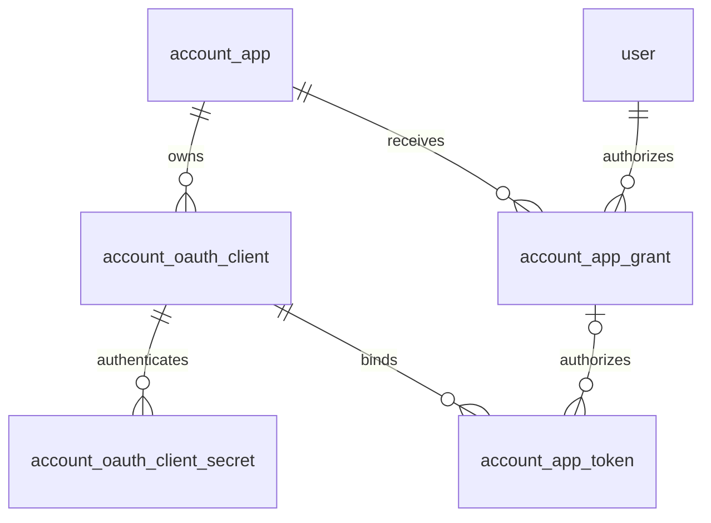
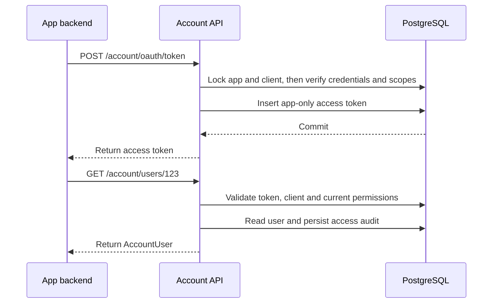

# XBuilder Account app registration and integration technical design

XBuilder Account uses stable app registrations for first-party app identities and independent OAuth clients for sign-in
integration and app-only access. User grants, client credentials, and access tokens retain their respective
associations, which are validated during issuance, use, and revocation.

This document defines the data model, backend processing, APIs, frontend integration, and migration plan for
[app registration and integration](../product/account-app-integration.md). See [XBuilder Account](../product/account.md)
for user sign-in methods, third-party identities, and account sessions. The complete OpenAPI contract is defined in
[`docs/openapi.yaml`](../openapi.yaml) and updated alongside endpoint implementation and frontend integration.

## Implementation structure

The Account backend resides in [goplus/builder-backend](https://github.com/goplus/builder-backend) and uses PostgreSQL
and GORM. SQL migrations define database structure. The Account module owns the business rules for apps, OAuth clients,
user grants, and tokens.

| Module | Responsibility |
| - | - |
| `internal/model` | Persistence models and database mappings |
| `internal/account` | App registration, OAuth client configuration, credentials, grants, tokens, and data access records |
| `internal/controller` | Coordinate business operations, generate DTOs, and combine business transactions with management audits |
| `cmd/xbuilder-backend` | HTTP parameter parsing, authentication entry points, responses, and request correlation |
| `internal/authn/account` | Validate user tokens accepted by XBuilder product APIs |
| `internal/audit` | Validate and persist management operation audits |
| `spx-gui/src/apis` | Frontend adapters for Account and management APIs |
| Account Web, XBuilder Admin Console | Sign-in flows and app integration management interfaces |

Authentication results distinguish user subjects from app subjects and include the calling app, OAuth client, and token
scope. Operations requiring a user identity accept only user subjects. An empty or default user ID cannot stand in for
an app subject.

## Identifiers and data model

`app.id` identifies a first-party app. An OAuth client's numeric primary key `id` identifies the management resource and
internal associations, referenced as `oauthClientID`. The public identifier is stored separately in `client_id` and
returned as `clientID` by management APIs. OAuth uses `client_id`, and Hosted sign-in uses `clientID`.

An OAuth client's `appID` and public identifier are immutable after creation. Account assigns client identifiers and
does not accept caller-supplied values. Protocol requests locate clients by exact, case-sensitive `client_id` matching.
Management endpoints locate resources by numeric `id`. See
[RFC 6749 client identifier](https://www.rfc-editor.org/rfc/rfc6749.html#section-2.2) for protocol requirements.



The following tables use database field names. Except for access audit records, each table includes an `id bigint`
primary key, `created_at timestamptz`, and `updated_at timestamptz`. Identity sequences generate primary keys, and the
backend writes timestamps. Fields not marked nullable are `NOT NULL`.

App and client status retain `0 = active` and `1 = disabled`. Client types retain `0 = public` and `1 = confidential`.
Token types retain `0 = accessToken` and `1 = refreshToken`. Subject types use `0 = user` and `1 = app`. Account
validates enums and conditional field rules. The database enforces foreign keys and unique constraints. Non-primary-key
fields have no database defaults and are explicitly written by business code at creation.

### App registration

`account_app` stores registration data, lifecycle state, and app-only permissions.

| Field | PostgreSQL type | Meaning |
| - | - | - |
| `name` | `citext` | Unique management name, immutable after creation |
| `display_name` | `text` | Display name |
| `avatar` | `text`, nullable | Avatar object reference managed by Account |
| `description` | `text`, nullable | Short description |
| `status` | `smallint` | `active` or `disabled` |
| `client_credentials_scopes` | `text[]` | Platform-approved app-only scopes |

`name` has a unique index and follows the existing management name matching contract. `display_name` is nonempty
single-line text without leading or trailing whitespace, limited to 100 Unicode code points. `description` is limited to
200 Unicode code points. Names and descriptions are treated as plain text.

Avatar uploads reuse Account's image processing and storage capabilities. Object references are persisted and converted
to HTTP URLs in DTOs. Responses return `null` for `avatar` or `description` when absent. Creating an app does not also
create an OAuth client.

`client_credentials_scopes` is a set without duplicates. An omitted value at creation is stored as an empty array.
Allowed elements are `account:app:read` and `account:user:read`. Confidential clients of the same app allowing
`client_credentials` share this set.

### OAuth client

`account_oauth_client` stores specific integration configurations.

| Field | PostgreSQL type | Meaning |
| - | - | - |
| `app_id` | `bigint` | Foreign key to the owning app |
| `client_id` | `text` | Public OAuth client identifier |
| `name` | `citext` | Management name unique within the owning app |
| `client_type` | `smallint` | `public` or `confidential` |
| `status` | `smallint` | `active` or `disabled` |
| `grant_types` | `text[]` | Allowed OAuth grant types |
| `redirect_uris` | `text[]` | Exact-match callback allowlist |
| `redirect_uri_patterns` | `text[]` | Preview callback rules managed through controlled operational configuration |

Create a case-sensitive unique index on `client_id`, a unique index on `(app_id, name)`, and list indexes on
`(app_id, created_at, id)` and `(app_id, updated_at, id)`. The format and length limits for `name` follow app management
names. `app_id`, `client_id`, `name`, `client_type`, and `grant_types` are immutable after creation. A different
integration purpose requires another client.

New clients generate `client_id` with `GenerateOpaqueSecretBytes(16)`, encoding 16 cryptographically secure random bytes
as 22 unpadded [Base64url](https://www.rfc-editor.org/rfc/rfc4648.html#section-5) characters. This identifier is stored
in plaintext.

`grant_types` is a nonempty set without duplicates and supports these combinations:

| Integration purpose | `grant_types` | Configuration requirements |
| - | - | - |
| User authorization | `authorization_code`, optionally with `refresh_token` | At least one exact callback address |
| App-only access | Only `client_credentials` | Must be a confidential client, with both callback sets empty |

Ordinary management APIs can update only `redirectURIs` and return `redirectURIPatterns` as read-only configuration.
Production callbacks use exact full-URI matching. Preview rules are configured through controlled operations and used
only for HTTPS preview environments whose domains and deployed content are controlled by the platform. A public hosting
provider's domain suffix alone does not establish trust.

Preview callback matching reuses the existing validator. Hostnames are case-insensitive, with at most one `*` in the
leftmost subdomain label matching a nonempty substring. All other hostname labels must match. Scheme, port, encoded
path, and query match exactly. Userinfo, fragments, and wildcards outside the hostname are rejected. Authorization codes
store the complete redirect URI used in the request, and token exchange compares it verbatim.

### Client secret

`account_oauth_client_secret` stores confidential client credentials.

| Field | PostgreSQL type | Meaning |
| - | - | - |
| `oauth_client_id` | `bigint` | Foreign key to the owning OAuth client |
| `name` | `citext` | Credential management name |
| `secret_hash` | `bytea` | SHA-256 hash of the secret value |
| `secret_prefix` | `text` | Prefix shown in management interfaces |
| `last_used_at` | `timestamptz`, nullable | Most recent successful authentication time |
| `revoked_at` | `timestamptz`, nullable | Revocation time |

Create a unique index on `secret_hash` and a partial unique index on `(oauth_client_id, name)` where
`revoked_at IS NULL`. New secrets use the existing generator of 32 cryptographically secure random bytes, encoded as 43
unpadded Base64url characters. They are generated independently of `clientID` and returned in plaintext only on
successful creation. Public clients cannot create secrets.

Rotation creates a new secret, updates the backend holding the credential, and revokes the old secret. Multiple active
secrets can coexist during the overlap period. Revoking a secret does not revoke previously issued tokens.

### User grants

`account_app_grant` continues to store delegated user authorization for apps.

| Field | PostgreSQL type | Meaning |
| - | - | - |
| `app_id` | `bigint` | Foreign key to the authorized app |
| `user_id` | `bigint` | Foreign key to the authorizing user |
| `scope` | `text` | User-approved scope set |
| `last_used_at` | `timestamptz`, nullable | Most recent use time |
| `revoked_at` | `timestamptz`, nullable | Revocation time |

Retain the unique index on `(app_id, user_id)`. Clients of the same app share a grant record, while authorization codes
and tokens bind to specific clients. Business logic compares scopes as sets. Persistence and responses use sorted,
space-separated strings.

### Access tokens and refresh tokens

`account_app_token` stores user tokens and app-only access tokens.

| Field | PostgreSQL type | Meaning |
| - | - | - |
| `app_id` | `bigint` | App owning the token |
| `oauth_client_id` | `bigint` | OAuth client used to issue the token |
| `subject_type` | `smallint` | `user` or `app` |
| `grant_id` | `bigint`, nullable | User grant record |
| `token_type` | `smallint` | `accessToken` or `refreshToken` |
| `token_family_id` | `text`, nullable | Refresh token family of a user token |
| `scope` | `text` | Scope set issued for this token |
| `name` | `text` | Name supplied for an administrator-created token, or an empty string for automatically issued tokens |
| `token_hash` | `bytea` | SHA-256 hash of the raw token |
| `replaced_by_token_id` | `bigint`, nullable | Foreign key to the record replacing this refresh token |
| `expires_at` | `timestamptz` | Expiration time |
| `last_used_at` | `timestamptz`, nullable | Most recent successful use time |
| `consumed_at` | `timestamptz`, nullable | Refresh token consumption time |
| `revoked_at` | `timestamptz`, nullable | Revocation time |

Create `(id, app_id)` unique constraints on both `account_oauth_client` and `account_app_grant`. Token composite foreign
keys on `(oauth_client_id, app_id)` and `(grant_id, app_id)` ensure that the client and user grant belong to the same
app.

Nullable composite associations use PostgreSQL's default `MATCH SIMPLE`, allowing `grant_id` to be null for app-only
access tokens. Account still validates the subject-specific fields. See
[PostgreSQL foreign keys](https://www.postgresql.org/docs/18/ddl-constraints.html#DDL-CONSTRAINTS-FK).

Retain the unique `token_hash` index and expiration index. Add indexes on `(app_id, oauth_client_id)` and
`(grant_id, token_family_id)` for revocation by app, client, user grant, and token family.

Token creation validates the following conditions, which subsequent updates must preserve:

- User tokens must have `grant_id` and `token_family_id`. The grant record determines the subject user
- App-only tokens must be access tokens with null `grant_id` and `token_family_id`
- A token family contains tokens for exactly one user grant and OAuth client
- `replaced_by_token_id` can reference only a refresh token in the same family
- Access tokens have null `consumed_at` and `replaced_by_token_id`

Tokens use the existing 32-byte random value generator. The backend stores only hashes and determines token type and
subject from database records. Ordinary access tokens last 5 minutes, and refresh tokens last 30 days.
Administrator-created user access tokens retain the maximum lifetime of 365 days.

### Authorization flow state

`account_auth_flow` retains existing short-lived state and adds these fields:

| Field | PostgreSQL type | Meaning |
| - | - | - |
| `oauth_client_id` | `bigint`, nullable | Client bound to a first-party app authorization flow |
| `grant_id` | `bigint`, nullable | User grant associated with an authorization code |
| `revoked_at` | `timestamptz`, nullable | Flow revocation time |

`oauth_client_id` and the existing `app_id` form a composite foreign key to the OAuth client. `grant_id` and `app_id`
form a composite foreign key to the user grant. Index both new association fields to invalidate unfinished flows by
client or user grant.

Usable PARs and authorization codes must associate with a specific client. Authorization codes must also associate with
a user and a valid user grant. Their app and user must match the grant. Account sign-in or third-party callback state
without a first-party app binding may omit the client association.

PARs last 10 minutes and authorization codes last 5 minutes. Both are single-use. Queries and conditional consumption
require an unexpired flow with null `consumed_at` and `revoked_at`. `consumed_at` records actual consumption, while
`revoked_at` records administrative revocation. Both are retained separately. The authorization code payload stores the
request's scope, redirect URI, and PKCE challenge.

## Authorization and token processing

### User authorization

User authorization uses PAR, authorization code flow, and PKCE S256. Each stage finds the OAuth client by public
`client_id`, then retrieves its app. Flows and tokens store that client's numeric association ID. Parameters cannot be
substituted between different clients of the same app.

1. PAR creation validates app and client status, user authorization purpose, requested scope, and callback
   configuration, and saves the client association
2. Authorization validates the Account session, reads PAR context, and determines the scopes approved by the user for
   the app in this request
3. In one transaction, lock the app, client, user grant, and PAR in the standard order. Revalidate, update the grant,
   consume the PAR, and issue an authorization code bound to that grant and client
4. Authorization code exchange validates the original client, full redirect URI, PKCE verifier, grant record, and flow
   validity. Consume the code and write tokens in one transaction
5. Clients with `refresh_token` enabled also receive a refresh token. Other clients receive only an access token

Scope expansion for an active grant uses set union. A narrower request does not reduce the existing grant, and expanded
authorization does not revoke other clients' active tokens. The authorization code and current access token contain only
the scopes approved for this request.

A revoked user grant can be re-established through a new user authorization flow. Reauthorization writes the scope set
approved in that request. Invalid authorization codes and tokens remain invalid.

Refresh validates the original client, user grant, and token family, consumes the old refresh token, and writes new
tokens in one transaction. Requested scopes must be a subset of the original refresh token's scope, or retain the
original scope when omitted. The new access token uses the requested scope. The new refresh token retains the original
refresh token's scope and cannot acquire extra permissions from an expanded `app_grant`. See
[RFC 6749 refresh token](https://www.rfc-editor.org/rfc/rfc6749.html#section-6) and
[OAuth security BCP](https://www.rfc-editor.org/rfc/rfc9700.html#section-4.14) for binding and rotation requirements.

Reusing a consumed refresh token persistently revokes that client's entire token family before returning
`invalid_grant`. The error response is returned after the revocation transaction commits. Returning a protocol error
must not roll back the revocation.

### App-only access

App backends use confidential client `client_secret_basic` authentication, with the public `clientID` as the username
and the secret as the password, and explicitly request a nonempty scope. In the issuance transaction, Account validates
credentials, app and client status, the `client_credentials` grant type, and whether the requested scopes are within the
app's current `clientCredentialsScopes`.



App-only access writes only access tokens and creates neither `app_grant` nor refresh tokens. This flow follows the
[OAuth client credentials grant](https://www.rfc-editor.org/rfc/rfc6749.html#section-4.4).

For example, the order system has app ID `20` and approval to read the app directory and user profiles. Its backend
client is confidential and allows `client_credentials`, with resource ID `201` and public `clientID`
`K7mR2qV9sT4wX6yZ8aB0Cg`:

```http
POST /account/oauth/token
Authorization: Basic <client-credentials>
Content-Type: application/x-www-form-urlencoded

grant_type=client_credentials&scope=account%3Aapp%3Aread%20account%3Auser%3Aread
```

```json
{
  "access_token": "xb_at_opaque_app_only_reference",
  "token_type": "Bearer",
  "expires_in": 300,
  "scope": "account:app:read account:user:read"
}
```

Unknown scopes or scopes exceeding approval return `invalid_scope`. A narrower token is not silently issued.

### Access token validation

Account reads the token by its hash from the primary database and joins its owning app and client. User subjects also
join `app_grant`. The base query for app subjects does not depend on that table. The token must be an unexpired,
unrevoked access token, and the app and client must be active.

| Subject | Additional validation | Accessible Account endpoints |
| - | - | - |
| User | Valid user grant and a client configured for user authorization, with the required scope in both token and grant | Own profile reads and permitted profile updates |
| App | Client configured for `client_credentials`, with the required scope in both token and the owning app's current `clientCredentialsScopes` | App directory and profile queries by user ID |

Both own-profile reads and queries by user ID use `account:user:read`. The former determines the target user from the
user subject. The latter accepts only app subjects and reads the target user from the path. Authentication and
authorization run before data queries.

XBuilder product APIs use `internal/authn/account` to validate user subjects and require the token's app name to be
`xbuilder`. Validation also checks the associated client, user grant, and `account:user:read` scope.

Remote first-party apps call introspection with their own confidential client. Account restricts introspection to tokens
of the same app. The caller then checks `active`, `token_type`, the user subject, and the required scope. App-only
access tokens cannot serve as user credentials for product APIs.

Token validity and authorization configuration do not use positive caches across requests. Callers can cache unexpired
app-only access tokens, but Account still checks their current permissions on every request. Data caching and token
validation are handled separately.

### Introspection and revocation

Introspection authenticates the requesting confidential client and is restricted to tokens of the same app. The
response's `client_id` is the `clientID` of the OAuth client bound to the token. A user's `sub` is the stable user ID,
and an app subject's `sub` is `app:{appID}`. Subject separation follows
[OAuth security BCP](https://www.rfc-editor.org/rfc/rfc9700.html#section-4.15).

```json
{
  "active": true,
  "token_type": "Bearer",
  "sub": "app:20",
  "client_id": "K7mR2qV9sT4wX6yZ8aB0Cg",
  "scope": "account:app:read account:user:read",
  "exp": 1792545000,
  "iat": 1792544700
}
```

Active access tokens have `token_type` set to `Bearer`. Refresh tokens omit the field. Unknown, inactive, or
different-app tokens return `{ "active": false }`. `token_type_hint` affects only lookup order and cannot replace
validation of the actual token type. See [RFC 7662](https://www.rfc-editor.org/rfc/rfc7662.html#section-2.2) for
response fields.

OAuth revocation permits only the original client to revoke its own tokens. Revoking an access token affects only that
token. Revoking a refresh token affects its token family, including associated access tokens. Revocation lookup can
locate consumed refresh tokens. Unknown tokens or tokens belonging to another client return success without changing
other records, preventing responses from revealing token ownership. See
[RFC 7009](https://www.rfc-editor.org/rfc/rfc7009.html#section-2.1) for protocol semantics.

## Transactions and lifecycle

### Lock order

Token issuance, refresh, authorization, disabling, and revocation follow one lock order: app, OAuth client, user grant,
then flow or token records. Operations skip resources they do not use and must not acquire an earlier lock after a later
one.

| Operation | Locking and commit scope |
| - | - |
| PAR, user authorization, token issuance, and refresh | Acquire shared locks on app and client, revalidate status and credentials, then lock grant and flow records as needed |
| Client configuration, secret creation or revocation, and client disabling | Acquire a shared app lock and an update lock on the client, and commit configuration changes and associated token invalidation in one transaction |
| App-only permission updates | Acquire an update lock on the app, and commit the target scope set and affected app-only token invalidation in one transaction |
| App disabling | Acquire an update lock on the app, and commit status changes and associated flow and token invalidation in one transaction |
| Revocation of an entire user grant | Acquire a shared app lock and an update lock on the grant, and commit associated authorization code and token invalidation in one transaction |

User authorization and refresh use an update lock on the grant to serialize grant and token family changes.
Authorization code and PAR consumption lock the corresponding flow record in the transaction, then validate and record
consumption so only one operation succeeds. Concurrent requests creating the same user grant first use the unique
constraint to locate the same record, then lock it to update scopes.

Flow and refresh token expiration checks use the current time after acquiring the relevant locks. New token lifetimes
start at actual issuance, not at a timestamp captured before waiting for locks.

Revoking an entire user grant does not iterate over and lock clients after taking the grant lock. It directly
invalidates the grant's unredeemed authorization codes and all tokens, avoiding conflict with the lock order used for
issuance by client.

Credential authentication must recheck secret revocation after acquiring the client lock. Earlier credential parsing at
the HTTP boundary does not replace this check in the issuance transaction.

Client configuration updates acquire the client update lock, read current configuration, apply the PATCH, validate the
complete target state, and determine which tokens must be revoked.

App-only permission updates acquire an update lock on the app, read the current approved set, apply the PATCH, validate
the target set, and revoke tokens belonging to that app with an `app` subject and any removed scope. They do not iterate
over and lock clients. The app lock serializes these updates with token issuance.

### Invalidation scope

| Operation | Persisted effect |
| - | - |
| Disable an app | Invalidate unfinished authorization flows for its clients and revoke all user tokens and app-only access tokens |
| Disable a client | Invalidate that client's unfinished authorization flows and revoke its tokens, preserving the app's user grants and other clients' tokens |
| Narrow or clear an app's `clientCredentialsScopes` | Revoke app-only access tokens containing removed scopes across all clients of that app, preserving user tokens |
| Expand an app's `clientCredentialsScopes` | Preserve existing token scopes. New permissions require a new token request |
| Revoke a client secret | Revoke the secret. Existing tokens are validated against their own state |
| Revoke an `app_grant` | Write the grant's `revoked_at`, and invalidate its unredeemed authorization codes and all user tokens |

Revocation writes the respective `revoked_at` for tokens and unfinished authorization flows without overwriting actual
consumption times. Re-enabling an app or client or restoring scopes does not clear revocation records. Re-establishing
user authorization permits only new authorization codes and tokens.

Successful configuration update responses require associated token invalidation and management audits to have committed.
Validation starting afterward must observe the updated state. Requests validated before the change may finish. Ongoing
business requests need not be interrupted.

## API contract

### App and client management

Account management endpoints require the current actor to have `accountAdmin` and follow management API user
authentication and permission checks. App-only permissions cannot access these endpoints.

| Operation | Request or result |
| - | - |
| `POST /admin/account/apps` | Require `name`, optionally accept `displayName`, `description`, and `clientCredentialsScopes`, and return `201` with `AdminAccountApp` |
| `PATCH /admin/account/apps/{appID}` | Update `displayName`, `description`, `status`, or `clientCredentialsScopes`, and return `AdminAccountApp` |
| `PUT /admin/account/apps/{appID}/avatar` | Upload an avatar and return `204` on success |
| `GET /admin/account/apps/{appID}/oauth-clients` | Return the app's OAuth client list |
| `POST /admin/account/apps/{appID}/oauth-clients` | Create a client and return `201` with `AccountOAuthClient` |
| `GET /admin/account/apps/{appID}/oauth-clients/{oauthClientID}` | Return `AccountOAuthClient` |
| `PATCH /admin/account/apps/{appID}/oauth-clients/{oauthClientID}` | Update status or callback addresses, and return `AccountOAuthClient` |

`AccountApp` returns `id`, `createdAt`, `updatedAt`, `name`, `displayName`, `avatar`, `description`, and `status`.
Nested `app` objects in user grants use the same structure.

App management endpoints return `AdminAccountApp`, containing the `AccountApp` registration fields and
`clientCredentialsScopes`. Ordinary directory responses and nested apps in user grants omit the app-only permission
configuration.

`AccountOAuthClient` returns `id`, `createdAt`, `updatedAt`, `appID`, `clientID`, `name`, `clientType`, `status`,
`grantTypes`, `redirectURIs`, and `redirectURIPatterns`. The `id` field and management parameter `oauthClientID` use the
decimal string of the numeric primary key. `clientID` uses the public identifier. Client responses do not include
secrets.

New apps and clients start as `active`. When app creation omits `displayName`, Account saves `name` as the display name.
Responses always return a nonempty `displayName`. Explicit values must pass display name validation. Empty strings,
whitespace-only strings, and `null` are rejected.

Client creation requires `name`, `clientType`, and `grantTypes`. User authorization clients must supply `redirectURIs`.
Omitted callback sets are stored as empty arrays. New app-only clients of the same app use its current approved set.

App and client creation and updates can supply a `reason` describing the actual purpose, entered by the admin console or
operational caller. It is written to the management audit and is not returned as app or client data. A supplied `reason`
must be nonempty and at most 500 Unicode code points. A reason alone does not constitute a resource update.

For example, create a backend client for the order system:

```http
POST /admin/account/apps/20/oauth-clients
Authorization: Bearer <admin-access-token>
Content-Type: application/json

{
  "name": "backend",
  "clientType": "confidential",
  "grantTypes": ["client_credentials"],
  "reason": "Read app registration and buyer profiles for order administration"
}
```

```json
{
  "id": "201",
  "createdAt": "2026-10-21T09:00:00+08:00",
  "updatedAt": "2026-10-21T09:00:00+08:00",
  "appID": "20",
  "clientID": "K7mR2qV9sT4wX6yZ8aB0Cg",
  "name": "backend",
  "clientType": "confidential",
  "status": "active",
  "grantTypes": ["client_credentials"],
  "redirectURIs": [],
  "redirectURIPatterns": []
}
```

PATCH updates only supplied fields. In app updates, `description: null` clears the description, and
`clientCredentialsScopes: []` revokes the app's app-only permissions. Non-nullable fields reject `null`. Empty requests,
unknown fields, read-only fields, and configurations inconsistent with the integration purpose return `400`.

App avatars use the same `multipart/form-data` file field `file`, image formats, and size limits as user avatars. After
the upload, registration changes and management audits commit in a database transaction, and the frontend queries app
data again. Uploads to external storage do not hold a database transaction open.

### Client secret and user grant management

| Operation | Request or result |
| - | - |
| `GET /admin/account/apps/{appID}/oauth-clients/{oauthClientID}/secrets` | Return management data for active secrets |
| `POST /admin/account/apps/{appID}/oauth-clients/{oauthClientID}/secrets` | Require `name`, and return `201`, management data, and the one-time `value` |
| `DELETE /admin/account/apps/{appID}/oauth-clients/{oauthClientID}/secrets/{secretID}` | Revoke the client's secret and return `204` on success |
| `DELETE /admin/account/app-grants/{appGrantID}` | Revoke the entire user grant and return `204` on success |

Secret management data retains `id`, `createdAt`, and `name`. In nested paths, the client must belong to the specified
app, and the secret must belong to the specified client. An association mismatch returns `404`.

Revoking an already revoked user grant returns `204`. A missing target record returns `404`. Listing, creating, and
revoking user grant tokens continue to use `app-grants/{appGrantID}/tokens`.

Administrator-created user access token requests add a required `oauthClientID`, also returned in token management
responses. The selected client must belong to the grant's app, be active, and allow user authorization. The token
inherits the active grant's scope, which cannot be overridden by the request. No refresh token is issued.

### Data reads

| Operation | Scope | Response |
| - | - | - |
| `GET /account/apps` | `account:app:read` | `AccountApp` list |
| `GET /account/apps/{appID}` | `account:app:read` | `AccountApp` |
| `GET /account/users/{userID}` | `account:user:read` | `AccountUser` |

These endpoints accept only app-only access tokens and do not fall back to Account cookie sessions. Directory queries
include disabled apps for historical references. `AccountUser` shares the six fields `id`, `createdAt`, `updatedAt`,
`username`, `displayName`, and `avatar` with the current-user query.

The three data query endpoints share a rate limit per OAuth client, reusing Redis counters from `internal/ratelimit`.
Deployment configuration defines the window and limit. Rate limits are checked after subject and scope validation and
before target data queries. Different tokens of the same client share counters across all Account backend instances.
Rate-limited responses return a wait time in seconds through `Retry-After`. Unavailable rate-limit storage returns a
server error.

App and client lists use `pageIndex`, `pageSize`, `orderBy`, and `sortOrder`. Page size defaults to 20 and cannot exceed
100 entries. Sorting supports `createdAt` or `updatedAt`, defaults to ascending `createdAt`, and uses `id` as the
secondary key in the same direction. Responses use `{ total, data }`. Secret lists retain existing pagination by
descending ID.

### OAuth and error responses

`OAuthClientID` is a nonempty, case-sensitive string used by OAuth parameters, the `client_secret_basic` username, and
Hosted sign-in. It accepts both retained existing identifiers and newly generated random identifiers.

`/account/oauth/token` adds the `client_credentials` request type. `OAuthScope` covers the three Account scopes, with
business validation restricting the allowed set by authorization mode. `OAuthIntrospection.sub` supports user IDs and
`app:{appID}`. Access token results include `token_type`. Existing OAuth paths continue to provide these behaviors.

OAuth errors use the existing `OAuthError`. Invalid client credentials return `invalid_client`, disallowed grant types
return `unauthorized_client`, and invalid authorization codes or refresh tokens return `invalid_grant`. Token issuance
and introspection responses retain `Cache-Control: no-store`.

Other JSON endpoints use `APIError` without an additional response envelope. Errors are distinguished as follows:

| HTTP status | Condition |
| - | - |
| `400` | Invalid parameters, fields, or target configuration |
| `401` | Missing valid access token or management credentials |
| `403` | Subject type, scope, or management permissions do not satisfy requirements |
| `404` | After authentication and authorization, the resource is missing or does not belong to the specified parent |
| `409` | App name conflict, a client name conflict within the app, or an active secret name conflict within the client |
| `429` | Data queries exceed the client's rate limit, using existing error code `42900` |

Bearer authentication failures and insufficient scopes retain the existing `WWW-Authenticate` header. Database or
storage failures return server errors and must not be converted into missing resources.

## Auditing and data access

Management changes to apps, clients, secrets, permission configuration, and user grants reuse `internal/audit` in the
same database transaction as the business writes. App-only permission changes record the owning app, previous and new
scopes, the actor, and the reason. Client credential authentication is not recorded as an administrator operation.

Cross-app data reads use append-only `account_access_log` records owned by the Account module. The log distinguishes
app-only access from delegated user access and supports directory list requests without a single target resource.

| Field | PostgreSQL type | Meaning |
| - | - | - |
| `id` | `bigint` | Automatically generated primary key |
| `created_at` | `timestamptz` | Access time |
| `oauth_client_id` | `bigint` | Foreign key to the calling client, whose stable ownership determines the app |
| `actor_user_id` | `bigint`, nullable | Foreign key to the delegated user, null for app-only access |
| `operation` | `text` | Data read operation |
| `scope` | `text` | Scope required by the operation |
| `target_app_id` | `bigint`, nullable | Requested target app ID |
| `target_user_id` | `bigint`, nullable | Requested target user ID |
| `http_status` | `smallint` | Access result |
| `trace_id` | `text` | HTTP request trace ID |

Target IDs record query intent without foreign keys so nonexistent targets can be recorded. Both target fields are null
for directory lists. Create indexes on `created_at`, `(oauth_client_id, created_at)`, and `(target_user_id, created_at)`
for archiving and controlled investigation.

The HTTP entry point establishes a request trace, and access audits use the same trace ID as existing logs. Data reads
with a verifiable subject that are not rate-limited record the operation, target, and result. Successful responses are
returned only after reliable persistence of the access audit. Authentication failures without an identifiable subject go
to structured security logs. Rate-limited requests also go to structured security logs, recording the calling client,
operation, and trace ID without writing `account_access_log`. Account Web cookie sessions retain existing account access
rules.

Audits do not store data response bodies, secrets, raw tokens, or raw authentication headers. Business systems retain
the actual actor, business resource, and purpose, correlated with Account records through request identifiers. Access
logs do not participate in permission decisions and are archived and removed under the security audit retention policy.

## Frontend and integration configuration

Admin app lists and details display registration data and status. App creation and editing forms manage
`clientCredentialsScopes`. App creation omits `displayName` when no display name is entered. Approving or revoking
app-only scopes collects a purpose description and submits it through `reason`.

OAuth clients appear under app details, display a copyable `clientID`, and separately manage callbacks, status, and
secrets. Client creation forms validate configuration by integration purpose.

User grant details retain the app and user association, and token lists add the client association. Administrators
creating tokens can select only active user authorization clients under that app. Ordinary app directory data cannot be
used to load secrets or client configuration.

Frontend adapters maintain separate types for the app directory, app management, and OAuth clients. Client management
requests fill `oauthClientID` with the resource's `id`, while OAuth integration uses the public `clientID`. Account Web
passes Hosted sign-in `clientID` unchanged as a string so the authorization backend can locate the client and app.
XBuilder sign-in configures the public `clientID` through `VITE_ACCOUNT_OAUTH_CLIENT_ID`.

The three app-level secret management operations move to `oauth-clients/{oauthClientID}/secrets`. Implementation removes
the original routes and adapters at the same time. Client configuration moves from app management APIs to client
resources. All management forms and authorization details use the corresponding new structures.

Creation and PATCH operations update the interface using resources returned by the backend. Avatar uploads and
operations with empty responses query again through the existing flow. Secret values remain only in the current creation
result's interface state and are not written to persistent browser storage.

## Data migration and release

### Migration mapping

Existing app `id`, `name`, `displayName`, status, and user grants remain stable, with `clientCredentialsScopes`
initialized to an empty set. Each existing app is migrated to one OAuth client whose numeric primary key `id` equals the
original app ID. Its public `client_id` stores the original app ID's decimal string, its name is `default`, and its
initial status is `active`. Client type and callback configuration come from the app. The client's `grantTypes` are
`authorization_code` and `refresh_token`. Disabled apps remain restricted by their own app status.

OAuth client numeric primary keys use an independent sequence. After backfill, advance the sequence beyond the current
maximum primary key.

| Existing data | Migration handling |
| - | - |
| App client type and callback configuration | Move to the app's `default` client |
| App secrets | Move to the client secret table, preserving record IDs, hashes, names, use times, and revocation times |
| User grants | Preserve app, user, scope, and revocation state |
| User tokens | Backfill app, `default` client, and user subject type, preserving raw value hashes, family, expiration, and revocation state |
| Unfinished first-party app authorization flows | Invalidate and require sign-in to restart |
| Account sessions and product-owned sessions | Preserve and validate under their respective existing validity rules |

Advance the client secret sequence beyond the maximum imported record ID as well. Existing tokens are not reissued.
Migration does not restore consumed, expired, or revoked credentials. Initialize app avatars and descriptions as absent.
Backfill the client association for existing app-associated flows.

Before enabling new writes, write `revoked_at` on all unfinished first-party app authorization flows and shorten
`expires_at` to no later than the migration time.

Grant and token backfills must uniquely identify the original app. Records with missing associations, missing parents,
or invalid states must be handled before migration, without filling gaps with default IDs. Migration uses explicit SQL.
Validate record counts, associations, and unique constraints before enabling new writes.

### Release order

A maintenance window coordinates backend and admin console releases. Stop Account authorization, refresh, and management
writes during the window. Confirm that old backend instances have stopped before migration, preventing old writes from
creating data without client associations.

1. Back up the database and verify existing apps, client ID configuration, secrets, and token associations in each
   deployment
2. Run the migration to create new structures, backfill data, remove `client_type`, `redirect_uris`, and
   `redirect_uri_patterns` from `account_app`, and remove the old `account_app_secret` table in one transaction
3. Validate mappings, record counts, and sequences, then deploy the backend and admin console supporting client
   bindings, subject separation, and new management APIs
4. Verify existing sign-in, refresh, product API authentication, and management operations before enabling app-only
   access

Mainland China and overseas environments perform backups, validation, and release independently. Deployment
configuration references the apps, clients, and credentials of the corresponding environment.

### Rollback boundary

Direct rollback to the old backend is unsupported after migration commits. The down migration refuses to run while app
registrations exist.

If release problems occur, stop new writes and preserve the security results of disabling, scope reduction, secret
revocation, and token revocation, then repair or roll forward. Restoring an old database snapshot must not re-enable
revoked access.

## Validation and implementation order

| Validation area | Required coverage |
| - | - |
| Data model | Unique constraints, composite foreign keys, subject-specific fields, and rejection of cross-app associations |
| App registration | Omitted display name defaults at creation, explicit empty value rejection, and omitted update fields preserving current values |
| Client identifiers | Random identifiers for new clients, separate lookup by numeric resource ID and public `clientID`, case-sensitive matching, and identifier immutability |
| User authorization | Clients of the same app share grants, and expanded grants do not expand existing token scopes |
| Callback validation | Exact callbacks, single-label wildcards, exact matching of other URI components, and rejection of invalid callbacks |
| OAuth flows | Public client identifier resolution and original-client binding in PAR, authorization code, PKCE, refresh, revocation, and Hosted sign-in, separate consumption and revocation records, and expiration checks after waiting for locks |
| Refresh | Single-use consumption, no scope expansion, and committed token family revocation after replay |
| App-only permissions | Empty sets by default, shared approval across existing and new app-only clients of the same app, and no permission configuration in app directory or nested app responses |
| App-only access | Confidential client and grant type restrictions, explicit scope requests, and no user grants or refresh tokens |
| Data queries | Subject and scope combinations, target restrictions for current-user and by-ID queries, and the six-field user structure |
| Data rate limits | Shared limits across a client's tokens and backend instances, rate limiting before target queries, over-limit responses and logs, and rate-limit storage failures |
| Transactions and revocation | Lock ordering and transaction boundaries for issuance, disabling, app-only permission reduction, secret revocation, and user grant revocation, plus invalidation of affected app-only tokens across all clients of the same app while preserving user tokens when permissions are reduced |
| Configuration restoration | Re-enabling or restoring scopes does not reactivate old flows or tokens |
| Auditing | Management writes and audits commit or roll back together, and data access retains subject, target, and request correlation |
| Performance | Throughput, latency, and primary database read/write load for the complete authentication, data query, and synchronous audit path at expected peak traffic |
| Migration | Existing `client_id` values remain unchanged, secret and token usability, association backfill, sequences, invalidation state, atomic backfill and legacy storage cleanup, and downgrade rejection when app registrations exist |
| Frontend | App display name defaults, app-only permission configuration, client configuration, resource ID and `clientID` usage, client selection, and one-time secret display |

Backend unit tests reuse existing store interfaces, fakes, and `go-sqlmock` to cover authorization, token issuance and
revocation, transaction call ordering, and failure handling. Existing CI runs `scripts/validate-database-migrations.sh`
to check database migration structure.

Implementation proceeds in dependency order: data models and migration, OAuth and authentication, data queries and
auditing, then the admin console and integration validation. OpenAPI definitions and frontend adapters are updated with
the endpoints in each phase. The backend runs `go test ./...`. The frontend completes project-required type checking,
formatting, lint, and relevant behavior tests.
