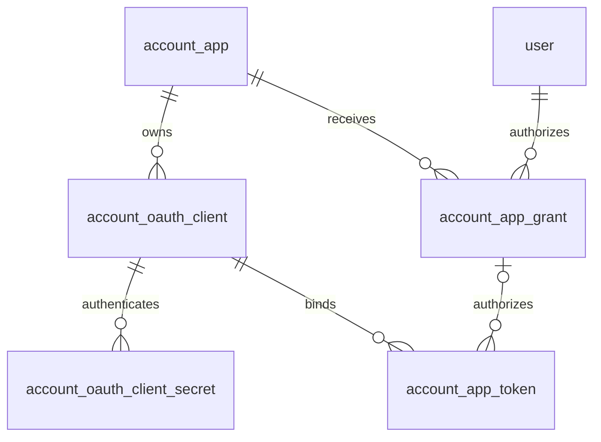
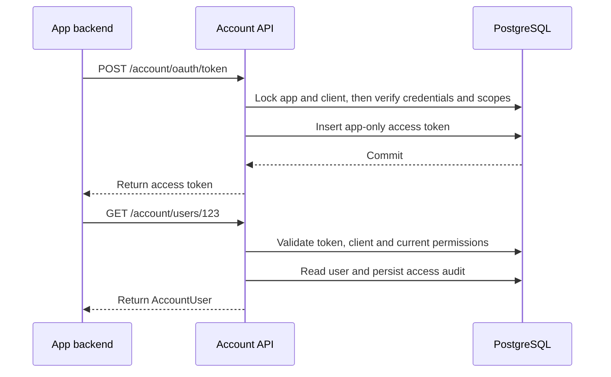

# XBuilder Account 自有 app 登记与接入技术设计

XBuilder Account 以稳定的 app 登记承载自有 app 身份，以独立的 OAuth clients 管理登录接入和 app 自主访问。用户授权、客户端凭证和访问令牌分别保存所属关系，并在签发、使用和撤销时校验。

本文档定义[自有 app 登记与接入](../product/account-app-integration.zh.md)的数据模型、后端处理、API、前端接入和迁移方案。用户登录方式、第三方身份和 account session 见 [XBuilder Account](../product/account.zh.md)。完整 OpenAPI 契约由 [`docs/openapi.yaml`](../openapi.yaml) 定义，并随接口实现与前端接入同步更新。

## 实现结构

Account 后端位于 [goplus/builder-backend](https://github.com/goplus/builder-backend)，使用 PostgreSQL 和 GORM。SQL migrations 定义数据库结构，Account 模块拥有 app、OAuth client、用户授权和令牌的业务规则。

| 模块 | 职责 |
| - | - |
| `internal/model` | 持久化模型与数据库映射 |
| `internal/account` | App 登记、OAuth client 配置、凭证、授权、令牌与资料访问记录 |
| `internal/controller` | 组织业务操作、生成 DTO，并组合业务事务与管理审计 |
| `cmd/xbuilder-backend` | HTTP 参数解析、认证入口、响应和请求关联 |
| `internal/authn/account` | 校验 XBuilder 产品 API 接受的用户令牌 |
| `internal/audit` | 管理操作的审计校验与持久化 |
| `spx-gui/src/apis` | Account 和管理接口的前端 adapters |
| Account Web、XBuilder Admin Console | 登录流程与 app 接入管理界面 |

鉴权结果区分用户主体和 app 主体，并包含调用 app、OAuth client 和令牌 scope。需要用户身份的调用只接受用户主体，不能使用空用户 ID 或默认用户代替 app 主体。产品 API 所认可的 app 和 OAuth clients 由产品后端的受信配置确定，并在创建 authenticator 时传入。

## 标识与数据模型

`app.id` 标识自有 app。OAuth client 的数值主键 `id` 用于管理资源和内部关联，以 `oauthClientID` 引用。对外标识单独保存在 `client_id`，管理 API 返回为 `clientID`，OAuth 协议使用 `client_id`，Hosted sign-in 使用 `clientID`。

OAuth client 的 `appID` 和对外标识在创建后保持不变。客户端标识由 Account 分配，不接受调用方指定。协议请求按 `client_id` 区分大小写精确查询 client，管理接口按数值 `id` 定位资源。标识的协议要求见 [RFC 6749 client identifier](https://www.rfc-editor.org/rfc/rfc6749.html#section-2.2)。



下列表中的字段使用数据库名称。除访问审计外，各表均包含 `id bigint` 主键、`created_at timestamptz` 和 `updated_at timestamptz`。主键由 identity sequence 生成，时间由后端写入。表中未标记可空的字段均为 `NOT NULL`。

App 和 client 的状态沿用 `0 = active`、`1 = disabled`，客户端类型沿用 `0 = public`、`1 = confidential`。令牌类型沿用 `0 = accessToken`、`1 = refreshToken`，主体类型使用 `0 = user`、`1 = app`。枚举和条件字段规则由 Account 校验，外键与唯一约束由数据库保证。非主键字段不设置数据库默认值，创建时由业务代码显式写入。

### App 登记

`account_app` 保存登记资料与生命周期。

| 字段 | PostgreSQL 类型 | 含义 |
| - | - | - |
| `name` | `citext` | 唯一的管理名称，创建后保持不变 |
| `display_name` | `text` | 展示名称 |
| `avatar` | `text`，可空 | Account 管理的图标对象引用 |
| `description` | `text`，可空 | 简短说明 |
| `status` | `smallint` | `active` 或 `disabled` |

`name` 使用唯一索引，匹配规则沿用现有管理名称契约。`display_name` 为非空单行文本，首尾不含空白，最多 100 个 Unicode code points，`description` 最多 200 个。名称和说明按纯文本处理。

图标上传复用 Account 的图片处理与存储能力，持久化对象引用，并在 DTO 中转换为 HTTP URL。没有图标或说明时，响应中的 `avatar`、`description` 为 `null`。创建 app 不同时创建 OAuth client。

### OAuth client

`account_oauth_client` 保存具体接入配置。

| 字段 | PostgreSQL 类型 | 含义 |
| - | - | - |
| `app_id` | `bigint` | 所属 app 的外键 |
| `client_id` | `text` | 对外使用的 OAuth client 标识 |
| `name` | `citext` | 所属 app 内唯一的管理名称 |
| `client_type` | `smallint` | `public` 或 `confidential` |
| `status` | `smallint` | `active` 或 `disabled` |
| `grant_types` | `text[]` | 允许的 OAuth grant types |
| `redirect_uris` | `text[]` | 精确匹配的回调 allowlist |
| `redirect_uri_patterns` | `text[]` | 受控运维配置的预览环境回调规则 |
| `client_credentials_scopes` | `text[]` | 获准用于 app 自主访问的 scopes |

建立区分大小写的 `client_id` 唯一索引、`(app_id, name)` 唯一索引，以及 `(app_id, created_at, id)`、`(app_id, updated_at, id)` 列表索引。`name` 的格式与长度限制沿用 app 管理名称。`app_id`、`client_id`、`name`、`client_type` 和 `grant_types` 在创建后保持不变。接入用途变化时登记另一个 client。

新建 client 的 `client_id` 复用 `GenerateOpaqueSecretBytes(16)` 生成，将 16 字节安全随机值以无填充 [Base64url](https://www.rfc-editor.org/rfc/rfc4648.html#section-5) 编码为 22 个字符。该标识以明文保存。

`grant_types` 使用不重复的非空集合，支持以下组合：

| 接入用途 | `grant_types` | 配置要求 |
| - | - | - |
| 用户授权 | `authorization_code`，可包含 `refresh_token` | 配置至少一个精确回调地址，`client_credentials_scopes` 为空 |
| App 自主访问 | 仅 `client_credentials` | 必须为 confidential client，两个回调集合均为空 |

`client_credentials_scopes` 使用不重复的集合，创建时未提供则写入空数组。数组元素只允许 `account:app:read` 和 `account:user:read`。更新时校验完整的目标配置，不能只校验发生变化的单个字段。

回调匹配复用现有校验器。普通管理接口只能更新 `redirectURIs`，`redirectURIPatterns` 作为只读配置返回。预览环境规则继续限定为平台控制的 callback hosts，生产回调使用精确地址。授权码保存请求实际使用的完整 redirect URI，token exchange 与其逐字比较。

### Client secret

`account_oauth_client_secret` 保存 confidential client 的凭证。

| 字段 | PostgreSQL 类型 | 含义 |
| - | - | - |
| `oauth_client_id` | `bigint` | 所属 OAuth client 的外键 |
| `name` | `citext` | 凭证管理名称 |
| `secret_hash` | `bytea` | Secret value 的 SHA-256 哈希 |
| `secret_prefix` | `text` | 管理展示所用前缀 |
| `last_used_at` | `timestamptz`，可空 | 最近成功认证时间 |
| `revoked_at` | `timestamptz`，可空 | 撤销时间 |

建立 `secret_hash` 唯一索引，以及限定 `revoked_at IS NULL` 的 `(oauth_client_id, name)` 唯一索引。新 secret 使用现有 32 字节安全随机值生成器，以无填充 Base64url 编码为 43 个字符，与 `clientID` 分别生成，只在创建成功时返回原值。Public client 不能创建 secret。

轮换通过创建新 secret、更新持有凭证的后端和撤销旧 secret 完成。重叠期允许多份有效 secret。Secret 撤销不撤销此前签发的令牌。

### 用户授权

`account_app_grant` 继续保存用户对 app 的委托授权。

| 字段 | PostgreSQL 类型 | 含义 |
| - | - | - |
| `app_id` | `bigint` | 获得授权的 app 外键 |
| `user_id` | `bigint` | 授权用户的外键 |
| `scope` | `text` | 用户批准的 scope 集合 |
| `last_used_at` | `timestamptz`，可空 | 最近使用时间 |
| `revoked_at` | `timestamptz`，可空 | 撤销时间 |

保留 `(app_id, user_id)` 唯一索引。同一 app 的 clients 共用授权记录，授权码和令牌分别绑定具体 client。Scope 在业务层按集合比较，持久化和响应使用排序后的空格分隔字符串。

### 访问令牌与 refresh token

`account_app_token` 保存用户令牌和 app 自主访问令牌。

| 字段 | PostgreSQL 类型 | 含义 |
| - | - | - |
| `app_id` | `bigint` | 令牌所属 app |
| `oauth_client_id` | `bigint` | 签发令牌所用的 OAuth client |
| `subject_type` | `smallint` | `user` 或 `app` |
| `grant_id` | `bigint`，可空 | 用户授权记录 |
| `token_type` | `smallint` | `accessToken` 或 `refreshToken` |
| `token_family_id` | `text`，可空 | 用户令牌所属的 refresh token family |
| `scope` | `text` | 本次签发的 scope 集合 |
| `name` | `text` | 管理员创建令牌时提供的名称，自动签发时为空字符串 |
| `token_hash` | `bytea` | 令牌原值的 SHA-256 哈希 |
| `replaced_by_token_id` | `bigint`，可空 | 替代当前 refresh token 的记录外键 |
| `expires_at` | `timestamptz` | 到期时间 |
| `last_used_at` | `timestamptz`，可空 | 最近成功使用时间 |
| `consumed_at` | `timestamptz`，可空 | Refresh token 的消费时间 |
| `revoked_at` | `timestamptz`，可空 | 撤销时间 |

`account_oauth_client` 和 `account_app_grant` 分别建立 `(id, app_id)` 唯一约束。令牌通过 `(oauth_client_id, app_id)`、`(grant_id, app_id)` 复合外键关联，保证 client 与用户授权属于同一个 app。

可空复合关联使用 PostgreSQL 默认的 `MATCH SIMPLE`，允许 app 自主访问令牌的 `grant_id` 为空，主体对应字段仍由 Account 校验。外键语义见 [PostgreSQL foreign keys](https://www.postgresql.org/docs/18/ddl-constraints.html#DDL-CONSTRAINTS-FK)。

保留 `token_hash` 唯一索引和到期时间索引，建立 `(app_id, oauth_client_id)`、`(grant_id, token_family_id)` 索引，用于按 app、client、用户授权和 token family 撤销。

令牌创建入口校验以下条件，并由后续更新保持：

- 用户令牌必须关联 `grant_id` 和 `token_family_id`，主体用户由授权记录确定
- App 自主访问令牌必须为 access token，`grant_id` 和 `token_family_id` 均为空
- 同一 token family 只能包含同一个用户授权和 OAuth client 的令牌
- `replaced_by_token_id` 只能指向同一 family 的 refresh token
- Access token 的 `consumed_at` 和 `replaced_by_token_id` 均为空

令牌使用现有 32 字节随机值生成器，服务端只保存哈希，类型与主体由数据库记录确定。普通 access token 有效期为 5 分钟，refresh token 为 30 天。管理员创建的用户 access token 沿用最长 365 天的限制。

### 授权流程状态

`account_auth_flow` 保留现有短期状态，并增加以下字段：

| 字段 | PostgreSQL 类型 | 含义 |
| - | - | - |
| `oauth_client_id` | `bigint`，可空 | 自有 app 授权流程绑定的 client |
| `grant_id` | `bigint`，可空 | 授权码对应的用户授权 |
| `revoked_at` | `timestamptz`，可空 | 流程被撤销的时间 |

`oauth_client_id` 与现有 `app_id` 组成指向 OAuth client 的复合外键，`grant_id` 与 `app_id` 组成指向用户授权的复合外键。增加两个关联字段的索引，用于按 client 或用户授权作废未完成流程。

可用的 PAR 和授权码必须关联具体 client。授权码还必须关联用户和有效的用户授权，其 app 与用户分别和授权记录一致。未绑定自有 app 的 Account 登录或第三方回调状态可以不关联 client。

PAR 的有效期为 10 分钟，授权码为 5 分钟，均按单次消费方式处理。查询和条件消费都要求流程未到期，且 `consumed_at`、`revoked_at` 均为空。`consumed_at` 记录实际消费，`revoked_at` 记录管理撤销，两者分别保留。授权码的 payload 保存本次请求的 scope、redirect URI 和 PKCE challenge。

## 授权与令牌处理

### 用户授权

用户授权使用 PAR、authorization code flow 和 PKCE S256。各阶段按对外 `client_id` 查找 OAuth client，再取得其 app，流程和令牌保存该 client 的数值关联 ID。参数不能在同一 app 的不同 clients 之间替换。

1. 创建 PAR 时校验 app 与 client 状态、用户授权用途、请求 scope 和回调配置，并保存 client 关联
2. 授权时验证 Account session，读取 PAR 上下文，并确定用户本次对该 app 批准的 scopes
3. 在同一事务中按统一顺序锁定 app、client、用户授权和 PAR，重新校验后更新授权、消费 PAR，并生成关联该授权与 client 的授权码
4. 兑换授权码时校验原 client、完整 redirect URI、PKCE verifier、授权记录与流程有效性，在事务中消费授权码并写入令牌
5. 启用 `refresh_token` 的 client 同时取得 refresh token，其他 client 只取得 access token

有效授权的 scope 扩展使用集合并集。本次请求范围较小时不缩小已有授权，扩展授权也不撤销其他 clients 的有效令牌。授权码和本次 access token 只包含本次请求中已获批准的 scopes。

已撤销的用户授权可以通过新的用户授权流程重新建立。重新授权写入本次批准的 scope 集合，已经失效的授权码和令牌保持失效。

Refresh 时校验原 client、用户授权和 token family，在事务中消费旧 refresh token，并写入新令牌。请求 scope 只能是原 refresh token scope 的子集，未提供时沿用原范围。新 access token 使用本次请求范围，新 refresh token 保留原 refresh token 的 scope，不能从扩展后的 `app_grant` 取得额外权限。绑定与轮换要求见 [RFC 6749 refresh token](https://www.rfc-editor.org/rfc/rfc6749.html#section-6) 和 [OAuth security BCP](https://www.rfc-editor.org/rfc/rfc9700.html#section-4.14)。

再次使用已消费的 refresh token 时，持久化撤销该 client 对应的整个 token family，再返回 `invalid_grant`。错误响应在撤销事务提交后返回，不能因返回协议错误而回滚撤销结果。

### App 自主访问

App 后端使用 confidential client 的 `client_secret_basic` 认证，用户名为对外的 `clientID`，密码为 secret，并显式请求非空 scope。Account 在签发事务中校验凭证、app 和 client 状态，以及请求范围是否属于当前 `clientCredentialsScopes`。



App 自主访问只写入 access token，不创建 `app_grant` 或 refresh token。该流程遵循 [OAuth client credentials grant](https://www.rfc-editor.org/rfc/rfc6749.html#section-4.4)。

例如，订单系统的 app ID 为 `20`，其后台 client 的资源 ID 为 `201`，对外的 `clientID` 为 `K7mR2qV9sT4wX6yZ8aB0Cg`，已获准读取 app 目录和用户资料：

```http
POST /account/oauth/token
Authorization: Basic <client-credentials>
Content-Type: application/x-www-form-urlencoded

grant_type=client_credentials&scope=account%3Aapp%3Aread%20account%3Auser%3Aread
```

```json
{
  "access_token": "xb_at_opaque_app_only_reference",
  "token_type": "Bearer",
  "expires_in": 300,
  "scope": "account:app:read account:user:read"
}
```

未知 scope 或超出批准范围返回 `invalid_scope`，不静默签发较小范围的令牌。

### Access token 校验

Account 根据令牌哈希从主库读取令牌，并连接其所属 app 和 client。用户主体进一步关联 `app_grant`，app 主体的基础查询不依赖该表。令牌必须为尚未到期、未撤销的 access token，app 与 client 必须有效。

| 主体 | 进一步校验 | 可访问的 Account 接口 |
| - | - | - |
| 用户 | 有效的用户授权与用户授权用途，令牌和授权均包含请求所需 scope | 本人资料读取和允许的资料更新 |
| App | `client_credentials` 用途，以及令牌与当前 `clientCredentialsScopes` 均包含请求所需 scope | App 目录与按用户 ID 查询资料 |

本人资料读取和按用户 ID 查询都使用 `account:user:read`。前者从用户主体确定目标用户，后者只接受 app 主体并读取路径中的目标用户。鉴权先于资料查询执行。

XBuilder 产品 API 通过 `internal/authn/account` 校验用户主体、预期 app 和认可的 OAuth clients。远程自有 app 使用 introspection 时，同样根据受信的 `clientID` 集合校验 client 归属。App 自主访问令牌不能作为产品 API 的用户凭证。

令牌有效性与授权配置不使用跨请求的正向缓存。调用方可以缓存尚未到期的 app 自主访问令牌，但 Account 每次仍校验其当前权限。资料缓存与令牌校验分别处理。

### Introspection 与 revocation

Introspection 认证请求方的 confidential client，并限制为同一 app 的令牌。响应中的 `client_id` 为令牌所绑定 OAuth client 的 `clientID`，用户 `sub` 为稳定用户 ID，app 主体的 `sub` 为 `app:{appID}`。主体区分遵循 [OAuth security BCP](https://www.rfc-editor.org/rfc/rfc9700.html#section-4.15)。

```json
{
  "active": true,
  "token_type": "Bearer",
  "sub": "app:20",
  "client_id": "K7mR2qV9sT4wX6yZ8aB0Cg",
  "scope": "account:app:read account:user:read",
  "exp": 1792545000,
  "iat": 1792544700
}
```

有效 access token 的 `token_type` 为 `Bearer`，refresh token 不返回该字段。未知、失效或不属于同一 app 的令牌返回 `{ "active": false }`。`token_type_hint` 只影响查找顺序，不能代替实际令牌类型校验。响应字段见 [RFC 7662](https://www.rfc-editor.org/rfc/rfc7662.html#section-2.2)。

OAuth revocation 只允许原 client 撤销自己的令牌。撤销 access token 只影响该令牌，撤销 refresh token 影响其 token family，包括关联的 access tokens。查询撤销目标时允许定位已消费的 refresh token。未知令牌或不属于原 client 的令牌返回成功且不改变其他记录，避免通过响应探测令牌归属。协议语义见 [RFC 7009](https://www.rfc-editor.org/rfc/rfc7009.html#section-2.1)。

## 事务与生命周期

### 锁顺序

令牌签发、refresh、授权、停用和撤销遵循一致的加锁顺序：app、OAuth client、用户授权、流程或令牌记录。没有相应资源的操作跳过该层，不能在锁定后续资源后再反向锁定前一层。

| 操作 | 锁定与提交范围 |
| - | - |
| PAR、用户授权、令牌签发和 refresh | App、client 使用共享锁，重新校验状态与凭证，再按需锁定授权和流程记录 |
| Client 配置、secret 创建或撤销、client 停用 | App 使用共享锁，client 使用更新锁，配置与关联令牌失效同事务提交 |
| App 停用 | App 使用更新锁，状态、关联流程与令牌失效同事务提交 |
| 整份用户授权撤销 | App 使用共享锁，授权使用更新锁，关联授权码与令牌失效同事务提交 |

用户授权与 refresh 使用授权更新锁序列化 grant 和 token family 的变化。授权码和 PAR 的消费在事务中锁定对应流程记录，再校验并记录消费，确保只有一次操作成功。多个请求同时创建同一用户授权时，先依赖唯一约束定位同一记录，再锁定该记录更新 scope。

流程和 refresh token 的过期校验使用取得相关锁后的当前时间。新令牌的有效期从实际签发时刻计算，不沿用等待锁之前的时间值。

整份用户授权撤销不在取得授权锁后遍历锁定 clients。它直接作废该授权的未兑换授权码和全部令牌，避免与按 client 签发的锁顺序交叉。

凭证认证需要在取得 client 锁后重新检查 secret 的撤销状态。HTTP 边界先前完成的凭证解析不能代替签发事务中的检查。

配置更新取得 client 更新锁后，读取当前配置并应用 PATCH，再校验完整目标状态和计算需要撤销的令牌范围。

### 失效范围

| 操作 | 持久化效果 |
| - | - |
| 停用 app | 作废其 clients 的未完成授权流程，撤销全部用户令牌和 app 自主访问令牌 |
| 停用 client | 作废该 client 的未完成授权流程并撤销其令牌，保留 app 的用户授权及其他 clients 的令牌 |
| 收紧或清空 `clientCredentialsScopes` | 撤销包含已移除 scope 的 app 自主访问令牌 |
| 扩展 `clientCredentialsScopes` | 保留既有令牌范围，新权限通过重新申请令牌取得 |
| 撤销 client secret | 撤销该 secret，既有令牌按自身状态校验 |
| 撤销 `app_grant` | 写入授权的 `revoked_at`，作废其未兑换授权码和全部用户令牌 |

令牌和未完成授权流程的撤销均写入各自的 `revoked_at`，不覆盖实际消费时间。重新启用 app、client 或恢复 scopes 不清除撤销记录。用户授权的重新建立只允许生成新的授权码和令牌。

配置更新返回成功时，相关令牌失效和管理审计必须已经提交。之后开始的校验必须读取到更新后的状态。变更前已经通过校验的请求可以完成，不要求中断正在执行的业务请求。

## API 契约

### App 与 client 管理

Account 管理接口要求当前操作者具有 `accountAdmin`，并沿用管理接口的用户认证与权限校验。App 自主访问权限不能用于这些接口。

| 操作 | 请求或结果 |
| - | - |
| `POST /admin/account/apps` | 必填 `name`，可提供 `displayName`、`description`，返回 `201` 和 `AccountApp` |
| `PATCH /admin/account/apps/{appID}` | 更新 `displayName`、`description` 或 `status`，返回 `AccountApp` |
| `PUT /admin/account/apps/{appID}/avatar` | 上传图标，成功返回 `204` |
| `GET /admin/account/apps/{appID}/oauth-clients` | 返回该 app 的 OAuth clients 列表 |
| `POST /admin/account/apps/{appID}/oauth-clients` | 创建 client，返回 `201` 和 `AccountOAuthClient` |
| `GET /admin/account/apps/{appID}/oauth-clients/{oauthClientID}` | 返回 `AccountOAuthClient` |
| `PATCH /admin/account/apps/{appID}/oauth-clients/{oauthClientID}` | 更新状态、回调地址或自主访问 scopes，返回 `AccountOAuthClient` |

`AccountApp` 返回 `id`、`createdAt`、`updatedAt`、`name`、`displayName`、`avatar`、`description` 和 `status`。用户授权中的嵌套 `app` 同样使用该结构。

`AccountOAuthClient` 返回 `id`、`createdAt`、`updatedAt`、`appID`、`clientID`、`name`、`clientType`、`status`、`grantTypes`、`redirectURIs`、`redirectURIPatterns` 和 `clientCredentialsScopes`。其中 `id` 和管理参数 `oauthClientID` 使用数值主键的十进制字符串，`clientID` 使用对外标识。Secret 不包含在 client 响应中。

创建 app 和 client 的初始状态均为 `active`。创建 app 时，省略 `displayName` 则由 Account 使用 `name` 保存为展示名称，响应始终返回非空的 `displayName`。显式提供的值必须通过展示名称校验，空字符串、纯空白和 `null` 均不接受。

创建 client 必填 `name`、`clientType` 和 `grantTypes`。用户授权 client 必须提供 `redirectURIs`，其他数组未提供时写入空集合。创建和更新 client 可以提供 `reason`，由管理台或运维调用方填写实际用途，写入管理审计而不作为 client 资料返回。例如，为订单系统创建后台 client：

```http
POST /admin/account/apps/20/oauth-clients
Authorization: Bearer <admin-access-token>
Content-Type: application/json

{
  "name": "backend",
  "clientType": "confidential",
  "grantTypes": ["client_credentials"],
  "clientCredentialsScopes": ["account:app:read", "account:user:read"],
  "reason": "Read app registration and buyer profiles for order administration"
}
```

```json
{
  "id": "201",
  "createdAt": "2026-10-21T09:00:00+08:00",
  "updatedAt": "2026-10-21T09:00:00+08:00",
  "appID": "20",
  "clientID": "K7mR2qV9sT4wX6yZ8aB0Cg",
  "name": "backend",
  "clientType": "confidential",
  "status": "active",
  "grantTypes": ["client_credentials"],
  "redirectURIs": [],
  "redirectURIPatterns": [],
  "clientCredentialsScopes": ["account:app:read", "account:user:read"]
}
```

PATCH 只更新出现的字段。`description: null` 清除说明，`clientCredentialsScopes: []` 撤销自主访问权限。不可空字段不接受 `null`。`reason` 提供时必须非空，最多 500 个 Unicode code points，单独提供原因不构成资源更新。空请求、未知字段、只读字段和不符合接入用途的配置返回 `400`。

图标使用与用户头像相同的 `multipart/form-data` 文件字段 `file`、图片格式和大小限制。上传完成后，登记更新与管理审计在数据库事务中提交，前端重新查询 app 资料。外部存储上传不占用数据库事务。

### Client secret 与用户授权管理

| 操作 | 请求或结果 |
| - | - |
| `GET /admin/account/apps/{appID}/oauth-clients/{oauthClientID}/secrets` | 返回有效 secret 的管理资料 |
| `POST /admin/account/apps/{appID}/oauth-clients/{oauthClientID}/secrets` | 必填 `name`，返回 `201`、管理资料和单次展示的 `value` |
| `DELETE /admin/account/apps/{appID}/oauth-clients/{oauthClientID}/secrets/{secretID}` | 撤销该 client 的 secret，成功返回 `204` |
| `DELETE /admin/account/app-grants/{appGrantID}` | 撤销整份用户授权，成功返回 `204` |

Secret 管理资料沿用 `id`、`createdAt` 和 `name`。嵌套路径中的 client 必须属于指定 app，secret 必须属于指定 client。关联不匹配时返回 `404`。

整份用户授权撤销对已撤销记录返回 `204`，目标记录不存在时返回 `404`。用户授权令牌的列表、创建和撤销仍使用 `app-grants/{appGrantID}/tokens`。

管理员创建用户 access token 的请求增加必填 `oauthClientID`，令牌管理响应增加同名字段。所选 client 必须属于该授权的 app，处于有效状态且允许用户授权。令牌继承有效授权的 scope，不接受请求覆盖，也不签发 refresh token。

### 资料读取

| 操作 | Scope | 响应 |
| - | - | - |
| `GET /account/apps` | `account:app:read` | `AccountApp` 列表 |
| `GET /account/apps/{appID}` | `account:app:read` | `AccountApp` |
| `GET /account/users/{userID}` | `account:user:read` | `AccountUser` |

这些接口只接受 app 自主访问令牌，不回退到 Account cookie 会话。目录查询包含停用 app，以支持历史引用。`AccountUser` 与本人查询共用 `id`、`createdAt`、`updatedAt`、`username`、`displayName` 和 `avatar` 六个字段。

App 和 client 列表使用 `pageIndex`、`pageSize`、`orderBy` 和 `sortOrder`。页大小默认为 20，最大为 100，排序字段为 `createdAt` 或 `updatedAt`，默认按 `createdAt` 升序，使用 `id` 作为同方向的次级排序。返回 `{ total, data }`。Secret 列表沿用现有按 ID 降序的分页方式。

### OAuth 与错误响应

`OAuthClientID` 定义为非空、区分大小写的字符串，供 OAuth 参数、`client_secret_basic` 用户名和 Hosted sign-in 使用，接受保留的既有标识与新生成的随机标识。

`/account/oauth/token` 增加 `client_credentials` 请求类型。`OAuthScope` 覆盖三种 Account scopes，业务校验根据授权方式限制可用集合。`OAuthIntrospection.sub` 支持用户 ID 和 `app:{appID}`，access token 的结果包含 `token_type`。已有 OAuth 路径继续承载这些行为。

OAuth 错误使用现有 `OAuthError`。无效 client 凭证返回 `invalid_client`，不允许的授权方式返回 `unauthorized_client`，无效授权码或 refresh token 返回 `invalid_grant`。令牌签发和 introspection 响应保留 `Cache-Control: no-store`。

其他 JSON 接口沿用 `APIError`，不增加响应包装。错误按以下规则区分：

| HTTP 状态码 | 条件 |
| - | - |
| `400` | 参数、字段或目标配置不合法 |
| `401` | 缺少有效的 access token 或管理凭证 |
| `403` | 主体类型、scope 或管理权限不满足要求 |
| `404` | 完成认证与授权后，资源不存在或不属于指定父资源 |
| `409` | App 名称或 app 内的 client、有效 secret 名称冲突 |

Bearer 认证失败和 scope 不足保留现有 `WWW-Authenticate` 头。数据库或存储故障返回服务器错误，不能转换为资源不存在。

## 审计与资料访问

App、client、secret、权限配置和用户授权的管理变更复用 `internal/audit`，与业务写入使用同一个数据库事务。权限配置审计保存变更前后的 scopes、操作者和原因。客户端凭证认证不作为管理员操作记录。

跨 app 的资料读取使用追加写入的 `account_access_log`，由 Account 模块保存。它区分 app 自主访问和用户委托访问，并支持没有单个目标资源的目录列表请求。

| 字段 | PostgreSQL 类型 | 含义 |
| - | - | - |
| `id` | `bigint` | 自动生成的主键 |
| `created_at` | `timestamptz` | 访问发生时间 |
| `oauth_client_id` | `bigint` | 调用 client 的外键，app 由其稳定归属确定 |
| `actor_user_id` | `bigint`，可空 | 用户委托访问的用户外键，app 自主访问为空 |
| `operation` | `text` | 调用的资料读取操作 |
| `scope` | `text` | 操作要求的 scope |
| `target_app_id` | `bigint`，可空 | 请求中的目标 app ID |
| `target_user_id` | `bigint`，可空 | 请求中的目标用户 ID |
| `http_status` | `smallint` | 访问结果 |
| `trace_id` | `text` | HTTP 请求的 trace ID |

目标 ID 记录查询意图，不设外键，以允许记录不存在的目标。目录列表的两个目标字段均为空。建立 `created_at`、`(oauth_client_id, created_at)` 和 `(target_user_id, created_at)` 索引，支持归档和受控排查。

HTTP 入口建立请求 trace，访问审计与现有日志使用同一个 trace ID。具有可验证主体的资料读取保存操作、目标与结果，成功响应在访问审计可靠写入后返回。无法识别主体的认证失败进入结构化安全日志。Account Web 的 cookie 会话继续使用现有账号访问规则。

审计不保存资料响应正文、secret、令牌原值或原始认证头。业务系统保存实际操作者、业务资源和用途，并通过请求关联标识与 Account 记录对应。访问日志不参与权限判断，按安全审计保留策略归档和清理。

## 前端与接入配置

管理台的 app 列表与详情展示登记资料和状态。创建 app 时，未填写展示名称则省略 `displayName`。OAuth clients 位于 app 详情下，展示可复制的 `clientID`，并分别管理回调、状态、secret 和 `clientCredentialsScopes`。创建 client 的表单按接入用途校验配置。批准或撤销自主访问 scopes 时收集用途说明，通过 `reason` 提交。

用户授权详情保留 app 与用户关联，令牌列表增加 client 关联。管理员创建令牌时，只能选择该 app 下有效的用户授权 client。普通 app 目录返回的数据不能用于加载 secret 或客户端配置。

前端 adapters 分别维护 app 和 OAuth client 的类型，client 管理请求以资源的 `id` 填充 `oauthClientID`，OAuth 接入使用对外的 `clientID`。Account Web 将 Hosted sign-in 的 `clientID` 原样作为字符串传递，由授权后端定位 client 和 app。XBuilder 登录通过 `VITE_ACCOUNT_OAUTH_CLIENT_ID` 配置对外的 `clientID`。

App 层的三个 secret 管理操作迁至 `oauth-clients/{oauthClientID}/secrets`，实现时同步移除原路由和 adapters。App 管理接口中的客户端配置迁至 client 资源，所有管理表单和授权详情使用对应的新结构。

创建和 PATCH 操作使用后端返回的资源更新界面。上传图标和返回空响应的操作按现有流程重新查询。Secret value 只保留在本次创建结果的界面状态中，不写入浏览器持久化存储。

## 数据迁移与发布

### 迁移映射

已有 app 的 `id`、`name`、`displayName`、状态和用户授权保持稳定。每个已有 app 迁入一个 OAuth client，其数值主键 `id` 使用原 app ID，对外的 `client_id` 保存原 app ID 的十进制字符串，名称为 `default`，初始状态为 `active`，客户端类型和回调配置来自该 app。该 client 的 `grantTypes` 为 `authorization_code` 和 `refresh_token`，`clientCredentialsScopes` 为空。停用 app 的状态继续由 app 本身限制。

OAuth client 的数值主键使用独立的 sequence。回填完成后，将该 sequence 推进到当前最大主键之后。

| 现有数据 | 迁移处理 |
| - | - |
| App 的客户端类型与回调配置 | 迁入该 app 的 `default` client |
| App secret | 迁入 client secret 表，保留记录 ID、哈希、名称、使用与撤销时间 |
| 用户授权 | 保留 app、用户、scope 和撤销状态 |
| 用户令牌 | 回填 app、`default` client 与用户主体类型，保留原值哈希、family、到期和撤销状态 |
| 未完成的自有 app 授权流程 | 作废，要求重新发起登录 |
| Account session 与产品自有 session | 保留，按各自原有有效性规则校验 |

Client secret 的 sequence 同样推进到迁入记录的最大 ID 之后。既有令牌不重新签发，迁移不恢复已消费、过期或撤销的凭证。App 的图标和说明初始化为空。已有 app 关联的流程回填 client。

未完成的自有 app 授权流程在开放新写入前统一写入 `revoked_at`，并将 `expires_at` 收紧至不晚于迁移时刻。旧版本只检查消费状态和到期时间，收紧到期时间可保证维护窗口内回退旧版本时，这些流程仍然失效。

对授权和令牌的回填必须能唯一关联原 app。缺少关联、父资源不存在或状态不合法的记录应在迁移前处理，不能用默认 ID 补齐。迁移通过显式 SQL 完成，校验记录数、关联和唯一约束后再启用新写入。

### 发布顺序

本次使用维护窗口协调后端和管理台发布。窗口内停止 Account 授权、refresh 和管理写入，确认旧后端实例停止后执行迁移，避免旧写入生成缺少 client 关联的数据。

1. 备份数据库，核对各部署的既有 app、client ID 配置、secret 和令牌关联
2. 执行新增表、字段和回填的 migration，校验映射、记录数与 sequence，并将 app 上待清理的客户端配置列调整为可空
3. 发布支持 client 绑定、主体区分和新管理接口的后端及管理台
4. 验证既有登录、refresh、产品 API 认证和管理操作，再开放 app 自主访问
5. 在后续受控 migration 中移除 `account_app` 的 `client_type`、`redirect_uris`、`redirect_uri_patterns` 三列和旧的 `account_app_secret` 表

中国大陆与海外分别执行备份、校验与发布。部署配置引用对应环境中的 app、client 和凭证。

### 回退边界

回填完成但尚未开放新写入时，可以使用保留的原结构和迁移映射恢复旧版本。新版本只维护目标模型，不向待清理的旧结构双写。开放新版本写入后，不再支持直接切回旧后端。

需要回退时先停止新写入，保留停用、scope 收紧、secret 和令牌撤销的安全结果，再修复或前向发布。不能通过恢复旧数据库快照重新启用已撤销的访问。

## 验证与实施顺序

| 验证范围 | 必须覆盖的行为 |
| - | - |
| 数据模型 | 唯一约束、复合外键、主体对应字段、跨 app 关联拒绝 |
| App 登记 | 创建时省略展示名称的默认值、显式空值拒绝、更新时省略字段保留现值 |
| 客户端标识 | 新建 client 的随机标识生成、数值资源 ID 与对外 `clientID` 分别定位、大小写匹配与标识不可变 |
| 用户授权 | 同一 app 的 clients 共用授权，授权范围扩展不改变既有令牌范围 |
| OAuth 流程 | PAR、授权码、PKCE、refresh、revocation 和 Hosted sign-in 的对外 client 标识解析与原 client 绑定，消费与撤销分别记录，等待锁后的过期校验 |
| Refresh | 单次消费、scope 不扩大、重放后的 family 撤销能够提交 |
| App 自主访问 | Confidential client 限制、明确请求 scope、不创建用户授权或 refresh token |
| 资料查询 | 主体与 scope 组合、本人和按 ID 查询的目标约束、六字段用户结构 |
| 并发与撤销 | 签发与停用、scope 收紧、secret 撤销和用户授权撤销的竞争 |
| 恢复配置 | 重新启用或恢复 scopes 不使旧流程和令牌重新生效 |
| 审计 | 管理写入与审计共同提交或回滚，资料访问保留主体、目标和请求关联 |
| 迁移 | 既有 `client_id` 保持原值、secret 与令牌可用性、关联回填、sequence、失效状态，以及旧版本回退后历史流程仍失效 |
| 前端 | App 展示名称默认值、client 配置、资源 ID 与 `clientID` 的使用、client 选择及单次展示 secret |

后端单元测试复用现有 store interfaces、fakes 和 `go-sqlmock`。Migration 与真实锁竞争使用 PostgreSQL 验证，迁移结构检查复用 `scripts/validate-database-migrations.sh`，并另外构造已有 app、撤销凭证和 token family 的数据回填用例。

实施按数据模型与迁移、OAuth 与鉴权、资料查询与审计、管理台和接入验证的依赖顺序推进。OpenAPI 与各阶段的接口和前端 adapters 同步，后端运行 `go test ./...`，前端按项目要求完成类型、格式、lint 和相关行为测试。
