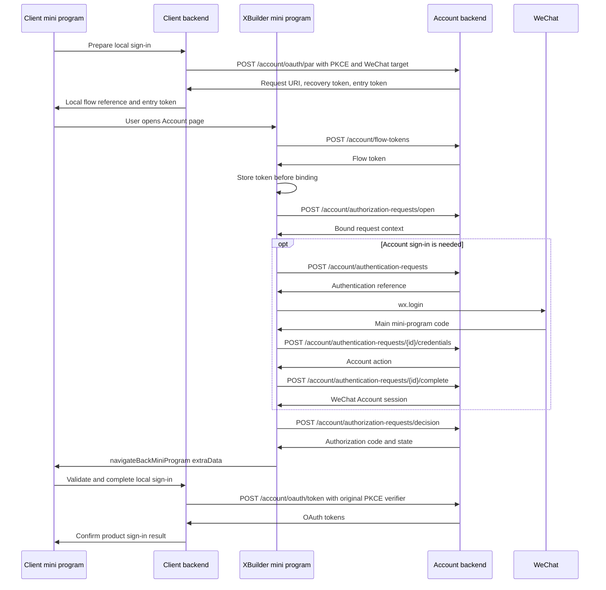
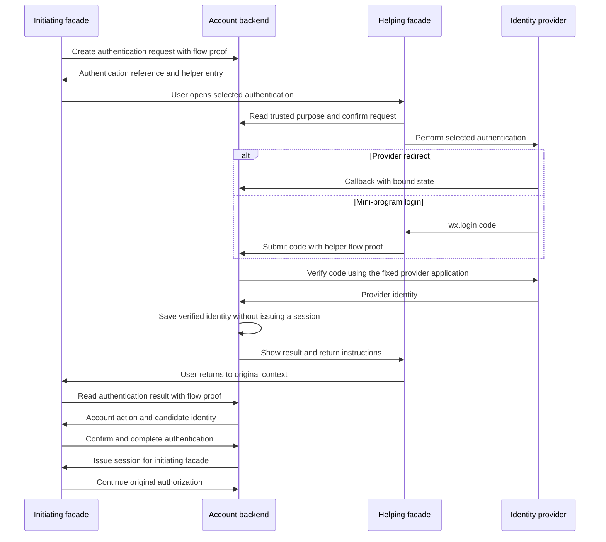

# XBuilder Account facades technical design

Account facades use the same Account backend for identity verification and OAuth authorization while holding independent
Account sessions. The backend stores interaction state. Integrating apps receive authorization results through the
original return channel.

This document defines the data model, transactions, APIs, frontend integration, and release plan for the initial Web and
WeChat [Account facades](../product/account-facades.md). Apps, OAuth clients, user grants, and tokens follow the
[app registration and integration technical design](account-app-integration.md). See
[XBuilder Account](../product/account.md) for account and identity rules. The complete OpenAPI contract is defined in
[`docs/openapi.yaml`](../openapi.yaml) and updated alongside endpoint implementation and frontend integration.

## Implementation structure

The backend implementation resides in the Account module of
[goplus/builder-backend](https://github.com/goplus/builder-backend). It reuses PostgreSQL, GORM, identity adapters,
account resolution, and token services. Browsers and mini programs call the same authorization operations. The HTTP
layer delivers redirect addresses or structured results as appropriate.

| Module | Responsibility |
| - | - |
| `internal/model` | Persistence mappings for sessions, short-lived flows, and OAuth client return configuration |
| `internal/account.AuthFlowService` | PAR, entry binding, authorization confirmation, authorization code issuance, and result recovery |
| `internal/account.AuthenticationService` | Authentication requests, upstream verification, account interactions, and authentication result consumption |
| `internal/account.IdentityProviderRegistry` | Generate authorization addresses and verify credentials using registered application configurations |
| `internal/account.ProviderIdentityService` | Read, create, and explicitly link Account accounts using verified identities |
| `internal/account.UserSessionService` | Issue, validate, and revoke Account sessions by facade |
| `internal/signin` | Short-lived sign-in transactions for XBuilder as an integrating app, obtaining product tokens through Account OAuth APIs |
| `internal/controller`, `cmd/xbuilder-backend` | DTOs, HTTP authentication, cookies, dependency assembly, and cleanup task lifecycle |
| `gui/src/apis/account` | Flow and session API adapters for Web |
| `gui/src/apps/account` | Authorization pages, authentication assistance pages, and flow models |
| `miniprogram/` | The XBuilder main mini program project, hosting native Account pages and WeChat API adapters |

Provider callbacks only verify upstream credentials and store authentication results. The initiating entry point calls
account resolution, identity linking, and session issuance when consuming authentication results. The helping entry
point does not perform these operations. Services receive stores, a clock, a random value generator, upstream clients,
configuration, and result encryption through constructor parameters.

## Request identifiers and credentials

An authorization request stores the integrating app's OAuth parameters for an attempt. An authentication request records
one identity verification attempt and its state. The integrating app queries authorization status and reopens the
original entry point to receive a result that was not delivered. The initiating entry point recovers authentication
results.

Request references and credentials are generated independently and are not derived from one another. Private credentials
use the existing 32-byte secure random value generator, encoded as unpadded Base64url. The backend stores SHA-256
hashes. Each validation also checks request type, owning client, status, and validity period.

| Value | Holder | Purpose and transfer |
| - | - | - |
| `request_uri` / `requestURI` | Integrating app and Account facade | The same PAR reference in OAuth parameters and flow JSON |
| `recoveryToken` | Integrating app backend | Query authorization status, cancel unfinished requests, and prepare a continuation entry point |
| `entryToken` | Integrating app frontend, then the Account facade | Open or resume an entry point once, valid for 60 seconds, without permission to read results |
| `flowToken` | Initiating or helping entry point | Operate on authorization or the specified authentication according to its binding, without returning it to the integrating app |
| `authenticationRequestID` | Initiating and helping entry points | Locate the specified authentication. The helping entry point can only view the request description and perform that authentication |
| Account session token | Its owning facade | Prove Account sign-in state without replacing the request correlation above |

Before binding a request, the facade prepares and stores `flowToken`. The initial authorization entry consumes
`entryToken` and records the binding. Retrying the open operation with the same flow credential returns the original
context so a lost response does not prevent continuation.

The recovery credential proves only the relationship to the request initiator. It does not directly authorize reading a
code. Authorization codes are always delivered by the bound facade through the registered return channel, following the
[OAuth requirements for return and request binding](https://www.rfc-editor.org/rfc/rfc9700.html#section-2.1). When a
return is lost, the integrating app reopens the original entry point and the original facade delivers the authorization
code again. Recovery endpoints cannot bypass the callback or mini program return relationship.

Web stores `flowToken` in a `__Host-xbuilder-account-flow` cookie with `HttpOnly`, `Secure`, `SameSite=Lax`, and
`Path=/`, without `Domain`. Account WeChat stores the flow credential in private storage and submits it in the
`Account-Flow-Token` header. Preparation reuses a valid credential and resets the cookie lifetime or local retention
period to 30 minutes. Each request remains subject to its own deadline. A random value not bound to a request grants no
flow permissions.

## Data model

### OAuth client WeChat return configuration

Add `wechat_return_targets jsonb` to `account_oauth_client`, storing an empty array when unconfigured. Each entry
contains `redirectURI` and `miniProgramAppID`, and their combination must be unique. The configuration does not include
the integrating mini program's AppSecret.

```json
{
  "wechatReturnTargets": [
    {
      "redirectURI": "https://xatom.example.com/account/callback",
      "miniProgramAppID": "<caller-mini-program-app-id>"
    }
  ]
}
```

`redirectURI` must be an exactly registered callback for the client. Preview wildcard rules do not apply. The WeChat
return target is the original calling mini program. The integrating app manages page routing after return, without
registering internal pages.

Add `wechatReturnTargets` to client creation, query, and PATCH endpoints. Administrators replace the target
configuration with a complete array. The backend validates duplicates and callback associations against the complete
resulting client configuration. A client used for app-only access must have empty `wechatReturnTargets`. Changes to
`redirectURIs` also validate associated targets and record the management audit in the same transaction. Removing or
modifying a target invalidates affected unfinished authorization requests and unredeemed authorization codes, without
revoking access tokens already issued to that client.

WeChat authorization still stores and validates the original OAuth `redirect_uri`, with the authorization code delivered
through the WeChat return channel. This is Account's platform interaction extension. PAR, PKCE, and token exchange
retain OAuth rules.

### Account session

Add `facade smallint` to `account_user_session`, with `0 = web` and `1 = wechat`. Sessions continue to store opaque
token hashes and retain the existing lifetime, revocation, and user association rules.

Web uses only the session cookie under the Account Web domain. APIs retain the Account Web same-origin proxy. Account
WeChat uses `Authorization: Bearer <account-session-token>`. Only flow endpoints, `GET /account/session`, and
`DELETE /account/session` accept this credential. The two channels validate `facade = web` and `facade = wechat`,
respectively. Product APIs, the OAuth token endpoint, and app-only access do not query Account sessions as Bearer
credentials. Add `facade` to the session DTO. Existing session management continues to validate user ownership.

A request carrying both a session cookie and an Account session Bearer credential returns `400` to avoid implicitly
choosing an identity. Web endpoints that change state validate a trusted `Origin`. Upstream callbacks use one-time state
bound to the authentication request and the corresponding provider checks.

### Short-lived flow records

Reuse `account_auth_flow`, retaining its app, OAuth client, user, grant, handle hash, payload, expiration, consumption,
and revocation fields. Add the following fields:

| Field | PostgreSQL type | Meaning |
| - | - | - |
| `parent_id` | `bigint`, nullable | Parent flow foreign key, restricted to the same app and OAuth client |
| `status` | `text`, nullable | Business status of a PAR or authentication request |
| `version` | `bigint` | Concurrency control version incremented on each state change |
| `recovery_token_hash` | `bytea`, nullable | Hash of the integrating app's PAR recovery credential |
| `owner_token_hash` | `bytea`, nullable | Hash of the flow credential held by the PAR's initiating entry point or the authentication request's helping entry point |
| `result_type` | `text`, nullable | Type of the current encrypted content |
| `result_ciphertext` | `bytea`, nullable | Encrypted recoverable result |
| `result_key_id` | `text`, nullable | Key version used to encrypt the result |
| `result_expires_at` | `timestamptz`, nullable | Expiration time of the recoverable result |

Create a unique constraint on `(id, app_id, oauth_client_id)` and the corresponding composite parent flow foreign key,
plus indexes on `parent_id` and `(flow_type, status, expires_at)`. Add a `CHECK` constraint requiring both app and
client to be non-null when a parent flow exists. Retain the unique handle hash index. Create a partial unique index on
`(parent_id, flow_type)` for `flow_type IN (1, 2)` so each authentication has only one upstream state and each PAR
issues only one authorization code. Create a partial index on `result_expires_at` for non-null ciphertext to support
expiration cleanup.

| Flow type | Parent flow | Stored content |
| - | - | - |
| `pushedAuthorizationRequest` | None | OAuth parameters, entry point, current authentication, and authorization result |
| `authenticationRequest` | PAR, or the primary authentication request for identity linking | Specified authentication, verified identity, and session issuance result |
| `providerRedirectState` | Authentication request | Upstream state, callback, PKCE, and nonce verification context |
| `authorizationCode` | PAR | User grant, actual redirect URI, scope, and PKCE challenge |
| `providerCredentialUse` | Authentication request | Fingerprint of a credential submitted for upstream verification |

Flow enums are `0 = pushedAuthorizationRequest`, `1 = providerRedirectState`, `2 = authorizationCode`,
`3 = providerCredentialUse`, and `4 = authenticationRequest`. Business code writes `version` starting at 1, without a
database default.

PAR and authentication request payloads retain their public references verbatim for recovery after a lost response and
continuation after callbacks. Associations use numeric record primary keys. External references remain public request
references.

The business layer decodes each payload type into a distinct Go type. Behavior is not determined by arbitrary field
combinations. The owning app, client, and parent flow are immutable after creation. Parent type, provider, operation
purpose, and credential category must match. One-time protocol state continues to record consumption in `consumed_at`
and administrative revocation in `revoked_at`. Changing expiration times cannot replace these facts.

### Authorization requests

The PAR payload retains the original `redirectURI`, `state`, scope, PKCE challenge, and UI locales, with these
additions:

| Field | Meaning |
| - | - |
| `facade` | `web` or `wechat` for this attempt |
| `entryPurpose` | `authorize` opens unfinished authorization, and `return` resumes the return of an issued result |
| `entryTokenHash`, `entryExpiresAt`, `entryConsumedAt` | Current one-time entry credential |
| `wechatReturnTarget` | Snapshot of the caller AppID and callback validated against client configuration |
| `activeAuthenticationRequestID` | Record ID of the current primary authentication |
| `confirmedUserID`, `confirmedSessionID` | Account and session used for user confirmation |

A PAR is valid for 10 minutes from creation and hosts a single authorization. Entry binding consumes `entryToken` once.
Unfinished requests continue within the original parameters and flow, following the
[PAR rules for repeated requests](https://www.rfc-editor.org/rfc/rfc9126.html#section-4). Authorization confirmation
consumes the PAR and writes the authorization code, authorization result, and terminal status in the same transaction.

Preparing entry again invalidates any previous unused `entryToken` without extending the PAR or code lifetime.
Reentering unfinished authorization restores the original context when the original `flowToken` is valid. If the
credential is lost, cancel in-flight authentication and clear its results before rebinding. Returning an authorized
request accepts only the original `flowToken` and does not allow rebinding. Create a new authorization when the private
context is lost, without revoking an established Account session.

### Authentication requests

An authentication request has an independent random public `authenticationRequestID`, rather than the PAR URN. Its
payload stores the authentication method, `purpose`, initiating and executing facades, provider application identifier,
original PAR reference, a six-digit comparison code, `activeAccountProofRequestID`, and the completion request digest.
`purpose` is `sign_in` or `account_proof`, determined by the relationship between primary authentication and account
proof.

An authentication request is valid for 5 minutes from creation and expires no later than its original PAR. Verified
identities contain the stable subject, namespace, source application, client subject, and limited display data required
by `VerifiedProviderIdentity`, stored as encrypted results. Password verification returns and stores the user ID,
credential record ID, and `updatedAt`. Before completion, check that the same credential still exists with an unchanged
version. Do not store the password or a copy of its hash.

When linking an existing account, create an account proof child request for the verified primary authentication without
replacing the PAR's current primary authentication. The child only verifies an existing user's identity and does not
automatically create an account. It is valid only while the primary authentication remains `verified` and is waiting for
that child request. Identity linking consumes both proofs in the same transaction.

The provider code fingerprint is a SHA-256 digest of the provider, upstream application client ID, and code encoded with
length prefixes. Store it in `providerCredentialUse.handle_hash`. The unique constraint applies across OAuth clients,
and consumption is recorded before verification starts. Repeated submissions to the same authentication request return
the stored state without calling the upstream provider again.

### Recoverable results

The original authorization code is retained briefly only in the PAR's encrypted result. The authorization code record
continues to store only its hash. The result contains `code`, the original `state`, redirect URI, and code expiration
time. It is valid for 5 minutes from issuance and delivered only to the original facade.

After primary authentication completes, replace the recoverable result with the completion request content, session IDs
before and after completion, and the content needed for the initial response. Newly issued Web and WeChat session tokens
are retained encrypted for at most 5 minutes so the original facade can recover the same result. Web delivers through
cookies, and WeChat through JSON. Reusing an existing session does not return a new token. Recovery validates result
lifetime and session status without consuming authentication proofs again or reactivating revoked sessions.

`result_type` distinguishes `provider_redirect`, `verified_identity`, `password_proof`, `session_result`, and
`authorization_result`. The result type, ciphertext, key version, and expiration time are written or cleared together.
Entering the next phase replaces the previous encrypted content. Identity proofs are not retained long term.

Result encryption uses AES-256 and
[`cipher.NewGCMWithRandomNonce`](https://pkg.go.dev/crypto/cipher#NewGCMWithRandomNonce) from the Go standard library.
AAD binds the deployment environment, flow and parent flow IDs, flow and result types, app, client, and purpose. The key
identifier and ciphertext are stored separately. Keys come from deployment secrets and are not stored in the database.
Key usage follows the API's limits. Rotation retains versions still used by valid results.

Authorization result recovery validates the code's own lifetime, independently of the PAR's original validity period.
Consumed, expired, or revoked codes no longer return their original values.

## Authorization and authentication flows

### State transitions

| Request | State | Subsequent behavior |
| - | - | - |
| Authorization request | `pending` | Entry binding, authentication, account selection, and confirmation |
| Authorization request | `authorized` | The original facade can redeliver a valid authorization code, and the integrating app can query result availability |
| Authorization request | `denied`, `cancelled`, `expired` | Return the terminal state and corresponding error. The integrating app creates a new request as needed |
| Authentication request | `pending` | Perform the selected authentication |
| Authentication request | `verifying` | Wait for credential verification already in progress without replaying the credential |
| Authentication request | `verified` | The initiating entry point confirms the account and consumes the result |
| Authentication request | `completed` | Primary authentication recovers the same session issuance result. Account proof only records consumption |
| Authentication request | `failed`, `cancelled`, `expired` | Retain the original authorization request and allow the initiating entry point to authenticate again or choose another method |

Late callbacks cannot overwrite terminal states. After a method change, entry rebinding, or reauthentication, the old
request is no longer the current authentication. Its result cannot create a session or complete authorization. Clear
recoverable results for replaced authentication requests, retaining the original terminal state if already completed.

Context responses include the owning record's `version`. State changes by a bound entry point submit `expectedVersion`.
A mismatch under the lock returns `request_changed`, and the frontend reads the context again. Repeated start or
completion operations first identify the same stored operation, then recover its result. Submitting authentication
results and completing account operations must check that the authentication remains the PAR's current primary
authentication and that an account proof remains its current child request. Entry binding, cancellation initiated by the
integrating app, and provider callbacks use their respective credentials and locked state without requiring an earlier
version read.

### Web authorization

The integrating app backend generates and stores the PKCE verifier and OAuth state. After creating a PAR, it stores the
recovery credential returned by Account. The backend provides the browser authorization entry point and local sign-in
flow correlation to the frontend, which navigates to that address.

`GET /account/oauth/authorize` validates the client, PAR, selected facade, and entry credential, then uses `302` to
direct the browser to Account Web's `/sign-in`. The page first temporarily stores the entry credential in the current
tab's `sessionStorage` and removes it from the URL. It then prepares the flow cookie and binds the request through the
structured open operation. After binding is confirmed, delete the temporary credential and use only the public request
reference and private cookie. If the open response is lost, the same flow credential can retry or read the original
context.

After the user confirms the account and scope, Account Web submits the authorization decision. The backend validates the
current cookie session against the confirmed values, issues an authorization code, and stores the result. The page then
navigates to the registered callback. Native integrating apps use this same path through a system authentication
browser, with the client's registered URI as the callback.

### Mini program authorization

The following example uses WeChat sign-in. An existing valid session can proceed directly to authorization confirmation.



The caller enables the sign-in button after preparing the request and entry credential, and prepares entry again when
the credential expires. A user click directly triggers
[`wx.navigateToMiniProgram`](https://developers.weixin.qq.com/miniprogram/dev/api/navigate/wx.navigateToMiniProgram.html).
The path points to `pages/account/index` and carries only public references. `entryToken` is passed through `extraData`.
The PKCE verifier, Account recovery credential, and product credentials remain with the caller.

When the platform explicitly reports that the user cancelled opening the authorization entry point, the caller cancels
the unfinished authorization request through its own backend. Other opening failures retain correlation and allow entry
preparation and retry.

On first receipt, the main mini program reads the source AppID provided by WeChat and compares it with the registered
caller returned by the backend. A source mismatch prevents opening the authorization interaction. The backend validates
the association between the client, callback, and registered mini program. A WeChat code does not prove the caller's
source.

When reusing a valid Account session, display the current account. Only after the user chooses WeChat sign-in does the
facade create the corresponding authentication request, call
[`wx.login()`](https://developers.weixin.qq.com/miniprogram/dev/framework/open-ability/login.html) for a fresh main mini
program code, and submit it for verification. Passwords are verified inside the mini program. Other third-party
authentication follows the [authentication assistance](#authentication-assistance) flow.

Authorization results return through `extraData` in
[`wx.navigateBackMiniProgram`](https://developers.weixin.qq.com/miniprogram/dev/api/navigate/wx.navigateBackMiniProgram.html),
containing `requestURI`, `code`, and `state`, or an OAuth error and `state`. Before returning, check that the current
navigation relationship still points to the original caller. If the source changes or the return fails, display return
instructions without sending the result to a new opener.

In `App.onShow`, the integrating mini program validates saved flow correlation, `state`, and the return source, then
completes sign-in through its own backend and restores the original business page. `wx.navigateBackMiniProgram` returns
only to the original mini program. The integrating app handles page routing. Missing return data triggers a query for
the known flow. If authorized, the user reopens the original Account entry point to complete the return. Event
parameters cannot create new pending requests. A cancelled local sign-in does not accept late results.

Authorization inside the main mini program uses its own OAuth client with the main mini program AppID registered. The
business module opens the Account page locally and passes the entry credential. Completion returns to the local business
page. If the page stack is lost, the business module recovers using its saved correlation.

### Web pages inside mini programs

The business H5 page in a `web-view` has its own backend prepare a `wechat` authorization request for the registered
host AppID. It then opens the host's native sign-in page through `wx.miniProgram.navigateTo`. The host receives the
request reference, entry credential, local flow reference, state, and registered business callback URI. It validates
that the native page was opened by the current trusted business page, and checks the page stack and saved correlation.
External launch parameters cannot create a pending sign-in. An XBuilder main mini program host uses the local Account
module. Other hosts open the main mini program from a user click.

The business H5 backend retains the PKCE verifier and Account recovery credential. The page uses a sign-in flow cookie
under its own domain. The host does not receive these credentials. The business callback has the same origin as the
original H5 page and meets the host's business domain configuration requirements.

After receiving the result, the host opens the registered business callback URI in the original `web-view`, passing the
code and state or an OAuth error. The page validates the original request correlation, exchanges the code through its
own backend, and restores the business page. The callback page removes the code from the URL before loading analytics or
third-party scripts. The host neither exchanges the H5 authorization code nor injects its own product sign-in state into
the page.

When return data is missing, the host first restores the original business page. The H5 page queries status through its
own backend. To receive an issued result, the host reopens the original Account entry point and receives the result
through the same channel. The lifecycle behavior of `postMessage` follows the
[WeChat component documentation](https://developers.weixin.qq.com/miniprogram/dev/component/web-view.html). It does not
deliver authorization codes in real time.

### Authentication assistance



| Scenario | Helping entry point |
| - | - |
| Non-WeChat third-party authentication in Account WeChat | Copy the authentication link and open Account Web's `/authenticate` page in a system browser |
| Non-WeChat third-party authentication restricted by the browser in Account Web | Open the same `/authenticate` entry point in a supported system browser |
| WeChat authentication in a mobile browser outside WeChat | Account generates a [URL Link](https://developers.weixin.qq.com/miniprogram/dev/framework/open-ability/url-link.html) to open `pages/account/verify` in the main mini program |

The authentication request fixes the provider, execution mode, requester, and sign-in operation. The helping entry point
offers no method selection. It displays the initiating facade and the same comparison code. The user checks the original
entry point before confirming authentication. The comparison code is only for checking the request and cannot read
authentication results.

The helping entry point first prepares its own flow credential, using a flow cookie in a browser or private storage in
the main mini program. The start operation binds its hash to the authentication request. Only that helping context can
continue afterward. The current Account session does not participate in this verification. Assistance does not set,
rotate, or clear that session.

The helping entry point displays only completion status and return instructions, without returning the verified identity
or a session token. On resuming, the initiating entry point checks the account, obtains user confirmation, and creates
or reuses its own Account session. Copied links and URL Links do not carry the source `flowToken` or guarantee an
automatic return to the original browser tab.

### Account interactions and session issuance

When the initiating entry point reads a `verified` primary authentication request, the backend returns the corresponding
account action and required fields. Provider display data is only input for account creation. It does not overwrite
existing user fields or automatically merge accounts by email or username.

Authorization confirmation displays the account, trusted requester, and all requested scopes. When authentication is
required, one confirmation can sequentially consume authentication and submit the authorization decision. The backend
validates each separately.

| Account action | Condition and handling | Completion action |
| - | - | - |
| `confirm_account` | Verified credentials identify an existing user. Display the user and confirm continuation | `sign_in` |
| `create_account` | The third-party identity is unbound. Prepare minimal user data under existing rules | `create_user` |
| `confirm_link` | The user chooses to link an existing account. Require valid proofs for the primary identity and existing account, and confirm the target | `link_identity` |
| `identity_conflict` | The linking target differs from the identity's existing owner. Reject reassignment | Confirm sign-in to the owning account or choose another method |

Before creating an account, allow edits to `username` and `displayName`, applying existing field validation on
submission. Missing optional provider display names or avatars use existing generation rules without adding required
profile fields.

Verified credentials or a valid session determine the target user. Client-submitted expected user and session values
only check consistency. Identity linking and account creation use `ProviderIdentityService`. Required proofs, binding
writes, authentication consumption, and session issuance commit together. Account proofs do not independently issue
sessions and are consumed only by their primary authentication.

Reuse the current valid session when its user matches the verified user. Otherwise, issue a new session for the current
facade. If the session associated with completed authentication becomes invalid, create a new sign-in authentication
request. Linking an existing account always requires fresh account proof.

Completing an account operation stores a SHA-256 digest of the validated request content in the same transaction, using
stable encoding and excluding `expectedVersion`. Repeated completion first validates request content, the flow
credential, and the current session, then recovers the same session without creating another. The current session must
be either the original session from the first operation or the issued session. A different session returns
`account_changed`. The frontend serializes session changes, accepts responses only for the current request, and reads
the session again before authorization.

Before issuing an authorization code, revalidate that the Account session is valid, the account matches this
confirmation, the app and client are available, the scope is approved, and the callback and WeChat return configuration
remain trusted. If switching or revoking the session from another page causes validation to fail, retain the unfinished
authorization and require confirmation or authentication again.

## Transactions and lifecycle

### Lock order

Retain the lock order from the app integration design, placing new records in their corresponding stages:

1. App and OAuth client
2. Users, identities, password credentials, and Account sessions requiring writes, sorting multiple records of the same
   type by stable primary key
3. User grant to the app
4. PAR, authentication, upstream redirect, and authorization code records, with parents before children and records at
   the same level sorted by ID
5. Token families and token records

Operations lock only the records they involve. `ProviderIdentityService` separates data preparation from transactional
writes. Read verified identities, prepare avatars, and determine candidate users outside the transaction. Inside the
transaction, revalidate username uniqueness, identity ownership, and password credential versions. An ownership change
rolls back the transaction and restarts preparation. Do not acquire earlier-stage record locks while holding flow locks.
If creating an identity encounters a unique conflict, read the actual binding again rather than transferring the
existing identity to another user.

Request lifetime and verification completion deadline checks use the current time after acquiring the relevant locks.
Result lifetime starts at actual issuance, rather than a time captured before waiting for locks or upstream
verification.

Authorization confirmation validates the expected session, updates `app_grant`, consumes the PAR, and writes the unique
authorization code and encrypted result in one transaction. Token exchange consumes the code, issues tokens, and clears
the corresponding ciphertext in one transaction.

Administrative disabling or configuration invalidation writes `revoked_at` to associated flows in the same lock order.
Unfinished authorization and authentication requests become `cancelled`, and recoverable ciphertext is cleared.
Authorized requests retain their original state and report result unavailability according to code revocation. Restoring
configuration does not restore invalidated flows.

### Upstream verification and unknown outcomes

To verify upstream credentials, first lock the PAR and current authentication request, check the flow credential,
version, and status, record the credential fingerprint, and commit the transition to `verifying`. Then call the upstream
provider outside the transaction. The entire verification has a 15-second timeout, and the authentication request has a
completion deadline 30 seconds after entering `verifying`. Upstream callbacks first consume the corresponding state
once, then verify under the same rules. Do not wait for network operations while holding database locks.

After the upstream response, acquire flow locks again and store the verified identity only if the original authorization
remains valid, the authentication is still the current attempt, and its status allows the update. Results arriving after
cancellation, method changes, or expiration do not create accounts or sessions. Persist upstream authentication failure
before returning an error. An error response must not roll back the credential consumption record.

If the process crashes or the network outcome is unknown, authentication remains `verifying` at most until its
completion deadline, then becomes `failed`. An explicit retry creates a new authentication request and obtains a fresh
provider code. It does not replay a submitted code or save raw credentials for automatic background retries.

### Recovery and cleanup

Status queries read complete records by handle and ownership. Result reads validate the result's own lifetime without
requiring that the original request remain unconsumed. Authorization confirmation and code exchange each validate their
current pending state.

The integrating app backend queries only authorization status and result availability. For an authorized request with a
still-valid code, it prepares a `return` entry point so the original facade can deliver the same code again. A lost
original flow credential or an invalid code requires new authorization. Revoking a session does not revoke previously
issued OAuth codes or product tokens by default.

The integrating app backend coordinates token exchange through its local sign-in flow. If exchange has started and the
result is unknown, first check saved product sign-in state. If no result can be recovered, create a new authorization
request without exchanging the old code again. After the integrating app cancels local sign-in, stop accepting
completion results for that flow. Late callbacks must not sign the user in again.

Clear ciphertext and key references when results expire or become invalid. Retain finished flows and credential usage
fingerprints for 24 hours, then delete them in batches. Delete parent records only after all associated children can be
deleted. `cmd/xbuilder-backend` owns an Account cleanup loop that starts scans every minute, processes up to 1000
records per batch by stable primary key, and uses conditional updates and parent-child lock order for competition
between instances. Stop the loop and wait for it on shutdown. Endpoints enforce validity and verification completion
deadlines in real time, independently of cleanup timing.

## Provider and deployment configuration

`IdentityProviderRegistry` registers adapters by `applicationKey` and validates the provider owning each configuration.
The displayed list deduplicates by provider and retains the existing order. The backend selects an application from
configured options suitable for the current entry point. The authentication request stores the application identifier,
client ID, callback, scope, and audience or nonce needed for validation. Verification does not depend on configuration
resubmitted by the caller. Runtime environment information selects interactions but does not prove user or caller
identity.

| `applicationKey` | Purpose | Application and scope |
| - | - | - |
| `wechat.website` | Regular desktop browsers and an explicit alternative for incompatible H5 clients | Website application, `snsapi_login` |
| `wechat.service_account` | Mobile and desktop WeChat H5 | Verified service account, `snsapi_userinfo` |
| `wechat.mini_program` | WeChat identity verification in mini programs | XBuilder main mini program, verified through `code2Session` |

The WeChat adapter explicitly selects `qrconnect`, web OAuth, or `code2Session`. An empty callback does not determine
the mode. Configure separate AppID/AppSecret pairs for all three application types without falling back to another
type's secret. They bind to the same Open Platform account, resolve identities through UnionID, and record applications
and OpenIDs using the existing `user_identity_source` model. A missing required identifier fails the authentication
attempt.

To generate a URL Link, first call
[`stable_token`](https://developers.weixin.qq.com/miniprogram/dev/server/API/mp-access-token/api_getstableaccesstoken.html)
with the main mini program credentials, using normal mode with `force_refresh = false`. Cache the application access
token in the existing Redis by environment and main mini program AppID, with a lifetime equal to the returned remaining
lifetime minus 60 seconds. Do not persist it in account tables or write it to logs.

Then call the
[URL Link API](https://developers.weixin.qq.com/miniprogram/dev/server/API/qrcode-link/url-link/api_generateurllink.html),
fixing the published assistance page, `env_version = release`, and `expire_type = 0`. Set `expire_time` to the
authentication request's Unix expiration time. The query contains only that request's public reference. This capability
requires a mainland China mini program operated by a non-individual entity. The backend still independently validates
request lifetime. Links do not carry user data. Account pages and provider addresses returned by APIs must belong to
trusted configuration. They must not provide an arbitrary redirect proxy.

Other providers reuse registered Web applications and adapters. PKCE, nonce, and callback state bind to the
authentication request. Provider PKCE verifiers retain the existing derivation from a server-side secret and state,
without adding plaintext persistence. Raw provider tokens are used briefly only to obtain a stable identity. See
[Helping entry points and provider callbacks](#helping-entry-points-and-provider-callbacks) for callback browser
binding.

Deployment configuration adds service account credentials and main mini program entry points, retaining existing fields
for website application and main mini program credentials:

```dotenv
ACCOUNT_PROVIDER_WECHAT_CLIENT_ID=<website-app-id>
ACCOUNT_PROVIDER_WECHAT_CLIENT_SECRET=<website-secret>
ACCOUNT_PROVIDER_WECHAT_SERVICE_ACCOUNT_CLIENT_ID=<service-account-app-id>
ACCOUNT_PROVIDER_WECHAT_SERVICE_ACCOUNT_CLIENT_SECRET=<service-secret>
ACCOUNT_PROVIDER_WECHAT_MINI_PROGRAM_CLIENT_ID=<main-mini-program-app-id>
ACCOUNT_PROVIDER_WECHAT_MINI_PROGRAM_CLIENT_SECRET=<mini-program-secret>
ACCOUNT_FACADE_WECHAT_ENABLED=true
ACCOUNT_FACADE_WECHAT_AUTHORIZATION_PATH=pages/account/index
ACCOUNT_FACADE_WECHAT_AUTHENTICATION_PATH=pages/account/verify
ACCOUNT_FLOW_ENCRYPTION_ACTIVE_KEY_ID=2026-11
ACCOUNT_FLOW_ENCRYPTION_KEYS='{"2026-11":"<base64-encoded-32-byte-key>"}'
```

Parse and validate the complete configuration at startup. Enabling the WeChat facade requires complete main mini program
credentials and page paths. Configuration errors fail startup. All instances use the same set of valid encryption keys.
Distribute a new key before switching the write version. Do not remove old keys still needed by database results or
short-lived product caches. If an application identity or callback configuration change prevents existing authentication
from continuing, return `configuration_changed` so the initiating entry point can authenticate again.

## API contract

### OAuth and integrating app operations

PAR and token endpoints retain OAuth request and response formats. PAR does not accept `xbuilder_provider` or
`xbuilder_provider_code`. Third-party credentials are submitted only to their corresponding authentication requests.

| PAR parameter | Rule |
| - | - |
| `client_id`, `redirect_uri`, scope, `state`, PKCE, `ui_locales` | Retain existing client binding and parameter validation |
| `xbuilder_facade` | `web` or `wechat`, defaulting to the browser flow `web` when omitted |
| `xbuilder_wechat_mini_program_appid` | Required for `wechat` and must match the return configuration for that client and callback |

Success returns `201`, adding three extension fields to the standard PAR response:

```json
{
  "request_uri": "urn:ietf:params:oauth:request_uri:par_reference",
  "expires_in": 600,
  "xbuilder_recovery_token": "<recovery-token>",
  "xbuilder_entry_token": "<entry-token>",
  "xbuilder_entry_expires_in": 60
}
```

The integrating app backend stores the recovery credential and PKCE verifier, returning only entry information and local
flow correlation to its frontend. The browser opens `GET /account/oauth/authorize` with the original `client_id`,
`request_uri`, and `xbuilder_entry_token`. This endpoint guides browsers only for `web`. Account Web and WeChat share
the structured open operation below for entry binding. WeChat does not depend on HTTP redirects to open the main mini
program.

| Endpoint | Request and result |
| - | - |
| `POST /account/authorization-requests/entry` | `clientID`, `requestURI`, and `recoveryToken`, returning `entryPurpose`, a new `entryToken`, and expiration time |
| `POST /account/authorization-requests/status` | The same recovery parameters, returning `AuthorizationStatus` without a code |
| `POST /account/authorization-requests/cancel` | The same recovery parameters, updating unfinished requests to the target cancelled state and returning `AuthorizationStatus` |

The integrating app backend calls these endpoints. Confidential clients also use `client_secret_basic`. Public clients
still require the correct recovery credential. Each operation validates client binding. Credentials cannot be used
across requests. Cancelling a finished request returns its existing result without changing the fact of issuance.

`AuthorizationStatus` contains `requestURI`, `version`, `status`, and the original `state`. `pending` returns
`expiresAt`. `authorized` returns `codeAvailable` and `codeExpiresAt`, with `unavailableReason` set to `consumed`,
`expired`, or `revoked` when unavailable. `denied` and `cancelled` return OAuth `access_denied`. A request that expires
before authorization completes returns `invalid_request`.

An unfinished request has entry purpose `authorize`. An authorized request with an available code has purpose `return`.
Entry credential lifetime cannot exceed the PAR or code deadline, respectively. A Web `return` entry point opens Account
Web directly without submitting a consumed or expired PAR to OAuth authorize. Entry validation failures display only a
local error and do not redirect to an unverified address.

### Facade authorization operations

`POST /account/flow-tokens` accepts `facade`. Web validates a same-origin request, prepares or reuses the flow cookie,
and returns `204`. WeChat calls it only when no valid local credential exists, receives `flowToken` and its retention
period, and stores it before binding a request. The operation does not create users, sessions, or independent database
flow records.

```http
POST /account/authorization-requests/open
Account-Flow-Token: <flow-token>
Content-Type: application/json

{
  "clientID": "K7mR2qV9sT4wX6yZ8aB0Cg",
  "requestURI": "urn:ietf:params:oauth:request_uri:par_reference",
  "entryToken": "<entry-token>",
  "facade": "wechat",
  "sourceMiniProgramAppID": "<caller-mini-program-app-id>"
}
```

The open operation returns `AuthorizationContext`. Initial binding consumes the entry credential once. Retrying with the
same flow credential returns the existing context. A `return` entry validates the original binding without creating a
new one. Opening a fresh return entry with a new flow credential returns `return_context_lost`, requiring the
integrating app to authorize again. Web submits the flow credential through a cookie and omits WeChat source fields. The
main mini program fills `sourceMiniProgramAppID` from the actual platform-provided source. Local entry uses the main
mini program AppID.

| Endpoint | Authentication and behavior |
| - | - |
| `POST /account/authorization-requests/context` | Use the flow credential and `requestURI` to return request context |
| `POST /account/authorization-requests/decision` | Use the same flow credential with `requestURI`, `expectedVersion`, and `decision` to return the authorization result |
| `POST /account/authorization-requests/return` | Use the original flow credential and `requestURI` to return the same still-valid authorization result |
| `GET /account/session` | Validate the Web cookie or WeChat session Bearer credential and return the current session and user |
| `DELETE /account/session` | Revoke the current corresponding session, also clearing the session cookie on Web |

Web submits the flow credential through a cookie, and WeChat through `Account-Flow-Token`, not in JSON. Operations
needing the current account also submit the corresponding Account session. Opening an entry point does not authenticate
an identity or create a session.

`decision` is `approve`, `deny`, or `cancel`. Approval also requires `expectedUserID` and `expectedSessionID` and
validates the current Account session. Denial and cancellation do not require sign-in. Finished requests return the
original result. Repeating a decision cannot authorize another account.

`decision` and `return` return `AuthorizationResult`, extending `AuthorizationStatus` with `redirectURI` and the
registered WeChat return target. They include `code` only when `codeAvailable = true`. `return` does not repeat account
selection or authorization. Changes to the current Account session do not alter the issued result.

`AuthorizationContext` contains `requestURI`, `version`, status, expiration time, trusted app display data, requested
scope, facade, WeChat return target, current authentication reference, available authentication methods, and the current
Account session. Authorized requests also return `authorizedUser` and code expiration time. The return page displays the
original authorized account. Responses do not contain the integrating app's recovery credential, PKCE verifier, or
provider secret.

### Authentication and session operations

```http
POST /account/authentication-requests
Account-Flow-Token: <flow-token>
Content-Type: application/json

{
  "requestURI": "urn:ietf:params:oauth:request_uri:par_reference",
  "expectedVersion": 2,
  "method": "google",
  "acquisition": "external_browser"
}
```

Creation returns `201` and `AuthenticationRequest`. `method` and `acquisition` must be among the options provided by the
context. The backend fixes the provider application and operation purpose. Replacing primary authentication updates the
PAR's current authentication association, cancels unfinished old attempts, and clears their recoverable results.
Creating account proof also submits `parentAuthenticationRequestID`. Compare `expectedVersion` with that primary
authentication's version, and update its current proof association. In the example above, Account Web provides
assistance and the response includes a link to copy for that authentication.

| Endpoint | Behavior |
| - | - |
| `GET /account/authentication-requests/{requestID}` | The initiating entry point reads status, account actions, and allowed operations. After primary authentication completes, it can recover the original completion request content, without receiving a session token |
| `POST /account/authentication-requests/{requestID}/credentials` | Submit the password or main mini program code for this attempt and return the stored authentication state |
| `POST /account/authentication-requests/{requestID}/start` | Prepare the fixed provider authorization address or WeChat URL Link and return the corresponding entry point |
| `POST /account/authentication-requests/{requestID}/complete` | Complete only primary authentication, consuming authentication and required account proof, performing account operations, and issuing a session for the initiating facade |
| `POST /account/authentication-requests/{requestID}/cancel` | Cancel the current authentication while retaining the still-valid original authorization request |

`AuthenticationRequest` contains `authenticationRequestID`, `version`, `status`, `method`, `purpose`, `acquisition`,
expiration time, the comparison code, and account actions allowed in that state. State changes submit that
authentication request's `expectedVersion`. Repeated start or completion operations recover the committed result.
Provider callbacks correlate through one-time state.

| `acquisition` | Scenario | Operation |
| - | - | - |
| `password` | Admin-managed password sign-in on Web or WeChat | Submit the password through `credentials` |
| `wechat_login` | WeChat sign-in in Account WeChat | Submit the main mini program code through `credentials` |
| `wechat_website` | Website application sign-in on Web and the explicit alternative entry point | Execute the provider callback after `start` |
| `wechat_service_account` | Service account web authorization in WeChat H5 | Execute the provider callback after `start` |
| `provider_redirect` | Other third-party OAuth in supported browsers | Execute the provider callback after `start` |
| `external_browser` | Other providers in WeChat or restricted browsers | Copy the assistance link and execute the provider callback after `helper/start` |
| `wechat_url_link` | WeChat sign-in in a mobile browser outside WeChat | `start` generates the URL Link, and the main mini program submits the code through `helper/wechat` |

The backend restricts operations according to the fixed `acquisition`. Direct and assisted authentication each bind
their own flow credentials. The other category of endpoint cannot take over the flow.

Credential submissions include `expectedVersion` and either password fields
`{ "type": "password", "username": "alice", "password": "<password>" }` or WeChat fields
`{ "type": "wechat_code", "code": "<code>" }`. The category must match the authentication request.

Primary authentication verification returns only account actions and necessary candidate data to the initiating entry
point. It does not return `VerifiedProviderIdentity`, raw subjects, or upstream tokens. `accountAction` contains `type`
and `allowedActions`, with an existing `AccountUser`, new account data, or account proof requirements according to the
action. Account proof returns only the verified existing user and status for the primary authentication's
`link_identity` operation.

Completion requests include `expectedVersion`, `action`, `expectedUserID`, and `expectedSessionID`, with `profile` or
`accountProofRequestID` according to the action. `expectedUserID` is `null` for a new user. `expectedSessionID` is
`null` when no current session exists. For example, confirming sign-in to an existing user:

```http
POST /account/authentication-requests/authentication_reference/complete
Account-Flow-Token: <flow-token>
Content-Type: application/json

{
  "expectedVersion": 4,
  "action": "sign_in",
  "expectedUserID": "42",
  "expectedSessionID": null
}
```

Success returns `status = completed` and `CurrentAccountSession`. Web sets the cookie through the response, without a
token in JSON. WeChat also returns `sessionToken` when creating a session, retaining the existing local credential when
reusing one. After a lost response, the initiating entry point can read `completion` from the still-valid completion
result. It contains the original completion request content. Resubmitting the same request recovers the session without
creating another user or session.

`start` fixes upstream state or the assistance target in a transaction. First encrypt and store the original upstream
state, then generate and store the authorization address. Retries use the same state. A URL Link references only the
same authentication request. Generation failures or unknown responses allow generating it again without replaying user
credentials. The frontend enables the open button after entry preparation completes.

### Helping entry points and provider callbacks

| Endpoint | Behavior |
| - | - |
| `GET /account/authentication-requests/{requestID}/helper` | Return the trusted requester, fixed method, operation purpose, comparison code, status, and expiration time, without identity results |
| `POST /account/authentication-requests/{requestID}/helper/start` | After the user confirms the context, start the specified Web provider authentication and bind the helping browser's flow cookie |
| `POST /account/authentication-requests/{requestID}/helper/wechat` | The main mini program submits a fresh code, completing only the fixed WeChat authentication |
| `POST /account/authentication-requests/{requestID}/helper/cancel` | The bound helping entry point cancels the current authentication without cancelling the original authorization |
| `GET /account/identity-providers/{provider}/callback` | Consume upstream state and store verification results in the parent authentication request |
| `POST /account/identity-providers/{provider}/callback` | Receive Apple `form_post`, then verify and consume through a same-origin relay |

Assistance state changes also submit `expectedVersion`. `helper/start` and `helper/wechat` bind the helping entry
point's flow credential when they start. Only the bound temporary flow context can recover a browser provider
authorization address. A lost start response returns the same valid redirect. Other contexts cannot replace the existing
binding. This temporary result is encrypted and cleared when upstream verification ends or the request becomes invalid.
Closing a page does not imply cancellation. The initiating entry point can query status before deciding to continue or
cancel.

Generating upstream state also stores the fixed Account return page and original request reference. Direct Web
authentication returns to `/sign-in`. Assisted authentication returns to `/authenticate`. Arbitrary return URLs are not
accepted.

Callbacks read the provider, application, callback, PKCE, nonce, and parent request from state. Before consuming state
or verifying a code, check the current browser's flow cookie. Direct authentication matches the PAR's initiating entry
point. Assisted authentication matches the authentication request's helping entry point. The provider in the URL must
also match the record. Forwarding an upstream authorization address cannot replace this check.

Apple cross-site `form_post` first returns an Account same-origin relay form without verifying or consuming credentials.
The form preserves the code, state, or error, escapes output through Go `html/template`, and automatically submits to
the configured same-origin callback. The second submission validates Account Web's `Origin` and flow cookie, then
verifies and returns to the page with `303`.

The relay page uses `no-store`, a CSP that allows only nonce scripts and same-origin forms while prohibiting framing,
and
[`Referrer-Policy: origin`](https://developer.mozilla.org/en-US/docs/Web/HTTP/Reference/Headers/Referrer-Policy#effect_on_the_origin_header).
This preserves the form submission's Origin and sends only origin information, without paths or queries. Upstream codes
remain only in the relay form and are not persisted.

A user declining authentication is recorded as `cancelled`. Other upstream failures are recorded as `failed`. Callbacks
and assistance endpoints do not read or repair Account sessions, or append raw provider errors to return URLs. After
returning to the page, read status using the original flow correlation.

### Responses and errors

Flow JSON endpoints retain `APIError` without adding a response envelope. Flow conflict and expiration errors add a
stable `reason`, using `40900` and the new `41000`, without parsing `msg`. OAuth protocol endpoints continue to return
`OAuthError`. Flow responses, responses containing credentials, and callback pages set `Cache-Control: no-store`.
Account pages and navigation responses use `Referrer-Policy: no-referrer`. The Apple relay page uses `origin` as
described above.

Account pages set `Content-Security-Policy: frame-ancestors 'none'` and `X-Frame-Options: DENY`, following the
[OAuth clickjacking prevention requirements](https://www.rfc-editor.org/rfc/rfc9700.html#section-4.16).

```json
{
  "code": 40900,
  "msg": "Conflict",
  "reason": "request_changed"
}
```

| HTTP status | Conditions and stable reasons |
| - | - |
| `400` | Invalid parameters, conflicting credential categories, or unknown callback types |
| `401` | Missing valid flow credential, recovery credential, or Account session |
| `403` | Source, facade, client purpose, or operation permission is not allowed |
| `404` | The target corresponding to valid credentials does not exist, without revealing other requests |
| `409` | `account_changed`, `request_changed`, `return_context_lost`, `already_completed`, `identity_conflict`, `configuration_changed` |
| `410` | `request_expired` or `proof_expired`, requiring authentication or authorization again |
| `429` | Sign-in, public entry, or recovery query rate limits exceeded, with `Retry-After` |

Temporary failures return server errors while retaining request correlation. Queries for finished requests return stored
state rather than using `410` to obscure their terminal status. Upstream authentication failures persist the
authentication request's `failed` status and provide a displayable reason and allowed operations to the initiating entry
point.

All anonymous entry points are rate-limited by trusted client IP. Flow operations also count requests per flow. Password
verification retains existing username and source limits. Queries default to once every 2 seconds, honor `Retry-After`,
and stop when the page is left or the flow ends. Logs, audits, and tracing record only internal flow IDs, client,
operation, and result. They do not record complete request handles, any flow credentials, sessions, codes, passwords, or
provider tokens.

## Frontend and product integration

### Account Web

Account Web adds authorization and authentication adapters in `gui/src/apis/account`, encapsulating flow credentials,
responses, and stable error reasons. Metadata types, construction, and error-code type guards for flow errors belong in
`gui/src/apis/common`. Feature adapters consume the validated results. `gui/src/apps/account/models/sign-in.ts` stores
the current context, authentication, and allowed operations. Pages use this state to display the current account,
sign-in choices, account actions, and completion status.

`/sign-in` hosts authorization and account interactions. `/authenticate` hosts only fixed authentication and return
instructions. Provider buttons first create an authentication request, then open the specified entry point according to
the response's acquisition. They do not infer AppIDs again or construct callbacks. Model methods handle account
switching, method changes, and retries by updating backend state. Discard old asynchronous responses by request and
version.

Account pages load only scripts built by this project. Immediately remove sensitive entry credentials and upstream
callback parameters from URLs. Do not pass authentication parameters or results to analytics or error reporting. Tab
recovery uses saved public correlation and temporary entry credentials, without obtaining session tokens from URLs.

### Account WeChat

`miniprogram/` organizes the main mini program as a native WeChat TypeScript project, separately from the Web Vite
build. `app.json` registers `pages/account/index` and `pages/account/verify` for authorization and authentication
assistance, respectively. API adapters distinguish flow credentials, Account sessions, and assistance calls that do not
submit a session. Account sessions and flow correlation are stored separately by purpose. Only the Account module reads
and writes session tokens. Business modules establish product sign-in state through their own backends.

The main mini program stores authorization and authentication reference correlation separately. Assistance pages do not
overwrite authorization page recovery information. On entering the foreground, read state using saved correlation.
`App.onShow` does not restart stopped flows. Use half-screen entry when a calling relationship is registered and the
client supports it, and offer full-screen entry when unsupported. Source mini program AppID, entry scenario, and
returnable target come from platform APIs, not page query values.

### Integration configuration

The admin console's OAuth client form adds a `wechatReturnTargets` list, edited together with callback configuration.
Removing a callback also removes associated targets. Submit the complete target state and update the interface using the
client returned by the backend.

### XBuilder product integration

XBuilder retains Account-issued token model. `internal/signin` acts as an OAuth client calling Account PAR, result
recovery, and token endpoints. It does not issue tokens directly or read internal Account sessions. Web and mini
programs register separate clients. The server selects a fixed client, scope, callback, and WeChat target by platform.
Callers cannot specify another app's client.

Short-lived sign-in transactions reside in the existing Redis, containing the local request ID, platform, client,
frontend credential hash, original business location, OAuth state, PKCE verifier, Account recovery credential, request
reference, return data, and completion state. Private content uses result encryption, with AAD binding the environment,
local request ID, client, and purpose. Records remain for at most 20 minutes. The original Account request and code
deadlines apply independently. Redis loss requires restarting unfinished sign-in without affecting established product
sign-in state.

Browsers and business H5 pages inside mini programs use the `__Host-xbuilder-sign-in-flow` cookie under the XBuilder
product domain, with the same attributes as the Account flow cookie. A valid value can bind multiple local sign-ins.
Native mini program pages use `Sign-In-Token`. Neither credential is passed to the Account facade or host. The host
receives only public flow correlation and Account entry information. Subsequent product sign-in operations validate this
credential. Web requests also validate the product's own trusted Origin.

| Product endpoint | Behavior |
| - | - |
| `POST /sign-in-requests` | Prepare the platform's sign-in transaction and PAR, returning a local reference, expiration time, and Web or mini program entry point |
| `POST /sign-in-requests/{requestID}/entry` | Use the local flow credential to prepare a still-valid Account entry point again |
| `POST /sign-in-requests/{requestID}/complete` | Accept return data, recover local processing state, complete a single exchange, and deliver the product sign-in result |
| `POST /sign-in-requests/{requestID}/cancel` | Close local sign-in and cancel unfinished Account authorization |

Preparation accepts `platform`, `returnTo`, and `uiLocales`. `returnTo` accepts only valid paths within the product.
`platform` selects the configured client and entry point according to this mapping:

| `platform` | OAuth client | Account entry point |
| - | - | - |
| `web` | Web client | Account Web, including H5 in WeChat's built-in browser |
| `wechat_mini_program` | WeChat client | Account page in the main mini program |
| `wechat_web_view` | WeChat client | Account WeChat through the host's native sign-in page |

A successful preparation result contains `signInRequestID`, `state`, `expiresAt`, and `entry`. The frontend retains the
original state to validate the return. `platform = wechat_mini_program` also returns the local `signInToken`.

`entry` distinguishes authorization from return purposes. Depending on the platform, it provides a browser address or
the main mini program AppID, page path, and `extraData`. Host navigation for business H5 pages also carries the
backend-configured `redirectURI`.

Completion requests carry the original callback's `code` and `state`, or an OAuth error and `state`. The backend
validates the local flow credential and state, encrypts and stores the return data, and ensures each sign-in request
accepts only the same result. Only after validating a successful authorization return does the backend use a Redis
conditional update to move the local sign-in transaction to `exchanging`. Only one handler per request can call the
token endpoint. The call timeout is 15 seconds, with a completion deadline of 30 seconds.

Repeated completion first recovers accepted return data or saved exchange results. If no return has arrived, query
Account status. Unfinished requests return `pending`. Authorized requests with an available result return
`return_required` and a continuation entry point for the user to return to the original facade and complete the return.
An error return, or an Account query confirming denial, cancellation, or expiration, ends local sign-in and returns
`failed` with `oauthError`.

After success, encrypt and store the same token result for at most 5 minutes and record a fixed access token expiration
time. Repeated completion delivers that result only to a holder of the original local flow credential without another
exchange. Recovery responses return `expires_in` based on remaining lifetime. Completed requests return `completed`,
`clientID`, the token response, `accessTokenExpiresAt`, and the original business location. An ongoing exchange returns
`pending`. Locally cancelled requests return `cancelled`. Unrecoverable results return `restart_required`.

An unknown exchange result must not trigger another call to the token endpoint. If the completion deadline passes
without a saved result, start sign-in again. Late responses after cancellation do not establish product sign-in state.
The client revokes known but undelivered tokens. Integrating apps using App-owned session model store their product
session results in their own backends rather than adopting XBuilder's token delivery mechanism.

XBuilder backend configuration provides `XBUILDER_SIGN_IN_WEB_CLIENT_ID`, `XBUILDER_SIGN_IN_WEB_REDIRECT_URI`,
`XBUILDER_SIGN_IN_WECHAT_CLIENT_ID`, and `XBUILDER_SIGN_IN_WECHAT_REDIRECT_URI`. Clients retain the public type. These
settings belong to product integration and are independent of third-party provider configuration. The frontend obtains
the client used for this attempt from the completion response.

`gui/src/stores/user` prepares, recovers, and completes sign-in through the product sign-in adapter. Credential records
retain the backend-returned `clientID` for that client's refresh and revocation. Recovered results use the fixed
`accessTokenExpiresAt`. User profile reads and product token usage retain existing rules. Clear local flow correlation
only after a backend-confirmed terminal state or explicit user cancellation.

## Migration and release

Implementation builds on the app / OAuth client model described above. Before release, obtain WeChat platform
permission, bind applications, complete main mini program review, and prepare client configuration and return targets.

Coordinate backend, Account Web, and integrating app releases through a maintenance window. Stop new authorization and
provider redirects during the window, wait for active verification to finish, and run migrations after old instances
stop.

Mark existing Account sessions as `web`, initialize empty WeChat return target collections for clients, and clear old
short-lived protocol records before adding flow fields, constraints, and indexes. Old records include type `3` handoff
records, whose payloads are not migrated. Existing users, identity sources, Account sessions, and product tokens retain
their rules. Product local credentials missing required associations require sign-in again.

1. Release database changes and the unified flow, authentication, and result recovery services
2. Update OpenAPI, Account Web, XBuilder backend sign-in transactions, and frontend adapters together
3. Remove PAR provider handoff, old provider lists and direct authorization entry points, automatic session creation in
   callbacks, direct password session creation, and frontend direct exchange paths, while reusing internal credential
   verification and identity resolution
4. Apply WeChat integration and client return configuration, checking business domains, request domains, callback
   domains, and Open Platform bindings
5. Release the main mini program and enable the WeChat facade after validating basic Web sign-in
6. Use two integrating apps to verify independent client authorization, reuse of the same main mini program session, and
   interruption recovery

Application configuration, databases, and encryption keys are isolated by deployment environment. After enabling writes
through the new flow, rollback must not restore old unfinished flows or reactivate consumed or revoked credentials.
Restore service through controlled forward fixes.

## Validation scope

| Area | Required behavior |
| - | - |
| Models and bindings | Apps, clients, parent-child flows, provider configuration, and return targets are consistent, and invalid combinations are rejected |
| Credential isolation | Recovery credentials cannot read codes or operate on authentication, assistance references cannot read identities or sessions, and Account sessions cannot serve as product tokens |
| Authorization | Existing sessions, first authorization, scope expansion, account changes, session revocation, and disabled apps or clients |
| Providers | One-time credentials, wrong applications, missing UnionID, cancellation, timeouts, process interruption after verification, and no raw token persistence |
| Account interactions | Bound and unbound identities, new account data, account proof consumption, identity conflicts, concurrent linking, and repeated completion |
| Authentication assistance | All three assistance paths, comparison code checks, source confirmation, flow cookie binding, rejection of forwarded authentication addresses, independent sessions in both entry points, and manual returns |
| Return and recovery | Forwarding an authorization URL cannot retrieve a code through recovery endpoints, rebinding unfinished authorization invalidates old authentication, authorized entry points cannot be rebound, the original entry point redelivers the same authorization code, and loss of private context requires new authorization |
| Mini programs | Full-screen and half-screen entry, local entry, source mismatches, navigation relationship changes, failed returns, process recreation, and late callbacks |
| Embedded web pages | Page flow cookies, host correlation, same-origin callbacks and business domains, independent exchange, component recreation, non-real-time `postMessage`, and original business page recovery |
| Concurrency and recovery | Cancellation racing completion, authentication cancellation retaining authorization, entry cancellation ending authorization, old results after method changes, different completion requests, duplicate callbacks, no exchange for error returns, unknown exchange outcomes, and single authorization code issuance |
| Encryption and cleanup | Wrong AAD, key rotation, expired results becoming unrecoverable, and cleanup preserving parent records required by valid codes |
| HTTP and frontend | CSRF, state, PKCE, prohibition of page framing, Apple POST relay and retries, error feedback, rate-limit backoff, credential redaction, and discarding old responses |

Backend unit tests reuse existing store interfaces, fakes, and `go-sqlmock` to cover parent-child flow binding, result
uniqueness, cancellation races, lock order, and token exchange. Database migrations use the existing CI validation
workflow. Encryption validation covers round trips, tampering, and context mismatches.

Frontend validation uses public models and adapters to cover flow changes, errors, and recovery without relying on
private component fields. Implementation runs backend `go test ./...`, frontend type checks, formatting, lint, and
relevant behavior tests. Validate WeChat flows under the
[product acceptance requirements](../product/account-facades.md#initial-delivery-and-acceptance) in real mobile and
desktop clients with debugging disabled. Record actual versions, platform permissions, and calling relationships.
