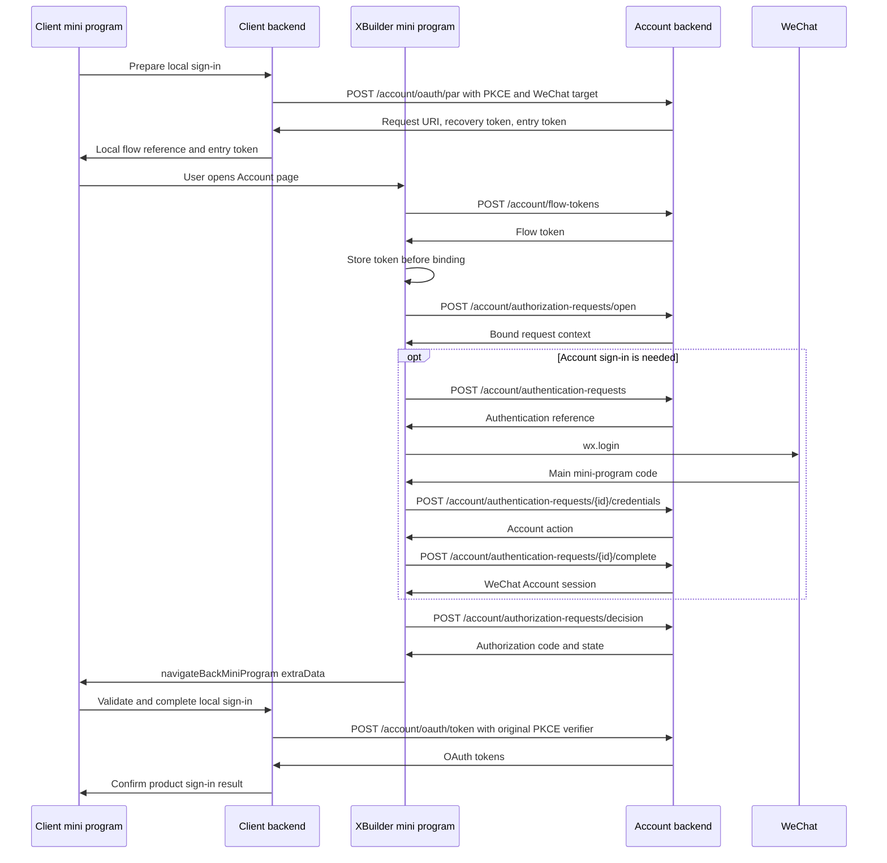
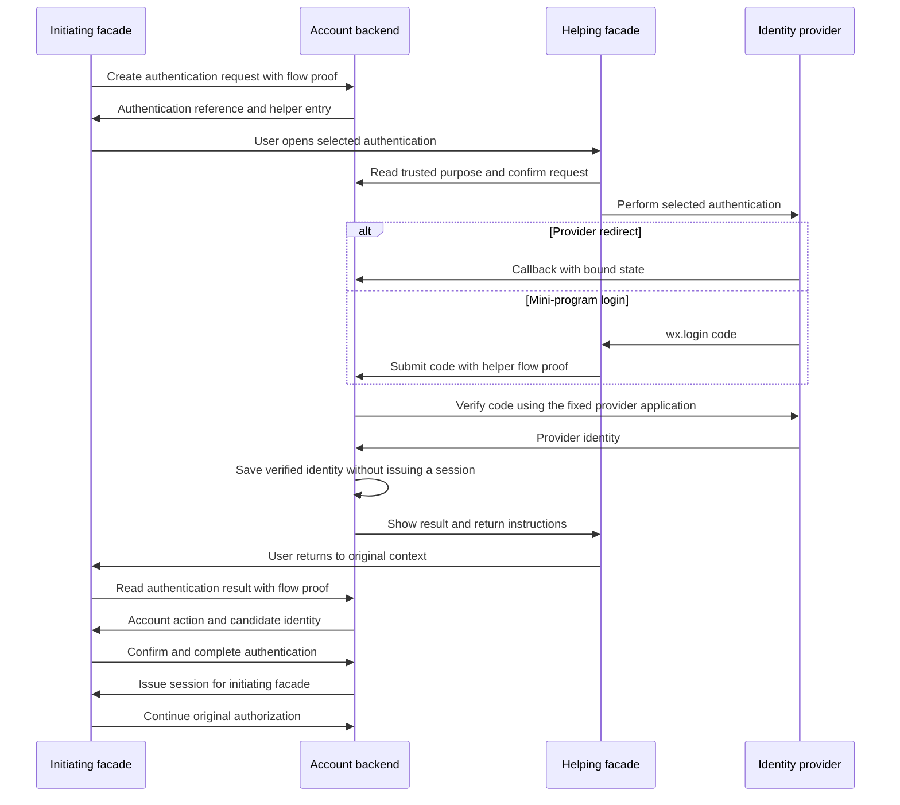

# XBuilder Account facades 技术设计

Account facades 使用同一 Account 后端验证身份和完成 OAuth 授权，各自持有独立的 Account session。后端保存交互状态，接入 app 通过原返回通道取得授权结果。

本文档定义 [Account facades](../product/account-facades.zh.md) 首期 Web 与 WeChat 的数据模型、事务、接口、前端接入和发布方案。App、OAuth client、用户授权和令牌遵循[自有 app 登记与接入技术设计](https://github.com/aofei/fork.goplus.builder/blob/82c7d6e551e7769847860a7532272f7ba32887d2/docs/develop/account-app-integration.zh.md)。账号与身份规则见 [XBuilder Account](../product/account.zh.md)，完整 OpenAPI 契约由 [`docs/openapi.yaml`](../openapi.yaml) 定义，并随接口实现与前端接入同步更新。

## 实现结构

后端在 [goplus/builder-backend](https://github.com/goplus/builder-backend) 的 Account 模块内实现，复用 PostgreSQL、GORM、身份适配器、账号解析和令牌服务。浏览器与小程序调用同一套授权操作，HTTP 层分别交付重定向地址或结构化结果。

| 模块 | 职责 |
| - | - |
| `internal/model` | 会话、短期流程及 OAuth client 返回配置的持久化映射 |
| `internal/account.AuthFlowService` | PAR、入口绑定、授权确认、授权码签发和结果恢复 |
| `internal/account.AuthenticationService` | 认证请求、上游验证、账号交互和认证结果消费 |
| `internal/account.IdentityProviderRegistry` | 按已登记的应用配置生成授权地址和验证凭证 |
| `internal/account.ProviderIdentityService` | 按已验证身份读取、创建和显式绑定 Account 账号 |
| `internal/account.UserSessionService` | 按 facade 签发、校验和撤销 Account session |
| `internal/signin` | XBuilder 作为接入 app 的短期登录事务，通过 Account OAuth 接口取得产品令牌 |
| `internal/controller`、`cmd/xbuilder-backend` | DTO、HTTP 鉴权、cookie、依赖装配和清理任务生命周期 |
| `spx-gui/src/apis/account` | Web 使用的流程与会话 API adapters |
| `spx-gui/src/apps/account` | 授权页面、认证协助页面和流程模型 |
| `miniprogram/` | XBuilder 主小程序工程，承载原生 Account 页面与微信接口适配 |

Provider callback 只验证上游凭证并保存认证结果。账号解析、身份绑定和会话签发由发起入口在消费认证结果时调用，协助入口不执行这些操作。服务通过构造参数接收 store、时钟、随机值生成器、上游客户端、配置和结果加密能力。

## 请求标识与凭证

授权请求保存接入 app 本次 OAuth 参数，认证请求记录其中一次身份验证及其状态。接入 app 查询授权状态，并在结果未送达时重新打开原入口接收结果。发起入口负责恢复认证结果。

请求引用与凭证分别生成，不相互派生。私有凭证使用现有 32 字节安全随机值生成器，以无填充 Base64url 编码，后端保存 SHA-256 哈希。每次校验同时检查请求种类、所属 client、状态和有效期。

| 值 | 持有方 | 用途与传递 |
| - | - | - |
| `request_uri` / `requestURI` | 接入 app 与 Account facade | OAuth 参数与流程 JSON 中的同一 PAR 引用 |
| `recoveryToken` | 接入 app 后端 | 查询授权状态、取消未完成请求和准备续接入口 |
| `entryToken` | 接入 app 前端，随后交给 Account facade | 单次打开或续接入口，有效期 60 秒，不授权读取结果 |
| `flowToken` | 发起入口或协助入口 | 按各自绑定关系操作授权或指定认证，不返回接入 app |
| `authenticationRequestID` | 发起入口与协助入口 | 定位指定认证，协助入口只能查看请求说明和执行该认证 |
| Account session token | 所属 facade | 证明 Account 登录状态，不代替上述请求关联 |

Facade 在绑定请求前先准备并保存 `flowToken`，首次授权入口消费 `entryToken` 并记录绑定。使用同一流程凭证重试打开时返回原上下文，避免响应丢失后无法继续。

恢复凭证只证明请求的发起关系，不直接授权读取 code。授权码始终由绑定的 facade 通过登记的返回通道交付，遵循 [OAuth 返回与请求绑定要求](https://www.rfc-editor.org/rfc/rfc9700.html#section-2.1)。回跳丢失时，接入 app 重新打开原入口，由原 facade 再次交付授权码。恢复接口不能绕过回调或小程序返回关系。

Web 的 `flowToken` 使用 `__Host-xbuilder-account-flow` cookie，设置 `HttpOnly`、`Secure`、`SameSite=Lax`、`Path=/`，不设置 `Domain`。Account WeChat 将流程凭证保存在私有存储中，以 `Account-Flow-Token` 请求头提交。准备时复用有效凭证，将 cookie 有效期或本地保管期限重设为 30 分钟。各请求受自身期限限制，未绑定请求的随机值不产生流程权限。

## 数据模型

### OAuth client 的微信返回配置

`account_oauth_client` 增加 `wechat_return_targets jsonb`，未配置时保存空数组。每项包含 `redirectURI` 和 `miniProgramAppID`，这两个字段的组合不得重复。配置不包含接入小程序的 AppSecret。

```json
{
  "wechatReturnTargets": [
    {
      "redirectURI": "https://xatom.example.com/account/callback",
      "miniProgramAppID": "<caller-mini-program-app-id>"
    }
  ]
}
```

`redirectURI` 必须是该 client 精确登记的回调，不使用预览通配规则。微信返回目标是原调用方小程序，返回后的页面路由由接入 app 管理，不登记其内部页面。

客户端创建、查询和 PATCH 接口增加 `wechatReturnTargets`。管理员以完整数组替换目标配置，后端按更新后的完整 client 配置校验重复项和回调关联。用于 app 自主访问的 client 的 `wechatReturnTargets` 必须为空。修改 `redirectURIs` 时同步校验相关目标，并在同一事务中记录管理审计。删除或修改目标时，作废受影响的未完成授权请求和未兑换授权码，不撤销该 client 已签发的访问令牌。

微信授权仍保存和校验原 OAuth `redirect_uri`，授权码通过微信返回通道交付。这部分属于 Account 的平台交互扩展，PAR、PKCE 与 token exchange 沿用 OAuth 规则。

### Account session

`account_user_session` 增加 `facade smallint`，取值为 `0 = web`、`1 = wechat`。会话仍保存不透明 token 的哈希，沿用现有有效期、撤销和用户关联规则。

Web 只使用 Account Web 域名下的 session cookie，API 沿用 Account Web 同源代理。Account WeChat 使用 `Authorization: Bearer <account-session-token>`，仅流程接口及 `GET /account/session`、`DELETE /account/session` 接受这种凭证。两种通道分别校验 `facade = web` 和 `facade = wechat`。产品 API、OAuth token 接口和 app 自主访问不查询 Account session 作为 Bearer 凭证。会话 DTO 增加 `facade`，既有会话管理仍按用户归属校验。

同一请求同时带 session cookie 与 Account session Bearer 时返回 `400`，避免隐式选择身份。Web 的状态变更接口校验受信 `Origin`，上游回调使用绑定认证请求的一次性 state 和相应 provider 校验。

### 短期流程记录

沿用 `account_auth_flow`，保留 app、OAuth client、用户、授权记录、句柄哈希、payload、到期、消费和撤销字段。新增以下字段：

| 字段 | PostgreSQL 类型 | 含义 |
| - | - | - |
| `parent_id` | `bigint`，可空 | 父流程外键，限定在同一 app 和 OAuth client 内 |
| `status` | `text`，可空 | PAR 或认证请求的业务状态 |
| `version` | `bigint` | 每次状态变更递增的并发控制版本 |
| `recovery_token_hash` | `bytea`，可空 | PAR 的接入方恢复凭证哈希 |
| `owner_token_hash` | `bytea`，可空 | PAR 的发起入口或认证请求的协助入口所持流程凭证哈希 |
| `result_type` | `text`，可空 | 当前加密内容的种类 |
| `result_ciphertext` | `bytea`，可空 | 可恢复结果的加密内容 |
| `result_key_id` | `text`，可空 | 结果加密所用的密钥版本 |
| `result_expires_at` | `timestamptz`，可空 | 可恢复结果的到期时间 |

建立 `(id, app_id, oauth_client_id)` 唯一约束和对应父流程复合外键，以及 `parent_id`、`(flow_type, status, expires_at)` 索引。增加 `CHECK` 约束，要求存在父流程时 app 与 client 均不可空。保留句柄哈希唯一索引，对 `flow_type IN (1, 2)` 建立 `(parent_id, flow_type)` 部分唯一索引，保证每次认证只有一个上游 state，每个 PAR 只签发一个授权码。对非空密文建立 `result_expires_at` 部分索引，用于到期清理。

| 流程种类 | 父流程 | 保存内容 |
| - | - | - |
| `pushedAuthorizationRequest` | 无 | OAuth 参数、入口、当前认证和授权结果 |
| `authenticationRequest` | PAR，或身份绑定的主认证请求 | 指定认证、已验证身份及会话签发结果 |
| `providerRedirectState` | 认证请求 | 上游 state、callback、PKCE 和 nonce 的验证上下文 |
| `authorizationCode` | PAR | 用户授权、实际 redirect URI、scope 和 PKCE challenge |
| `providerCredentialUse` | 认证请求 | 已提交上游验证的凭证指纹 |

流程枚举为 `0 = pushedAuthorizationRequest`、`1 = providerRedirectState`、`2 = authorizationCode`、`3 = providerCredentialUse` 和 `4 = authenticationRequest`。`version` 由业务代码从 1 开始写入，不设置数据库默认值。

PAR 与认证请求的 payload 按原值保存各自的公开引用，用于响应丢失后恢复及回调后的页面续接。关联字段使用记录的数值主键，对外仍使用公开请求引用。

各类 payload 在业务层解码为独立的 Go 类型，不使用自由字段组合决定行为。所属 app、client 和父流程创建后保持不变，父类型、provider、操作目的与凭证类别必须匹配。单次协议状态继续以 `consumed_at` 记录消费，`revoked_at` 记录管理撤销，不能用更新到期时间代替这些事实。

### 授权请求

PAR 的 payload 保存原始 `redirectURI`、`state`、scope、PKCE challenge 和 UI locales，并增加：

| 字段 | 含义 |
| - | - |
| `facade` | 本次使用的 `web` 或 `wechat` |
| `entryPurpose` | `authorize` 打开未完成授权，`return` 续接已签发结果的返回 |
| `entryTokenHash`、`entryExpiresAt`、`entryConsumedAt` | 当前单次入口凭证 |
| `wechatReturnTarget` | 经 client 配置校验的调用方 AppID 与回调快照 |
| `activeAuthenticationRequestID` | 当前主认证的记录 ID |
| `confirmedUserID`、`confirmedSessionID` | 用户确认时使用的账号和会话 |
| `oauthError` | 已拒绝或取消请求的 OAuth 错误 |

PAR 自创建起有效 10 分钟，只承载一次授权。入口绑定单次消费 `entryToken`，未完成请求在原参数和流程内继续，遵循 [PAR 重复请求处理规则](https://www.rfc-editor.org/rfc/rfc9126.html#section-4)。授权确认消费 PAR，并在同一事务中写入授权码、授权结果和终态。

重新准备入口使此前尚未使用的 `entryToken` 失效，不延长 PAR 或 code 的期限。未完成授权重新进入时，原 `flowToken` 有效则恢复原上下文，凭证丢失则在重新绑定前取消在途认证并清除其结果。已授权请求的返回只接受原 `flowToken`，不允许重新绑定。私有上下文丢失时创建新授权，已建立的 Account session 不因此撤销。

### 认证请求

认证请求对外使用独立的随机 `authenticationRequestID`，不使用 PAR 的 URN。其 payload 保存认证方式、`purpose`、发起与执行 facade、provider 应用标识、原 PAR 引用、核对用的六位数字，以及 `activeAccountProofRequestID` 和完成请求摘要。`purpose` 为 `sign_in` 或 `account_proof`，由主认证与账号证明关系确定。

认证请求自创建起有效 5 分钟，且不晚于原 PAR 到期。已验证身份包含 `VerifiedProviderIdentity` 所需的稳定 subject、namespace、来源应用、client subject 和有限展示资料，以加密结果保存。密码验证返回并保存用户 ID、凭证记录 ID 与 `updatedAt`，完成前检查同一凭证仍存在且版本未变，不保存密码或密码哈希副本。

需要绑定现有账号时，为已验证的主认证创建账号证明子请求，不替换 PAR 的当前主认证。子请求只验证现有用户的身份，不自动创建账号。它只在主认证仍为 `verified` 且等待该子请求时有效。绑定身份时，在同一事务中消费两份证明。

Provider code 的指纹为 provider、上游应用 client ID 和 code 按长度前缀编码后的 SHA-256 摘要，存入 `providerCredentialUse.handle_hash`。唯一约束跨 OAuth clients 生效，验证开始前即记录消费。重复提交同一认证请求时返回已保存状态，不再次请求上游。

### 可恢复结果

授权码原值只在 PAR 的加密结果中短期保存，授权码记录继续只保存哈希。结果包含 `code`、原 `state`、redirect URI 和授权码到期时间，有效期为签发后 5 分钟，只向原 facade 交付。

主认证完成后，将可恢复结果替换为完成请求的内容、完成前后的 session ID 和首次响应所需内容。新签发的 Web 与 WeChat session token 均最多加密保留 5 分钟，用于原 facade 恢复同一结果。Web 通过 cookie 交付，WeChat 通过 JSON 交付，复用原会话时不返回新 token。恢复时校验结果的有效期和会话状态，不重新消费认证证明，也不启用已撤销会话。

`result_type` 区分 `provider_redirect`、`verified_identity`、`password_proof`、`session_result` 和 `authorization_result`。结果种类、密文、密钥版本和到期时间同时写入或清除。进入下一阶段时替换前一阶段的加密内容，不长期保留身份证明。

结果加密复用 Go 标准库的 AES-256 与 [`cipher.NewGCMWithRandomNonce`](https://pkg.go.dev/crypto/cipher#NewGCMWithRandomNonce)。AAD 绑定部署环境、流程与父流程 ID、流程与结果种类、app、client 和用途。密钥标识与密文分别保存，密钥来自部署 secret，不存数据库。密钥使用次数遵循该 API 的限制，轮换时保留仍有有效结果使用的版本。

恢复授权结果时，按 code 自身的有效期校验，不受 PAR 原有效期限制。已消费、到期或撤销的 code 不再返回原值。

## 授权与认证流程

### 状态转换

| 请求 | 状态 | 后续行为 |
| - | - | - |
| 授权请求 | `pending` | 绑定入口、认证、账号选择和确认 |
| 授权请求 | `authorized` | 原 facade 可重送仍有效的授权码，接入 app 可查询结果是否可用 |
| 授权请求 | `denied`、`cancelled`、`expired` | 返回终态及对应错误，接入方按需创建新请求 |
| 认证请求 | `pending` | 执行已选认证 |
| 认证请求 | `verifying` | 等待已启动的凭证验证，不重放凭证 |
| 认证请求 | `verified` | 由发起入口确认账号并消费结果 |
| 认证请求 | `completed` | 主认证恢复同一会话签发结果，账号证明只记录已消费 |
| 认证请求 | `failed`、`cancelled`、`expired` | 保留原授权请求，允许发起入口重新认证或改选 |

终态不被迟到回调改写。改选方式、更换入口绑定或重新认证时，旧请求不再是当前认证，其结果不能创建会话或完成授权。被替代的认证清除可恢复结果，已完成时保留原终态。

上下文返回所属记录的 `version`。已绑定入口的状态变更提交 `expectedVersion`，锁内不一致时返回 `request_changed`，由前端重新读取。重复开始或完成时，先识别已保存的同一操作，再恢复结果。提交认证结果和完成账号操作时，须检查它仍是 PAR 的当前主认证，账号证明仍是主认证的当前子请求。入口绑定、接入 app 发起的取消操作和 provider callback 按对应凭证与锁内状态处理，不要求先读取版本。

### Web 授权

接入 app 后端生成并保存 PKCE verifier 和 OAuth state，创建 PAR 后保存 Account 返回的恢复凭证。后端向前端提供浏览器授权入口和本地登录流程关联，前端导航到该地址。

`GET /account/oauth/authorize` 校验 client、PAR、所选 facade 和入口凭证，使用 `302` 引导至 Account Web 的 `/sign-in`。页面先将入口凭证暂存于本标签页的 `sessionStorage` 并移除 URL 中的凭证，再准备流程 cookie，以结构化打开操作绑定请求。绑定确认后删除暂存凭证，后续只使用公开请求引用和私有 cookie。打开响应丢失时，同一流程凭证可重试或读取原上下文。

用户确认账号和 scope 后，Account Web 提交授权决定。后端验证当前 cookie session 与确认值，签发授权码并保存结果。页面随后导航到已登记的 callback。原生接入 app 同样通过系统认证浏览器执行这条路径，callback 沿用该 client 的登记 URI。

### 小程序授权

以下以选择微信登录为例，已有有效会话时可直接确认授权。



调用方在请求与入口凭证准备完成后启用登录按钮，入口到期时重新准备。[`wx.navigateToMiniProgram`](https://developers.weixin.qq.com/miniprogram/dev/api/navigate/wx.navigateToMiniProgram.html) 由用户点击直接触发，path 指向 `pages/account/index`，只携带公开引用。`entryToken` 通过 `extraData` 传递，PKCE verifier、Account 恢复凭证和产品凭证留在调用方。

平台明确报告用户取消打开授权入口时，调用方通过自己的后端取消未完成的授权请求。其他打开失败保留关联，允许重新准备入口后重试。

主小程序首次接收时读取微信提供的来源 AppID，与后端返回的登记调用方比较。来源不匹配时不打开授权交互。后端校验 client、回调与登记小程序的关联，微信 code 不作为调用方来源证明。

复用有效 Account session 时展示当前账号。用户选择微信登录后才创建对应认证请求，调用 [`wx.login()`](https://developers.weixin.qq.com/miniprogram/dev/framework/open-ability/login.html) 取得主小程序的新 code 并提交验证。密码在小程序内验证，其他第三方认证按[认证协助](#认证协助)流程完成。

授权结果通过 [`wx.navigateBackMiniProgram`](https://developers.weixin.qq.com/miniprogram/dev/api/navigate/wx.navigateBackMiniProgram.html) 的 `extraData` 返回，内容为 `requestURI`、`code` 和 `state`，或 OAuth 错误与 `state`。返回前检查当前打开关系仍指向原调用方。来源变化或返回失败时显示返回指引，不向新的打开方发送结果。

接入小程序在 `App.onShow` 中校验已保存的流程关联、`state` 和返回来源，再通过自己的后端完成登录并恢复原业务页面。`wx.navigateBackMiniProgram` 只返回原小程序，页面路由由接入 app 执行。缺少回传数据时查询已知流程，已授权则由用户重新打开原 Account 入口完成返回，不能用事件参数创建新的待处理请求。已取消的本地登录不接受迟到结果。

主小程序内部授权使用自己的 OAuth client，并登记主小程序 AppID。业务模块以本地调用打开 Account 页面并传递入口凭证。完成后返回本地业务页，页面栈丢失时由业务模块按保存的关联恢复。

### 小程序内网页

`web-view` 中的业务 H5 由自己的后端按已登记的宿主 AppID 准备 `wechat` 授权请求，再以 `wx.miniProgram.navigateTo` 打开宿主原生登录页。宿主接收请求引用、入口凭证、本地流程引用、state 和登记的业务回调 URI，校验原生页面由当前受信业务网页打开，并核对页面栈和已保存的关联。外部启动参数不能建立待处理登录。主小程序宿主使用本地 Account 模块，其他宿主由用户点击打开主小程序。

业务 H5 的后端保管 PKCE verifier 和 Account 恢复凭证，网页使用自己域下的登录流程 cookie，宿主不接收这些凭证。业务回调与原 H5 同源，并符合宿主的业务域名配置。

宿主收到结果后，在原 `web-view` 中打开登记的业务回调 URI，传递 code 与 state 或 OAuth 错误。网页校验原请求关联，通过自己的后端兑换并恢复业务页面。回调页面先移除 URL 中的 code，再加载分析或第三方脚本。宿主不兑换 H5 的授权码，也不将宿主产品登录态注入网页。

缺少回传数据时，宿主先恢复原业务页面，由 H5 通过自己的后端查询状态。需要接收已签发结果时，仍由宿主重新打开原 Account 入口，沿同一通道接收结果。`postMessage` 的生命周期行为遵循[微信组件文档](https://developers.weixin.qq.com/miniprogram/dev/component/web-view.html)，不承担授权码的实时交付。

### 认证协助



| 场景 | 协助入口 |
| - | - |
| Account WeChat 中的非微信第三方认证 | 复制认证链接，在系统浏览器打开 Account Web 的 `/authenticate` 页面 |
| Account Web 中受浏览器限制的非微信第三方认证 | 在受支持的系统浏览器打开同一 `/authenticate` 入口 |
| 微信外移动浏览器中的微信认证 | Account 生成 [URL Link](https://developers.weixin.qq.com/miniprogram/dev/framework/open-ability/url-link.html)，打开主小程序 `pages/account/verify` |

认证请求固定 provider、执行模式、请求方和登录操作，协助入口不提供方法选择。协助入口展示发起 facade 与同一校验码，用户核对原入口后确认认证。校验码只用于核对请求，不能用于读取认证结果。

协助入口先准备自己的流程凭证，浏览器使用流程 cookie，主小程序使用私有存储。开始操作将其哈希绑定到认证请求，后续仅该协助上下文可继续。当前 Account session 不参与这次验证，协助过程不设置、轮换或清除该会话。

协助入口只显示完成状态和返回指引，不返回已验证身份或 session token。发起入口恢复后校验账号，由用户确认，再创建或复用自己的 Account session。复制链接和 URL Link 均不传递源端 `flowToken`，也不提供自动返回原浏览器标签页的保证。

### 账号交互与会话签发

发起入口读取 `verified` 主认证请求时，后端返回对应的账号动作及所需字段。Provider 展示资料只作为账号创建的输入，不覆盖已有用户字段，不按邮箱或用户名自动合并账号。

授权确认展示账号、可信请求方和本次全部 scope。需要认证时，一次确认可依次完成认证消费与授权决定，后端分别校验。

| 账号动作 | 条件与处理 | 完成操作 |
| - | - | - |
| `confirm_account` | 已验证凭证对应现有用户，展示该用户并确认继续 | `sign_in` |
| `create_account` | 第三方身份未绑定，按既有规则准备最小用户资料 | `create_user` |
| `confirm_link` | 用户选择绑定现有账号，要求主身份及现有账号的有效证明并确认目标 | `link_identity` |
| `identity_conflict` | 绑定目标与身份已有归属不一致，拒绝移动绑定 | 确认登录所属账号或改选方式 |

新账号创建前可修改 `username` 和 `displayName`，提交时沿用既有字段校验。缺少可选的 provider 昵称或头像时沿用既有生成规则，不新增必填资料要求。

目标用户由已验证凭证或有效会话确定，客户端提交的预期用户和会话只用于一致性校验。身份绑定与账号创建通过 `ProviderIdentityService` 执行，必要证明、绑定写入、认证消费和会话签发共同提交。账号证明不单独签发 session，只由其主认证消费。

已验证用户与当前有效会话相同时复用该会话，否则签发当前 facade 的新会话。已完成认证对应的会话失效后，重新创建登录认证。绑定现有账号时始终要求新的账号证明。

完成账号操作时，在同一事务中保存已校验请求内容的 SHA-256 摘要，计算时使用稳定编码并排除 `expectedVersion`。重复提交完成请求时，先校验请求内容、流程凭证和当前会话，再恢复同一 session，不重复创建会话。当前会话只能是首次操作的原会话或已签发会话，变更为其他 session 时返回 `account_changed`。前端串行处理会话变更，只接收当前请求的响应，并在授权前重新读取会话。

签发授权码前再次校验 Account session 有效、账号与本次确认一致、app 与 client 可用、scope 已获批准、回调及微信返回配置仍受信。其他页面切换或撤销会话使校验失败时，保持未完成授权并要求重新确认或认证。

## 事务与生命周期

### 锁顺序

沿用自有 app 接入设计的锁顺序，并将新增记录放入相应阶段：

1. App、OAuth client
2. 需要写入的用户、身份、密码凭证和 Account session，多个同类记录按稳定主键排序
3. 用户对 app 的授权记录
4. PAR，以及认证、上游跳转和授权码记录，先父后子，同层按 ID 排序
5. Token family 与令牌记录

操作只锁定实际涉及的记录。`ProviderIdentityService` 将资料准备与事务内写入分开，读取已验证身份、准备头像及确定候选用户在事务外完成。事务内重新校验用户名唯一性、身份归属和密码凭证版本，归属变化时回滚并重新准备，不在持有流程锁时再申请前序记录锁。创建新身份遇到唯一冲突后，重新读取实际绑定，不把已有身份转给另一用户。

检查请求有效期和验证完成期限时，以取得相关锁后的当前时间为准。结果有效期从实际签发时刻计算，不沿用等待锁或上游验证之前的时间。

授权确认在一个事务中检查预期会话、更新 `app_grant`、消费 PAR、写入唯一授权码和加密结果。Token exchange 在同一事务中消费 code、签发令牌和清除对应密文。

管理停用或作废配置沿同一顺序写入关联流程的 `revoked_at`，未完成的授权与认证转为 `cancelled`，清除可恢复密文。已授权请求保留原状态，按 code 的撤销状态报告结果不可用。恢复配置不恢复已失效流程。

### 上游验证与未知结果

验证上游凭证时，先锁定 PAR 和当前认证请求，检查流程凭证、版本和状态，记录凭证指纹，将认证改为 `verifying` 后提交。随后在事务外请求上游，整次验证的超时为 15 秒，认证请求的完成期限为进入 `verifying` 状态后 30 秒。上游回调先单次消费对应 state，再按同一规则验证，不持有数据库锁等待网络。

上游返回后重新取得流程锁，仅当原授权仍有效、认证仍为当前尝试且状态允许时保存已验证身份。取消、改选或到期后收到的结果不创建账号或 session。上游失败持久化认证失败状态，再返回错误，不能因错误响应而回滚凭证消费记录。

进程崩溃或网络结果未知时，认证最多保持 `verifying` 至完成期限，随后变为 `failed`。显式重试创建新的认证请求并获取新的 provider code，不重放已经提交的 code，也不在后台保存原始凭证自动重试。

### 恢复与清理

状态查询按句柄和所属关系读取完整记录，结果读取按自身期限校验，不要求原请求仍未消费。授权确认与 code 兑换分别检查当前待处理状态。

接入 app 后端只查询授权状态和结果是否可用。已授权且 code 仍有效时，准备 `return` 入口，由原 facade 再次交付同一授权码。原流程凭证丢失或 code 已失效时重新授权。会话撤销不默认撤销此前已签发的 OAuth code 或产品令牌。

接入 app 后端按本地登录流程协调 token exchange。兑换已开始而结果未知时，先确认已保存的产品登录态，没有可恢复结果则创建新授权请求，不再次兑换旧 code。接入 app 取消本地登录后，停止接收该流程的完成结果，不因迟到回调重新登录。

结果到期或失效后清除密文和密钥引用。已结束流程与凭证使用指纹保留 24 小时后分批删除，父记录在关联子记录均可删除后清理。`cmd/xbuilder-backend` 创建 Account 清理循环，每分钟开始扫描，按稳定主键每批最多处理 1000 条，使用条件更新与父子锁顺序处理多实例竞争，退出时停止并等待循环结束。接口实时检查有效性和验证完成期限，不依赖清理准时运行。

## Provider 与部署配置

`IdentityProviderRegistry` 按 `applicationKey` 登记适配器，并校验配置所属的 provider，展示列表按 provider 去重并沿用现有顺序。后端从已配置且适合当前入口的选项中确定应用，认证请求保存应用标识、client ID、callback、scope 和校验所需的 audience 或 nonce。验证不依赖调用方重新提交的配置，运行环境信息只用于选择交互，不作为用户身份或调用方身份的证明。

| `applicationKey` | 用途 | 应用与 scope |
| - | - | - |
| `wechat.website` | 普通桌面浏览器及不兼容 H5 的显式备选入口 | 网站应用，`snsapi_login` |
| `wechat.service_account` | 移动端与桌面端微信 H5 | 已认证服务号，`snsapi_userinfo` |
| `wechat.mini_program` | 小程序微信身份验证 | XBuilder 主小程序，通过 `code2Session` 验证 |

微信适配器以显式模式选择 `qrconnect`、网页 OAuth 或 `code2Session`，不通过空 callback 推断模式。三类应用分别配置 AppID/AppSecret，不回退使用另一类应用的 secret。它们绑定同一开放平台，使用 UnionID 解析身份，并按既有 `user_identity_source` 模型记录应用与 OpenID。缺少必需标识时本次认证失败。

生成 URL Link 先以主小程序凭证调用 [`stable_token`](https://developers.weixin.qq.com/miniprogram/dev/server/API/mp-access-token/api_getstableaccesstoken.html)，使用普通模式 `force_refresh = false`。应用 access token 按环境和主小程序 AppID 缓存在现有 Redis 中，有效期按返回的剩余时间减去 60 秒设置，不持久化到账号表，不在日志中记录。

随后调用 [URL Link API](https://developers.weixin.qq.com/miniprogram/dev/server/API/qrcode-link/url-link/api_generateurllink.html)，固定已发布的协助页面、`env_version = release`、`expire_type = 0`，将 `expire_time` 设为认证请求的 Unix 到期时间，query 只包含该请求的公开引用。该能力要求境内非个人主体小程序，后端仍独立校验请求有效期。用户数据不写入链接参数，API 返回的 Account 页面和 provider 地址必须属于受信配置，不提供任意跳转代理。

其他 provider 复用已登记的 Web 应用和适配器。PKCE、nonce 和回调 state 绑定到本次认证请求，provider PKCE verifier 沿用现有服务端 secret 与 state 的派生，不新增明文持久化。原始 provider token 只在取得稳定身份时短暂使用，回调的浏览器绑定见[协助入口与 provider callback](#协助入口与-provider-callback)。

部署配置增加服务号凭证和主小程序入口，沿用现有网站应用与主小程序凭证字段：

```dotenv
ACCOUNT_PROVIDER_WECHAT_CLIENT_ID=<website-app-id>
ACCOUNT_PROVIDER_WECHAT_CLIENT_SECRET=<website-secret>
ACCOUNT_PROVIDER_WECHAT_SERVICE_ACCOUNT_CLIENT_ID=<service-account-app-id>
ACCOUNT_PROVIDER_WECHAT_SERVICE_ACCOUNT_CLIENT_SECRET=<service-secret>
ACCOUNT_PROVIDER_WECHAT_MINI_PROGRAM_CLIENT_ID=<main-mini-program-app-id>
ACCOUNT_PROVIDER_WECHAT_MINI_PROGRAM_CLIENT_SECRET=<mini-program-secret>
ACCOUNT_FACADE_WECHAT_ENABLED=true
ACCOUNT_FACADE_WECHAT_AUTHORIZATION_PATH=pages/account/index
ACCOUNT_FACADE_WECHAT_AUTHENTICATION_PATH=pages/account/verify
ACCOUNT_FLOW_ENCRYPTION_ACTIVE_KEY_ID=2026-11
ACCOUNT_FLOW_ENCRYPTION_KEYS='{"2026-11":"<base64-encoded-32-byte-key>"}'
```

启动时解析并校验完整配置。启用 WeChat facade 时要求主小程序凭证与页面路径齐备，配置错误使启动失败。各实例使用相同的有效加密密钥集合，先分发新密钥再切换写入版本。数据库结果或产品短期缓存仍依赖的旧密钥不能移除。应用身份或 callback 配置变化使已有认证无法继续时，返回 `configuration_changed`，由发起入口重新认证。

## API 契约

### OAuth 与接入 app 操作

PAR 和 token 接口保留 OAuth 请求与响应格式。PAR 不接受 `xbuilder_provider` 和 `xbuilder_provider_code`，第三方凭证只提交给相应认证请求。

| PAR 参数 | 规则 |
| - | - |
| `client_id`、`redirect_uri`、scope、`state`、PKCE、`ui_locales` | 沿用原 client 绑定和参数校验 |
| `xbuilder_facade` | `web` 或 `wechat`，省略时为浏览器流程 `web` |
| `xbuilder_wechat_mini_program_appid` | `wechat` 必填，须匹配该 client 与 callback 的返回配置 |

成功返回 `201`，在标准 PAR 响应中增加三个扩展字段：

```json
{
  "request_uri": "urn:ietf:params:oauth:request_uri:par_reference",
  "expires_in": 600,
  "xbuilder_recovery_token": "<recovery-token>",
  "xbuilder_entry_token": "<entry-token>",
  "xbuilder_entry_expires_in": 60
}
```

接入 app 后端保存恢复凭证和 PKCE verifier，向自己的前端只返回入口所需内容及本地流程关联。浏览器打开 `GET /account/oauth/authorize`，携带原 `client_id`、`request_uri` 和 `xbuilder_entry_token`。该接口仅为 `web` 引导浏览器，入口绑定由 Account Web 与 WeChat 共用下面的结构化打开操作。WeChat 不依赖 HTTP 重定向打开主小程序。

| 接口 | 请求与结果 |
| - | - |
| `POST /account/authorization-requests/entry` | `clientID`、`requestURI`、`recoveryToken`，返回 `entryPurpose`、新 `entryToken` 与到期时间 |
| `POST /account/authorization-requests/status` | 同一组恢复参数，返回 `AuthorizationStatus`，不返回 code |
| `POST /account/authorization-requests/cancel` | 同一组恢复参数，以取消为目标更新未完成请求，返回 `AuthorizationStatus` |

这些接口由接入 app 后端调用。Confidential client 同时使用 `client_secret_basic`，public client 仍需正确的恢复凭证。每次校验 client 绑定，凭证不能跨请求使用。取消已结束请求时返回既有结果，不改写已签发事实。

`AuthorizationStatus` 包含 `requestURI`、`version`、`status` 和原 `state`。`pending` 返回 `expiresAt`，`authorized` 返回 `codeAvailable`、`codeExpiresAt`，不可用时增加 `unavailableReason`，取值为 `consumed`、`expired` 或 `revoked`。`denied` 与 `cancelled` 返回 OAuth `access_denied`，请求在完成授权前到期时返回 `invalid_request`。

未完成请求的入口用途为 `authorize`，已授权且 code 可用时为 `return`，入口凭证有效期分别不超过 PAR 或 code 的期限。Web 的 `return` 入口直接打开 Account Web，不向 OAuth authorize 提交已消费或到期的 PAR。入口校验失败只显示本地错误，不向未验证地址重定向。

### Facade 授权操作

`POST /account/flow-tokens` 接收 `facade`。Web 校验同源请求，准备或复用流程 cookie 并返回 `204`。WeChat 仅在没有有效本地凭证时调用，取得 `flowToken` 与保管期限，保存后再绑定请求。该操作不创建用户、会话或独立数据库流程记录。

```http
POST /account/authorization-requests/open
Account-Flow-Token: <flow-token>
Content-Type: application/json

{
  "clientID": "K7mR2qV9sT4wX6yZ8aB0Cg",
  "requestURI": "urn:ietf:params:oauth:request_uri:par_reference",
  "entryToken": "<entry-token>",
  "facade": "wechat",
  "sourceMiniProgramAppID": "<caller-mini-program-app-id>"
}
```

打开操作返回 `AuthorizationContext`，首次绑定单次消费入口凭证，同一流程凭证重试返回既有上下文。`return` 入口校验原绑定，不创建新绑定。Web 以 cookie 提交流程凭证，省略微信来源字段。主小程序以平台真实来源填充 `sourceMiniProgramAppID`，本地入口使用主小程序 AppID。

| 接口 | 鉴权与行为 |
| - | - |
| `POST /account/authorization-requests/context` | 凭流程凭证与 `requestURI` 返回请求上下文 |
| `POST /account/authorization-requests/decision` | 同一流程凭证，加 `requestURI`、`expectedVersion`、`decision`，返回授权结果 |
| `POST /account/authorization-requests/return` | 原流程凭证与 `requestURI`，返回仍有效的同一授权结果 |
| `GET /account/session` | 校验 Web cookie 或 WeChat session Bearer，返回当前会话及用户 |
| `DELETE /account/session` | 撤销当前相应会话，Web 同时清除 session cookie |

Web 的流程凭证由 cookie 提交，WeChat 使用 `Account-Flow-Token`，不在 JSON 中传递。需要当前账号时，另提交相应 Account session。打开操作不执行身份认证或创建会话。

`decision` 为 `approve`、`deny` 或 `cancel`。批准还必须提交 `expectedUserID`、`expectedSessionID` 并验证当前 Account session。拒绝与取消不要求已登录。已结束请求返回原结果，不能借重复决定为另一账号重新授权。

`decision` 和 `return` 返回 `AuthorizationResult`，在 `AuthorizationStatus` 基础上增加 `redirectURI` 和登记的微信返回目标，仅在 `codeAvailable = true` 时包含 `code`。`return` 不重做账号选择或授权，当前 Account session 的变化不改变已签发事实。原流程凭证不匹配时返回 `return_context_lost`，由接入 app 重新授权。

`AuthorizationContext` 包含 `requestURI`、`version`、状态、到期时间、可信 app 展示资料、请求 scope、facade、微信返回目标、当前认证引用、可选认证方式及当前 Account session。已授权时另返回 `authorizedUser` 和 code 到期时间，返回页面展示原授权账号。响应不含接入方恢复凭证、PKCE verifier 或 provider secret。

### 认证与会话操作

```http
POST /account/authentication-requests
Account-Flow-Token: <flow-token>
Content-Type: application/json

{
  "requestURI": "urn:ietf:params:oauth:request_uri:par_reference",
  "expectedVersion": 2,
  "method": "google",
  "acquisition": "external_browser"
}
```

创建操作返回 `201` 和 `AuthenticationRequest`。`method` 与 `acquisition` 必须属于上下文提供的选项，后端固定 provider 应用和操作目的。替换主认证时更新 PAR 的当前认证关联，取消未完成的旧尝试并清除其可恢复结果。创建账号证明时另传 `parentAuthenticationRequestID`，`expectedVersion` 比较该主认证版本，并更新其当前证明关联。上例由 Account Web 协助，响应提供该认证的复制链接。

| 接口 | 行为 |
| - | - |
| `GET /account/authentication-requests/{requestID}` | 发起入口读取状态、账号动作和允许操作，主认证完成后可恢复原完成请求的内容，不交付 session token |
| `POST /account/authentication-requests/{requestID}/credentials` | 提交本次密码或主小程序 code，返回已保存的认证状态 |
| `POST /account/authentication-requests/{requestID}/start` | 准备固定的 provider 授权地址或微信 URL Link，返回对应入口 |
| `POST /account/authentication-requests/{requestID}/complete` | 仅主认证调用，消费认证与所需账号证明，完成账号操作并签发发起 facade 的 session |
| `POST /account/authentication-requests/{requestID}/cancel` | 取消当前认证，保留仍有效的原授权请求 |

`AuthenticationRequest` 包含 `authenticationRequestID`、`version`、`status`、`method`、`purpose`、`acquisition`、到期时间、校验码和该状态允许的账号动作。状态变更携带该认证的 `expectedVersion`，重复开始或完成按已提交结果恢复。Provider callback 使用一次性 state 关联。

| `acquisition` | 场景 | 执行操作 |
| - | - | - |
| `password` | Web 或 WeChat 的管理员托管密码登录 | `credentials` 提交密码 |
| `wechat_login` | Account WeChat 的微信登录 | `credentials` 提交主小程序 code |
| `wechat_website` | Web 的网站应用登录及显式备选入口 | `start` 后执行 provider callback |
| `wechat_service_account` | 微信 H5 的服务号网页授权 | `start` 后执行 provider callback |
| `provider_redirect` | 受支持浏览器中的其他第三方 OAuth | `start` 后执行 provider callback |
| `external_browser` | WeChat 或受限制浏览器中的其他 provider | 复制协助链接，`helper/start` 后执行 provider callback |
| `wechat_url_link` | 微信外移动浏览器中的微信登录 | `start` 生成 URL Link，主小程序以 `helper/wechat` 提交 code |

后端按固定的 `acquisition` 限制可调用操作。直接认证与协助认证分别绑定各自的流程凭证，不能通过另一类接口接管。

提交凭证时，除 `expectedVersion` 外，还需携带密码字段 `{ "type": "password", "username": "alice", "password": "<password>" }`，或微信字段 `{ "type": "wechat_code", "code": "<code>" }`，类别须与认证请求一致。

主认证的验证结果只向发起入口返回账号动作及必要的候选资料，不返回 `VerifiedProviderIdentity`、原始 subject 或上游令牌。`accountAction` 包含 `type`、`allowedActions`，并按动作携带既有 `AccountUser`、新账号资料或账号证明要求。账号证明只返回已验证的既有用户及状态，供主认证的 `link_identity` 操作引用。

完成请求除 `expectedVersion` 外，还包含 `action`、`expectedUserID`、`expectedSessionID`，并按动作携带 `profile` 或 `accountProofRequestID`。新建用户时 `expectedUserID` 为 `null`，无当前会话时 `expectedSessionID` 为 `null`。例如确认登录已存在用户：

```http
POST /account/authentication-requests/authentication_reference/complete
Account-Flow-Token: <flow-token>
Content-Type: application/json

{
  "expectedVersion": 4,
  "action": "sign_in",
  "expectedUserID": "42",
  "expectedSessionID": null
}
```

成功返回 `status = completed` 和 `CurrentAccountSession`。Web 通过响应设置 cookie，JSON 不含 token。WeChat 新建会话时额外返回 `sessionToken`，复用时保留本地已有凭证。响应丢失后，发起入口可从仍有效的完成结果读取 `completion`，其中包含原完成请求的内容。重新提交同一请求即可恢复会话，不重新创建用户或会话。

`start` 在事务内固定上游 state 或协助目标。上游 state 的原值先加密保存，再生成并保存授权地址，重试使用同一 state。URL Link 仅引用同一认证请求，生成失败或响应未知时可重新生成，不重放用户凭证。前端在入口准备完成后启用打开按钮。

### 协助入口与 provider callback

| 接口 | 行为 |
| - | - |
| `GET /account/authentication-requests/{requestID}/helper` | 返回可信请求方、固定方式、操作目的、校验码、状态和到期时间，不返回身份结果 |
| `POST /account/authentication-requests/{requestID}/helper/start` | 用户确认上下文后启动指定 Web provider 认证，绑定协助浏览器的流程 cookie |
| `POST /account/authentication-requests/{requestID}/helper/wechat` | 主小程序提交新 code，仅完成已固定的微信认证 |
| `POST /account/authentication-requests/{requestID}/helper/cancel` | 已绑定的协助入口取消当前认证，不取消原授权 |
| `GET /account/identity-providers/{provider}/callback` | 消费上游 state 并保存父认证请求的验证结果 |
| `POST /account/identity-providers/{provider}/callback` | 接收 Apple `form_post`，经同源中转后执行验证与消费 |

协助状态变更同样提交 `expectedVersion`，`helper/start` 与 `helper/wechat` 在开始时绑定协助入口的流程凭证。浏览器取得的 provider 授权地址只能由已绑定的临时流程上下文恢复，开始响应丢失时返回同一次有效跳转，其他上下文不能替换已有绑定。该临时结果加密保存，到上游验证结束或请求失效时清除。关闭页面不推断取消，发起入口可查询后决定继续或取消。

生成上游 state 时同时保存固定的 Account 返回页面和原请求引用。直接 Web 认证回到 `/sign-in`，协助认证回到 `/authenticate`，不接收任意返回 URL。

回调根据 state 读取 provider、应用、callback、PKCE、nonce 和父请求。消费 state 与验证 code 前，须核对当前浏览器的流程 cookie。直接认证匹配 PAR 的发起入口，协助认证匹配认证请求的协助入口，URL provider 也必须与记录一致。转发上游认证地址不能替代这项校验。

Apple 跨站 `form_post` 先返回 Account 同源的中转表单，不验证或消费凭证。表单保留 code、state 或错误，使用 Go `html/template` 转义输出，再自动提交到配置的同源 callback。第二次提交校验 Account Web 的 `Origin` 和流程 cookie，通过后执行验证并以 `303` 返回页面。

中转页使用 `no-store`、仅允许 nonce 脚本和同源表单且禁止嵌入的 CSP，以及 [`Referrer-Policy: origin`](https://developer.mozilla.org/en-US/docs/Web/HTTP/Reference/Headers/Referrer-Policy#effect_on_the_origin_header)，保留表单提交的 Origin，只发送源信息，不发送路径或 query。上游 code 只在中转表单中保留，不持久化。

用户拒绝认证记为 `cancelled`，其他上游失败记为 `failed`。回调与协助接口不读取或修复 Account session，不将 provider error 原文拼进返回 URL。返回页面后凭原流程关联读取状态。

### 响应与错误

流程 JSON 接口沿用 `APIError`，不增加响应包装。流程冲突与到期错误增加稳定的 `reason`，使用 `40900` 和新增的 `41000`，不解析 `msg`。OAuth 协议接口继续返回 `OAuthError`。流程响应、包含凭证的响应及回调页面设置 `Cache-Control: no-store`。Account 页面与跳转响应使用 `Referrer-Policy: no-referrer`，Apple 中转页按上述流程使用 `origin`。

Account 页面设置 `Content-Security-Policy: frame-ancestors 'none'` 和 `X-Frame-Options: DENY`，遵循 [OAuth 防点击劫持要求](https://www.rfc-editor.org/rfc/rfc9700.html#section-4.16)。

```json
{
  "code": 40900,
  "msg": "Conflict",
  "reason": "request_changed"
}
```

| HTTP 状态 | 条件与稳定原因 |
| - | - |
| `400` | 参数不合法、凭证类别冲突、未知 callback 类型 |
| `401` | 缺少有效流程凭证、恢复凭证或 Account session |
| `403` | 来源、facade、client 用途或操作权限不允许 |
| `404` | 合法凭证对应的目标不存在，不泄露其他请求 |
| `409` | `account_changed`、`request_changed`、`return_context_lost`、`already_completed`、`identity_conflict`、`configuration_changed` |
| `410` | `request_expired` 或 `proof_expired`，重新认证或重新授权 |
| `429` | 登录、公开入口或恢复查询超过限流，返回 `Retry-After` |

暂时故障返回服务器错误并保留请求关联。查询已结束请求返回已保存状态，不用 `410` 抹去其终态。上游认证失败写入认证请求的 `failed` 状态，并向发起入口提供可展示的原因和允许操作。

所有匿名入口按可信客户端 IP 限流，流程操作另按请求计数，密码验证保留现有用户名与来源限制。查询默认每 2 秒一次，遵守 `Retry-After`，页面离开或流程结束时停止。日志、审计和 tracing 只记录内部流程 ID、client、操作与结果，不记录完整请求句柄、各类流程凭证、session、code、密码或 provider token。

## 前端与产品接入

### Account Web

Account Web 在 `spx-gui/src/apis/account` 增加授权与认证 adapters，封装流程凭证、响应和稳定错误原因。流程错误的 metadata 类型、构造和按错误码校验的 type guard 放在 `spx-gui/src/apis/common`，feature adapters 消费校验结果。`spx-gui/src/apps/account/models/sign-in.ts` 保存当前上下文、认证和允许操作，页面只根据这些状态展示当前账号、登录选择、账号动作和完成状态。

`/sign-in` 承载授权与账号交互，`/authenticate` 只承载固定认证及返回指引。Provider 按钮先创建认证请求，再按响应的 acquisition 打开指定入口，不重新猜测 AppID 或拼接 callback。账号切换、改选和重试通过模型方法更新后端状态，旧异步响应按请求与版本丢弃。

Account 页面仅加载本项目构建的脚本，入口凭证与上游回调中的敏感参数立即从 URL 移除，认证参数与结果不交给分析或错误上报。标签页恢复使用保存的公开关联和临时入口凭证，不从 URL 中取得 session token。

### Account WeChat

`miniprogram/` 以微信原生 TypeScript 工程组织主小程序，与 Web 的 Vite 构建分开。`app.json` 登记 `pages/account/index` 和 `pages/account/verify`，分别承载授权与认证协助。API adapter 区分流程凭证、Account session 和不提交会话的协助调用。Account session 与流程关联按用途分开存储，session token 仅由 Account 模块读写。业务模块通过自己的后端建立产品登录态。

主小程序分别按授权与认证引用保存关联，协助页面不覆盖原授权页面的恢复信息。进入前台后，根据已保存的关联读取状态，已停止的流程不因 `App.onShow` 再次启动。半屏入口在已登记调用关系且客户端支持时使用，能力不支持时提供全屏入口。来源小程序的 AppID、进入场景和可返回对象从平台 API 读取，不能用页面 query 中的值替代。

### 接入配置

管理台的 OAuth client 表单增加 `wechatReturnTargets` 列表，与回调配置一并编辑。删除回调时同步移除关联目标，提交完整目标状态，并使用后端返回的 client 更新界面。

### XBuilder 产品接入

XBuilder 沿用 Account-issued token model。`internal/signin` 作为 OAuth client 调用 Account 的 PAR、结果恢复和 token 接口，不直接签发令牌或读取 Account 内部 session。Web 与小程序分别登记 client，服务端按平台选择固定 client、scope、callback 和微信目标，调用方不能指定其他 app 的 client。

短期登录事务保存在现有 Redis 中，包含本地请求 ID、平台、client、前端凭证哈希、原业务位置、OAuth state、PKCE verifier、Account 恢复凭证、请求引用、回传和完成状态。私有内容使用结果加密能力保存，AAD 绑定环境、本地请求 ID、client 与用途。记录最多保留 20 分钟，Account 原请求和 code 的期限仍独立生效。Redis 丢失使未完成登录重新发起，不影响已建立的产品登录态。

浏览器与小程序内的业务 H5 使用 XBuilder 产品域下的 `__Host-xbuilder-sign-in-flow` cookie，属性与 Account 的流程 cookie 相同，有效值可绑定多次本地登录。小程序原生页面使用 `Sign-In-Token`。两种凭证均不传给 Account facade 或宿主，宿主只接收公开流程关联和 Account 入口信息。后续产品登录操作验证该凭证，网页请求另校验产品自身的受信 Origin。

| 产品接口 | 行为 |
| - | - |
| `POST /sign-in-requests` | 准备平台对应的登录事务与 PAR，返回本地引用、到期时间和 Web 或小程序入口 |
| `POST /sign-in-requests/{requestID}/entry` | 凭本地流程凭证重新准备仍有效的 Account 入口 |
| `POST /sign-in-requests/{requestID}/complete` | 接收回传、恢复本地处理状态，完成单次兑换并交付产品登录结果 |
| `POST /sign-in-requests/{requestID}/cancel` | 关闭本地登录，取消仍未完成的 Account 授权 |

准备请求接受 `platform`、`returnTo` 和 `uiLocales`。`returnTo` 只接受产品内的有效路径，`platform` 按以下对应关系选择已配置的 client 与入口：

| `platform` | OAuth client | Account 入口 |
| - | - | - |
| `web` | Web client | Account Web，包含微信内置浏览器 H5 |
| `wechat_mini_program` | WeChat client | 主小程序 Account 页面 |
| `wechat_web_view` | WeChat client | 由宿主原生登录页进入 Account WeChat |

成功结果包含 `signInRequestID`、`state`、`expiresAt` 和 `entry`，前端保存原 state 以校验返回。`platform = wechat_mini_program` 时另返回本地 `signInToken`。

`entry` 区分授权与返回用途，按平台提供浏览器地址，或主小程序 AppID、页面路径和 `extraData`。业务 H5 的宿主跳转另携带后端配置的 `redirectURI`。

完成请求携带原回调的 `code` 与 `state`，或 OAuth 错误与 `state`。后端校验本地流程凭证与 state，加密保存回传，并保证同一登录请求只接受同一结果。仅在成功回传通过校验后，后端才通过 Redis 条件更新将本地登录事务转为 `exchanging`。同一请求只有一个处理者可调用 token 接口，调用超时为 15 秒，完成期限为 30 秒。

重复完成优先恢复已接受的回传或已保存的兑换结果。尚未收到回传时查询 Account 状态，未完成返回 `pending`，已授权且结果可用返回 `return_required` 和续接入口，由用户回到原 facade 完成返回。收到错误回传或查询确认 Account 授权已拒绝、取消或到期时，结束本地登录并返回 `failed` 与 `oauthError`。

成功后加密保存同一 token 结果最多 5 分钟，并记录固定的 access token 到期时间。重复完成只向持有原本地流程凭证的一方交付该结果，不再次兑换，恢复响应按剩余有效期返回 `expires_in`。已完成返回 `completed`、`clientID`、token 响应、`accessTokenExpiresAt` 和原业务位置。仍在兑换返回 `pending`，本地已取消返回 `cancelled`，无法恢复则返回 `restart_required`。

兑换结果未知时不重新调用 token 接口，超过完成期限且结果未保存则重新发起登录。取消后的迟到响应不建立产品登录态，已知但未交付的令牌由该 client 撤销。接入 app 使用 App-owned session model 时，由其自己的后端保存产品会话结果，不套用 XBuilder 的 token 交付方式。

XBuilder 后端配置分别提供 `XBUILDER_SIGN_IN_WEB_CLIENT_ID`、`XBUILDER_SIGN_IN_WEB_REDIRECT_URI`、`XBUILDER_SIGN_IN_WECHAT_CLIENT_ID` 和 `XBUILDER_SIGN_IN_WECHAT_REDIRECT_URI`，客户端均沿用 public 类型。这些配置属于产品接入，独立于第三方 provider 配置，前端从完成响应取得本次使用的 client。

`spx-gui/src/stores/user` 通过产品登录 adapter 准备、恢复和完成登录。凭证记录保存后端返回的 `clientID`，用于该 client 的 refresh 与撤销，恢复结果使用固定的 `accessTokenExpiresAt`。用户资料读取和产品令牌的使用规则沿用既有实现，只在后端确认终态或用户明确取消后清除本地流程关联。

## 迁移与发布

实施以前述 app / OAuth client 模型为基础。上线前完成微信平台许可、应用绑定和主小程序审核，准备 client 配置与返回目标。

维护窗口协调后端、Account Web 和接入 app 发布。窗口内停止新授权与 provider 跳转，等待正在执行的验证结束，旧实例停止后执行 migration。

迁移时将已有 Account session 标记为 `web`，为 client 写入空微信返回集合，清理旧短期协议记录后增加流程字段、约束和索引。旧记录包括类型 `3` 的 handoff，不迁移其 payload。已有用户、身份来源、Account session 和产品令牌按原有规则管理，产品本地凭证缺少必要关联时重新登录。

1. 发布数据库变更和统一的流程、认证及结果恢复服务
2. 同步更新 OpenAPI、Account Web、XBuilder 的后端登录事务与前端 adapters
3. 移除 PAR provider handoff、旧 provider 列表与直接授权入口、callback 自动创建 session、直接密码 session 创建及前端直接兑换路径，复用内部凭证验证与身份解析能力
4. 应用微信接入与 client 返回配置，核对业务域名、请求域名、回调域名和开放平台绑定
5. 发布主小程序，验证 Web 基本登录后启用 WeChat facade
6. 使用两个接入 app 验证独立 client 授权、同一主小程序会话复用及中断恢复

应用配置、数据库和加密密钥按部署环境隔离。开放新流程写入后，回退不得恢复旧未完成流程或重新启用已消费、撤销的凭证，需要通过受控前向修复恢复服务。

## 验证范围

| 范围 | 必须覆盖的行为 |
| - | - |
| 模型与绑定 | App、client、父子流程、provider 配置和返回目标一致，错误组合被拒绝 |
| 凭证隔离 | 恢复凭证不能读取 code 或操作认证，协助引用不能读取身份或 session，Account session 不能作为产品令牌 |
| 授权 | 已有会话、首次授权、scope 扩展、账号变化、session 撤销、app 或 client 停用 |
| Provider | 一次性凭证、错误应用、缺少 UnionID、取消、超时、验证后进程中断、原始 token 不持久化 |
| 账号交互 | 已绑定与未绑定、新账号资料、账号证明消费、身份冲突、并发绑定与重复完成 |
| 认证协助 | 三条协助路径、校验码核对、源端确认、流程 cookie 绑定、认证地址转发拒绝、两个入口的 session 独立与手动返回 |
| 返回与恢复 | 转发授权 URL 后不能从恢复接口取码、未完成授权换绑后旧认证失效、已授权入口不能换绑、原入口再次交付同一授权码、私有上下文丢失后重新授权 |
| 小程序 | 全屏与半屏、本地入口、来源不匹配、打开关系变化、返回失败、进程重建和迟到回调 |
| 内嵌网页 | 网页流程 cookie、宿主关联、同源回调与业务域名、独立兑换、组件重建、非实时 `postMessage` 与原业务恢复 |
| 并发与恢复 | 取消与完成竞争、认证取消保留授权、入口取消结束授权、改选后旧结果、不同完成请求、重复回调、错误回传不兑换、未知兑换结果与 code 单次签发 |
| 加密与清理 | 错误 AAD、密钥轮换、过期不可恢复、清理不删除有效 code 所需父记录 |
| HTTP 与前端 | CSRF、state、PKCE、页面禁止嵌入、Apple POST 中转与重试、错误反馈、限流退避、凭证脱敏及旧响应丢弃 |

后端单元测试复用现有 store interfaces、fakes 和 `go-sqlmock`。父子外键、唯一结果、取消竞争、锁顺序与 token exchange 使用 PostgreSQL 集成测试。加密验证覆盖结果往返、篡改和上下文不匹配。

前端以公开模型和 adapters 验证流程切换、错误与恢复，不依赖组件私有字段。实现阶段运行后端 `go test ./...`，完成前端类型、格式、lint 和相关行为测试。微信流程按[产品验收要求](../product/account-facades.zh.md#首期交付与验收)在关闭调试的移动端与桌面端真实客户端验证，并记录实际版本、平台许可和调用关系。
