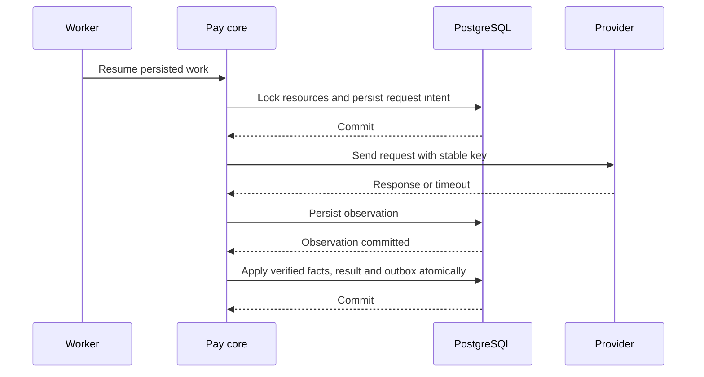

# XBuilder Pay 技术设计

XBuilder Pay 在统一的业务支付与退款模型下管理上游执行、资金事实和结果事件。支付核心以 PostgreSQL 保存可恢复的执行意图，通过上游适配器确认资金结果，并由 Pay Web 承载收银台和个人支付记录。

本文档定义 [XBuilder Pay](../product/pay.zh.md) 的数据模型、事务、上游接入、异步处理、API 和前端实现。Account 身份与资料访问遵循[自有 app 登记与接入设计](https://github.com/goplus/builder/blob/56d6d665d4f8701fe2e03ce5a0892f59e0510091/docs/product/account-app-integration.zh.md)及其[技术设计](https://github.com/goplus/builder/blob/56d6d665d4f8701fe2e03ce5a0892f59e0510091/docs/develop/account-app-integration.zh.md)。完整 OpenAPI 契约由 [`docs/openapi.yaml`](../openapi.yaml) 定义，并随接口实现与前端接入同步更新。

## 实现结构

Pay 后端作为 [goplus/builder-backend](https://github.com/goplus/builder-backend) 中的独立模块实现，复用 PostgreSQL、GORM、Redis、Asynq、管理鉴权和审计。HTTP 请求与后台任务调用同一套支付核心，不分别维护状态转换或金额规则。

| 模块 | 职责 |
| - | - |
| `internal/model` | Pay 持久化模型与数据库映射 |
| `internal/pay` | 接入授权、支付与退款规则、资金认领、异常处置和事件生成 |
| `internal/pay/providers` | 上游请求、签名、通知验证、金额转换和结果归一化 |
| `internal/controller` | 组织业务操作、生成 DTO，并组合管理事务与审计 |
| `cmd/xbuilder-backend` | HTTP 边界、依赖装配、任务注册和扫描器生命周期 |
| `internal/taskqueue` | Redis 任务调度，任务内容由 PostgreSQL 记录确定 |
| `internal/audit` | 管理操作审计 |
| `spx-gui/src/apis/pay` | Pay Web 与管理模块使用的 API adapters |
| `spx-gui/src/apps/pay` | Pay Web 的入口、路由、页面和付款交互 |

数据库连接、Account 访问、上游客户端、任务调度、时钟和密钥读取能力通过构造参数传入。上游调用和事件投递均在数据库事务之外执行，网络超时不能长期占用行锁。

## Account 接入

Pay 在每个部署环境中登记一个 Account app，并分别配置登录 client 和 app 自主访问 client。两个 clients 均为 confidential client，共用稳定的 `app.id`，凭证和授权用途分别管理。

| 用途 | Account 能力 | Pay 中的使用方式 |
| - | - | - |
| Pay Web 登录 | Authorization code flow、PKCE S256、`account:user:read` | 确认用户主体并创建 Pay session |
| App 登记资料 | App-only token、`account:app:read` | 查询 app 目录、校验登记关联并取得展示资料 |
| 用户资料 | App-only token、`account:user:read` | 按稳定 `user.id` 校验购买者并取得获准的资料 |

支付单的 `appID`、`businessAppID` 引用 Account `app.id`，OAuth client 的 `clientID` 用于 Pay 访问 Account。Client 或凭证轮换不改变支付归属。

Pay 后端拥有 Account 访问凭证，封装令牌申请、有效期内复用和资料查询。令牌失效时清除本地缓存并重新申请，权限不足时停止对应读取，不把失败降级为空资料或账号不存在。Account 返回 `429` 时保留有效令牌，按 `Retry-After` 延后后续资料请求。Pay 不直接读取 Account 数据表。

创建支付前，Pay 通过 `GET /account/users/{userID}` 确认购买者存在。`404` 表示目标不存在，认证、权限、限流或网络错误则作为依赖失败处理。调用方已创建资源的幂等恢复和历史资源读取不依赖重新查询 Account。

App 展示资料可以短期缓存，支付创建时保存业务来源的展示快照。当前 app 名称或图标读取失败时，历史记录继续使用快照。用户昵称和头像只用于展示，不参与资源归属、付款人匹配或资金授权判断。

Pay 的接入 app 使用 Pay API 凭证。它们不需要为了创建支付而申请 Account app-only token，也不会继承 Pay 的 Account 权限。

## 接入与上游配置

### App 配置与凭证

Pay 为已登记的 app 保存本地接入配置，包括操作权限、可代表的业务来源、来源读取范围、默认业务来源、业务链接 origins 和事件接收配置。配置与凭证由受控运维流程管理，变更和审计在同一事务中提交。

API 凭证使用 32 字节安全随机值，以无填充 Base64url 编码。服务端保存 SHA-256 哈希与展示前缀，只在创建时返回原值。凭证分别记录授权操作、到期时间和撤销时间，实际权限取凭证范围与 app 当前配置的交集。

轮换先创建新凭证并迁移调用方，旧凭证设置明确的到期时间，并在重叠期结束前撤销。

API 认证从主库校验凭证与接入配置，不缓存有效权限。创建和资金操作在业务事务中重新校验，以 app 配置共享锁协调停用与授权更新。多份凭证属于同一个 `appID`，不形成新的资源归属或幂等空间。

业务来源读取作为独立授权保存。资源查询把创建者与获准来源范围加入 SQL 条件，按 `reference` 恢复创建结果时只匹配调用 app 自己创建的资源。来源读取权限不参与关闭或退款授权。

### 商户账户

每个上游商户账户有稳定的本地 ID，绑定部署环境、上游、上游账户标识和收款主体。商户号、支付宝 APPID 或微信支付 APPID 不使用 Account `app.id`。

运行配置包含已开通的支付产品、币种与金额限制、API 版本、密钥与证书引用、通知入口和浏览器回跳入口。配置按版本发布，启动时校验账户身份、密钥可读性和产品配置，不把配置不完整的账户作为可用付款入口。

支付创建时固定收款主体和允许使用的账户范围。每次上游尝试进一步固定账户、支付产品、接口版本、业务参数和上游请求标识。账户身份不能原地替换，凭证轮换继续使用原账户。停用新交易入口后，已有交易的查询、关闭、退款和通知处理仍保留所需配置。

## 数据模型

SQL migrations 定义表结构。除 `pay_app` 和关联表外，各表使用 `id bigint` identity 主键、`created_at timestamptz` 和 `updated_at timestamptz`。时间由后端以 UTC 写入，非主键字段不设置数据库默认值。表中未标记可空的字段均为 `NOT NULL`。

业务枚举、金额和条件字段规则由 Pay 校验，数据库使用外键、唯一约束和非空约束保证关系完整性。Account 标识作为跨模块引用保存，存在性通过 Account 契约校验，不建立指向 Account 表的外键。

数据库金额使用 `bigint`，API 金额使用最小货币单位的整数。支付和退款请求金额范围为 `1` 至 `9007199254740991`，汇总金额允许为 `0`，并受币种与上游更严格的限制。金额格式化和解析使用整数运算，不经过浮点数。

每个启用币种记录 Pay 金额单位与上游金额单位的映射，上游观察先归一化再参与比较。币种和交易产品的特殊单位规则由适配器处理，见 [Stripe currencies](https://docs.stripe.com/currencies)。

### 接入配置

`pay_app` 以 `app_id bigint` 为主键，保存已在 Pay 配置的 Account app。它是本地接入配置，不分配另一套 app 标识。

| 字段 | PostgreSQL 类型 | 含义 |
| - | - | - |
| `status` | `smallint` | `active` 或 `disabled` |
| `operations` | `text[]` | 获准的业务 API 操作 |
| `business_app_ids` | `bigint[]` | 获准代表其创建支付的业务来源 |
| `readable_business_app_ids` | `bigint[]` | 获准读取的业务来源 |
| `default_business_app_id` | `bigint`，可空 | 省略业务来源时使用的 app |
| `allowed_origins` | `text[]` | 以该 app 为业务来源时允许的业务链接 origins |
| `event_endpoint` | `text`，可空 | 该接入 app 的事件接收地址 |
| `event_signing_key_refs` | `jsonb` | 当前签名密钥与轮换期间密钥的引用 |
| `created_at`、`updated_at` | `timestamptz` | 配置创建与更新时间 |

业务来源 app 可以只有链接规则，不持有 Pay API 凭证。默认业务来源必须属于 `business_app_ids`。允许创建支付的接入配置必须具备可用事件端点和签名密钥。

操作集合使用 `paymentRead`、`paymentCreate`、`paymentClose`、`refundRead` 和 `refundCreate`。读取操作仍受创建者或来源范围限制，关闭和退款只接受原创建者。接入 app 停用后停止新支付与新资金操作，保留的只读权限由配置明确授予，已有资金执行继续恢复。

`pay_app_credential` 保存 `app_id` 外键、管理名称、`token_hash`、`token_prefix`、`operations`、`expires_at` 和 `revoked_at`。后两个字段可空，分别表示未设置固定到期时间和未撤销。`token_hash` 建立唯一索引。

### 商户账户

`pay_merchant_account` 保存稳定的账户身份。

| 字段 | PostgreSQL 类型 | 含义 |
| - | - | - |
| `config_key` | `text` | 运行配置中的稳定账户键 |
| `provider` | `text` | `alipay`、`wechatpay` 或 `stripe` |
| `environment` | `text` | 上游测试或生产环境 |
| `provider_account_id` | `text` | 上游商户或账户标识 |
| `legal_entity_key` | `text` | 对应收款主体 |

`config_key` 和 `(provider, environment, provider_account_id)` 分别建立唯一索引。密钥原值不进入该表。

### 支付单

`pay_payment` 保存接入 app 使用的业务资源。

| 字段 | PostgreSQL 类型 | 含义 |
| - | - | - |
| `app_id` | `bigint` | 创建者，关联 `pay_app.app_id` |
| `business_app_id` | `bigint` | 业务来源，关联 `pay_app.app_id` |
| `user_id` | `bigint` | 购买者的 Account 用户 ID |
| `reference` | `text` | 创建者分配的稳定关联 |
| `amount` | `bigint` | 应收金额 |
| `currency` | `text` | 大写币种代码 |
| `description` | `text` | 购买说明 |
| `business_snapshot` | `jsonb` | 业务来源的名称、图标等展示快照 |
| `collection_context` | `jsonb` | 固定的收款主体、允许账户范围与配置版本 |
| `return_url`、`details_url` | `text`，可空 | 业务导航 |
| `status` | `smallint` | `pending`、`closing`、`succeeded` 或 `closed` |
| `expires_at` | `timestamptz` | 停止新付款交互的时间 |
| `close_requested_at` | `timestamptz`，可空 | 首次关闭意图 |
| `normal_receipt_id` | `bigint`，可空 | 已认领正常收款的外键 |
| `paid_at` | `timestamptz`，可空 | 正常收款的上游发生时间 |
| `refunded_amount`、`refunding_amount` | `bigint` | 业务退款汇总 |
| `version` | `bigint` | 业务表示版本，初始为 `1` |

建立 `(app_id, reference)` 唯一索引和非空 `normal_receipt_id` 唯一索引。前者承担创建幂等，后者防止同一收款被多个支付单认领。正常收款还必须属于当前支付的已核实交易关联。

列表索引分别覆盖 `(app_id, created_at, id)`、`(business_app_id, created_at, id)` 和 `(user_id, created_at, id)`。可退金额从状态和两个退款汇总计算，不另存一份可退余额。

### 收银台

`pay_checkout` 与支付单一对一，单独保存入口凭证和交互状态。

| 字段 | PostgreSQL 类型 | 含义 |
| - | - | - |
| `payment_id` | `bigint` | 支付单外键，唯一 |
| `token_hash` | `bytea` | 收银台凭证哈希，唯一 |
| `token_ciphertext` | `bytea` | 用于恢复相同入口的加密凭证 |
| `encryption_key_id` | `text` | 加密密钥版本 |
| `origin` | `text` | 创建时使用的 Pay Web origin |
| `expires_at` | `timestamptz` | 凭证到期时间 |
| `revoked_at` | `timestamptz`，可空 | 凭证撤销时间 |
| `options` | `jsonb` | Opaque 付款选项与账户、产品配置的映射 |
| `selected_option_id` | `text`，可空 | 当前请求使用的付款选项 |

收银台凭证使用 32 字节安全随机值。查询时按哈希定位记录，返回 `checkoutURL` 时解密原凭证并使用已保存的 origin 构造 URL。加密使用 AES-256-GCM，保存独立随机 nonce，并以部署标识和收银台 ID 作为 additional authenticated data。密文和 nonce 一并编码到 `token_ciphertext`，旧密钥保留至关联凭证完成重新加密或不再需要恢复。

支付单读取和幂等重试始终返回同一入口，不因读取重新生成凭证。收银台凭证到期或撤销后，业务响应仍可以保留该 URL，但入口不再授权读取或付款。凭证有效期覆盖支付期限和结果查看期，付款能力同时受支付单的 `expires_at` 与状态约束。

### 支付尝试

`pay_payment_attempt` 保存独立跟踪的上游收款请求。

| 字段 | PostgreSQL 类型 | 含义 |
| - | - | - |
| `payment_id` | `bigint` | 支付单外键 |
| `merchant_account_id` | `bigint` | 商户账户外键 |
| `product` | `text` | 具体上游支付产品 |
| `request_key` | `text` | 稳定的商户订单号或创建幂等键 |
| `retry_safe_until` | `timestamptz`，可空 | 上游明确限制幂等保留时间时的安全重发边界 |
| `request_params` | `jsonb` | 固定的上游业务参数、API 版本和配置关联 |
| `provider_object_id` | `text`，可空 | 上游主对象 ID |
| `provider_data` | `jsonb` | 相关资金对象 ID 和已验证的执行状态 |
| `status` | `smallint` | `prepared`、`unknown`、`payable`、`processing`、`succeeded` 或 `ended` |
| `create_started_at` | `timestamptz`，可空 | 创建请求进入可能已发出阶段的时间 |
| `close_requested_at` | `timestamptz`，可空 | 结束该尝试的意图 |
| `ended_at` | `timestamptz`，可空 | 已确认不能继续收款的时间 |

建立 `(merchant_account_id, request_key)` 唯一索引，以及非空 `(merchant_account_id, provider_object_id)` 唯一索引。支付尝试建立 `(payment_id, id)` 索引，用于查找仍需协调的执行。

`request_params` 不保存密钥或银行卡资料，签名时间等可更新的协议字段不改变业务参数与幂等标识。

`prepared` 表示尚未允许发出请求，`unknown` 表示创建可能已执行但结果未确认。`ended` 只能由已核实的结束事实确认，不能由任务重试次数或租约到期推导。同一支付单最多存在一个未结束且未成功的尝试，通过取得支付单行锁后检查并创建保证。

### 收款与资金记录

`pay_receipt` 保存已核实的上游收款及其业务关联。Pay 在该记录上加锁，协调收款认领与退款执行。尚未确定业务归属的收款也先保存。

| 字段 | PostgreSQL 类型 | 含义 |
| - | - | - |
| `merchant_account_id` | `bigint` | 收款账户外键 |
| `provider_transaction_id` | `text` | 上游资金交易 ID |
| `amount`、`currency` | `bigint`、`text` | 实际收款金额与币种 |
| `occurred_at` | `timestamptz` | 上游收款发生时间 |
| `payment_id` | `bigint`，可空 | 已核实关联的支付单外键 |
| `payment_attempt_id` | `bigint`，可空 | 已核实关联的支付尝试外键 |
| `refunds_blocked` | `boolean` | 是否暂停新的退款执行 |

`(merchant_account_id, provider_transaction_id)` 建立唯一索引，`(payment_id, id)` 索引用于交易追溯。收款事实的金额、币种和上游身份不因业务匹配或退款变化而修改。

`pay_funds_record` 追加保存实际资金事实。

| 字段 | PostgreSQL 类型 | 含义 |
| - | - | - |
| `merchant_account_id` | `bigint` | 商户账户外键 |
| `fact_key` | `text` | 适配器为该次资金事实确定的稳定唯一标识 |
| `kind` | `text` | 收款、退款、退款退回、争议或其他资金调整 |
| `direction` | `smallint` | 相对商户的资金流入或流出 |
| `amount`、`currency` | `bigint`、`text` | 实际资金金额与币种 |
| `occurred_at` | `timestamptz` | 上游发生时间 |
| `receipt_id` | `bigint`，可空 | 实际收款外键 |
| `refund_attempt_id` | `bigint`，可空 | 退款尝试外键 |
| `provider_inbox_id` | `bigint` | 资金证据的接收记录外键 |

`(merchant_account_id, fact_key)` 建立唯一索引。`fact_key` 根据上游交易和资金变化确定，不使用通知事件 ID 代替。例如，同一退款成功与其后续退回是两条资金事实，同一成功被通知、查询和账单重复确认则仍是同一事实。

资金记录建立 `(receipt_id, occurred_at, id)` 与 `(refund_attempt_id, id)` 索引，支持交易追溯与持锁期间的资金核算。

经济事实不覆盖或删除。后续退回、冲正和强制调整追加新记录，业务关联经核实后可以补充并保留操作记录。上游暂扣与中间账户状态保存在执行证据中，不作为退款成功事实。

### 业务退款与退款尝试

`pay_refund` 保存业务退款请求。

| 字段 | PostgreSQL 类型 | 含义 |
| - | - | - |
| `payment_id` | `bigint` | 原支付单外键 |
| `reference` | `text` | 创建者分配的退款关联 |
| `amount` | `bigint` | 本次业务退款金额 |
| `reason` | `text` | 业务退款原因 |
| `status` | `smallint` | `pending`、`succeeded` 或 `failed` |
| `completed_at` | `timestamptz`，可空 | 终态确认时间 |
| `version` | `bigint` | 业务表示版本，初始为 `1` |

`(payment_id, reference)` 建立唯一索引。创建者、业务来源、用户和币种由原支付确定，响应通过原支付关联取得，不能由退款请求重新指定。

`pay_refund_attempt` 复用于业务退款和异常处置。

| 字段 | PostgreSQL 类型 | 含义 |
| - | - | - |
| `receipt_id` | `bigint` | 实际收款外键 |
| `merchant_account_id` | `bigint` | 原收款的商户账户 |
| `refund_id` | `bigint`，可空 | 业务退款单外键 |
| `anomaly_id` | `bigint`，可空 | 异常处置外键 |
| `amount` | `bigint` | 本次上游尝试执行的金额 |
| `request_key` | `text` | 稳定的上游退款请求号或幂等键 |
| `retry_safe_until` | `timestamptz`，可空 | 上游限制幂等保留时间时的安全重发边界 |
| `request_params` | `jsonb` | 固定的退款参数、账户和接口配置关联 |
| `provider_object_id` | `text`，可空 | 上游退款对象 ID |
| `provider_data` | `jsonb` | 已验证的上游状态与关联 |
| `status` | `smallint` | `prepared`、`unknown`、`processing`、`succeeded` 或 `ended` |
| `submit_started_at` | `timestamptz`，可空 | 请求进入可能已发出阶段的时间 |
| `ended_at` | `timestamptz`，可空 | 已确认旧执行终结的时间 |

创建时必须且只能关联业务退款或异常处置之一。异常处置关联的原业务退款保存在异常记录中，不能因此把内部退款计入业务退款汇总。上游账户从原收款取得，`pay_receipt` 增加 `(id, merchant_account_id)` 唯一约束，退款尝试通过复合外键绑定同一账户。`(merchant_account_id, request_key)` 和非空 `(merchant_account_id, provider_object_id)` 分别建立唯一索引。

退款尝试分别为 `receipt_id`、`refund_id` 和 `anomaly_id` 建立关联查询索引，金额预占和退款恢复均在原收款锁下读取相关执行。

### 异常

`pay_anomaly` 保存异常类型、稳定的 `cause_key`、`status`、`version`，以及可空的支付单、业务退款、收款、支付尝试和退款尝试外键。`cause_key` 包含异常类型、账户及对应资金事实或执行关联，建立唯一索引，用于把同一原因的重复检测合并到同一记录。

状态使用 `processing` 和 `resolved`。核对任务、处置进度和用户摘要随该异常自己的版本更新，不修改原支付或终态退款。`pay_anomaly_funds_record` 以 `(anomaly_id, funds_record_id)` 为复合主键，关联该异常的资金事实。

建立 `(payment_id, created_at, id)` 索引用于个人详情和支付排障，建立 `(status, updated_at, id)` 索引用于查询未解决异常。

用户摘要只从已核实的购买者归属、资金异常类型和实际资金关联生成。未知执行、事件投递等运维异常不进入个人记录。需要向用户展示的退款进度从关联资金与仍在途的内部尝试计算，不直接使用业务退款金额或上游原始状态。

### 上游接收与事件投递

| 表 | 主要字段与约束 |
| - | - |
| `pay_provider_inbox` | 商户账户、来源类型、`message_key`、可空支付关联、上游对象与请求关联、加密证据、密钥版本、接收时间、处理时间和错误摘要，`(merchant_account_id, message_key)` 唯一 |
| `pay_event` | 接入 app、支付单、可空业务退款、事件类型、资源版本和已序列化的 `body bytea`，每个业务资源只允许一条结果事件 |
| `pay_event_delivery` | 事件外键、接收地址快照、投递状态、重试次数、下次投递时间和最近结果 |
| `pay_event_delivery_attempt` | 投递外键、本次请求时间、签名密钥版本、HTTP 结果和安全错误摘要 |

通知、主动查询和账单结果都先保存为上游接收记录，再进入统一的事实处理入口。通知按上游事件标识去重，没有事件标识时使用已验证消息的稳定摘要。查询和账单记录分别关联查询操作或账单行。原始通知加密保存，验签结论、证书或公钥标识与证据一起保留，管理审计只记录相关资源 ID、请求标识和处理结果。

`pay_event` 的结果唯一性分别通过支付事件的 `payment_id` 部分唯一索引和退款事件的 `refund_id` 部分唯一索引保证。事件正文、类型、资源关联和生成时间在创建后保持不变，投递进度保存在独立表中。

投递与投递尝试分别为 `event_id` 和 `delivery_id` 建立关联查询索引，事件建立 `(app_id, created_at, id)` 索引支持按接入 app 排障。

### 后台工作

`pay_work` 保存可恢复的工作调度。

| 字段 | PostgreSQL 类型 | 含义 |
| - | - | - |
| `kind` | `text` | 工作类型，决定关联资源与处理入口 |
| `resource_id` | `bigint` | 该类工作对应的资源 ID |
| `requested_version` | `bigint` | 最新的工作请求版本 |
| `processed_version` | `bigint` | 已处理的工作请求版本 |
| `next_run_at` | `timestamptz`，可空 | 下次应处理时间，空表示没有待执行工作 |
| `lease_generation` | `bigint` | 每次领取递增的租约代次 |
| `lease_expires_at` | `timestamptz`，可空 | 领取租约到期时间 |
| `last_error` | `text`，可空 | 安全错误摘要 |

建立 `(kind, resource_id)` 唯一索引，以及 `next_run_at IS NOT NULL` 的到期扫描索引。创建或推进业务资源的事务同时创建或唤醒工作记录。调度版本只协调后台工作，不作为业务 `version` 返回。

| `kind` | 关联资源 | 职责 |
| - | - | - |
| `payment` | 支付单 | 到期、关闭与尝试协调 |
| `paymentAttempt` | 支付尝试 | 上游创建、查询与关闭 |
| `refund` | 业务退款 | 准备退款尝试与确认整体结果 |
| `refundAttempt` | 退款尝试 | 上游退款与结果恢复 |
| `anomaly` | 异常 | 核实归属与推进内部退款 |
| `providerInbox` | 上游接收记录 | 应用经过验证的上游输入 |
| `eventDelivery` | 事件投递 | 发送事件与恢复投递 |
| `reconciliation` | 对账记录 | 下载、解析与核对交易 |

`pay_reconciliation` 保存账户、对账时间范围、上游账单标识与校验值、处理游标和结果。其工作由 `pay_work` 调度，账户与账期建立唯一关联，重复下载和重复解析通过资金事实唯一键去重。

### Pay Web 身份

`pay_auth_flow` 保存 `state_hash`、`browser_binding_hash`、`verifier_ciphertext`、`encryption_key_id`、`return_path`、`expires_at` 和可空的 `consumed_at`。哈希与密文使用 `bytea`，密钥 ID 和路径使用 `text`，时间使用 `timestamptz`。`state_hash` 建立唯一索引，流程最多有效 10 分钟。

`pay_session` 保存 `user_id bigint`、`token_hash bytea`、`profile_snapshot jsonb`、`expires_at timestamptz` 和可空的 `revoked_at timestamptz`。资料快照使用成功读取的 `AccountUser`。Session token 使用 32 字节安全随机值，`token_hash` 唯一，`expires_at` 建立清理索引。生命周期由 Pay 的固定 session 有效期决定，不受每次页面访问自动延长。

## 事务与执行

### 锁顺序与业务表示

业务事务使用 PostgreSQL `READ COMMITTED`，以资源行锁串行化相关操作。统一顺序为 app 配置、API 凭证、支付单、收银台、收款、业务退款、支付尝试、退款尝试和异常。没有相应资源时跳过该层，多笔 app 配置按 `app_id` 排序，其他同类记录按 ID 排序加锁。接收完成标记、事件和工作记录在业务变更后写入，并与业务变更在同一事务中提交。

有效期与权限在取得相关锁后按当前时间重新检查，不能使用等待锁之前的时间判断是否仍可发起操作。

上游输入处理可以先读取关联 ID，再按该顺序取得锁并重新校验。补充业务关联时，如果加锁后发现关联与先前读取的结果不一致，应结束当前事务，再按新的关联重新处理，不能反向加锁。未关联收款先独立保存，匹配业务资源使用新的事务。后台工作租约在短事务中领取，不在持有工作行锁时进入业务事务。

`pay_payment.updated_at`、`pay_refund.updated_at` 和 `version` 只在业务表示改变时更新。后台调度、上游查询、异常关联和内部退款更新各自记录，不能触发 GORM 自动刷新业务资源时间。业务写入入口显式维护业务时间与版本。

支付终态不再转换，但成功支付的业务退款汇总仍可变化。`closed` 支付的业务表示、终态业务退款的结果与金额保持不变。事件序列化、金额汇总和状态更新使用同一次事务中的数据。

### 创建支付与收银台交互

1. 验证 Pay 凭证与参数格式，先按 `(appID, reference)` 查找已有支付
2. 已存在时比较不可变创建参数，匹配则返回原资源，不重复查询 Account 或创建收银台
3. 新请求校验业务来源授权、购买者、业务 URL、金额与可用收款账户，确定有效期和展示快照
4. 事务中重新校验接入配置，使用 `ON CONFLICT (app_id, reference) DO NOTHING` 插入支付单
5. 插入成功后创建收银台与到期处理工作，一并提交。未插入时读取已有支付，比较创建参数后返回原资源或冲突

默认业务来源和默认有效期只在首次创建时确定。对已有资源重试时，省略这些字段沿用原值，其余创建参数仍完整比较。`reference` 区分大小写，不裁剪、改写或复用。`returnURL`、`detailsURL` 和 `description` 也属于创建参数。

收银台查询只读取摘要与当前交互，不创建上游交易。付款选项使用随机的 opaque `optionID`，只在该收银台内有效，不形成独立付款方式资源。发起交互时，在支付单与收银台锁下重新验证状态、期限和选项配置，再创建或复用尝试并唤醒工作。

同一有效选项的并发请求复用现有尝试。切换到其他选项时，先记录目标选项并结束旧尝试，确认旧执行不能继续收款后才创建新尝试。等待期间返回处理中，不能同时返回两份仍可付款的交互。

### 上游调用与未知结果

上游请求标识独立生成并满足对应产品的长度与字符集要求，不直接复用接入 app 的 `reference`。创建和退款分别保存请求标识，关闭始终针对原上游对象，重试同一操作时保持原关联与业务参数。

每次有资金影响的上游操作在发出前持久化业务参数、稳定请求标识和可能已执行状态。工作进程取得执行资格后重新校验支付关闭意图、期限或退款约束，提交事务后才执行网络请求。



请求超时、进程退出或无法确定是否发送时保持未知。恢复优先按已保存的对象 ID 或商户请求号查询，只有处于上游幂等保证范围内才使用原标识和原业务参数重发。SDK 自动重试必须服从同一规则，不能隐式产生新请求号或越过安全窗口。

租约过期只允许其他进程接管核对，不证明旧请求不会到达上游。旧工作进程不能凭过期租约提交执行状态，但其返回的有效资金证据仍进入统一事实处理。更换尝试或提交终态前，必须处理所有可能已发出的请求，不能仅依赖任务是否仍在运行。

上游查询暂未找到交易只构成一次观察。对于延迟创建、浏览器持有的签名付款请求或仍未知的服务器调用，需要结合该产品对请求有效期和订单关闭的保证确认旧入口失效。无法证明时继续查询、保留关闭或退款中的状态并告警。

### 收款认领与关闭

处理已验证且已关联的收款时，先按统一顺序锁定支付单与收款，在同一事务中按资金唯一键查重。命中已有事实时核对账户、事实类型、金额和币种，一致则复用原记录，冲突则保留输入证据并进入异常核对。

同一正常收款的重复确认在事实一致时幂等处理，不再次认领或生成异常。

尚未认领正常收款且支付仍为 `pending` 或 `closing` 时，校验账户、业务关联、金额和币种。校验通过后，在同一事务中保存资金记录和正常收款关联，更新支付单的状态、退款汇总、版本与付款时间，并写入 `payment.succeeded` 事件与投递工作。

支付已认领另一笔收款、已经 `closed` 或资金与预期不符时，保留实际收款并生成对应异常。正常认领和关闭提交都持有支付单更新锁，不能同时成功。额外收款不覆盖 `normal_receipt_id`，也不更新业务金额。

关闭请求先持久化 `closing` 和关闭意图，再由后台结束全部尝试。尚未允许发出的 `prepared` 尝试可以在锁下直接结束，可能已发出的创建请求必须先恢复。关闭工作只有在全部尝试不可继续收款且没有可认领正常收款时，才提交 `closed` 与 `payment.closed` 事件。

关闭核对同时检查已保存资金与尚未处理的关联上游输入。存在待处理资金证据时先推进事实处理，不能仅凭一次关闭响应跳过已经接收的成功信息。

关闭核对期间收到正常成功优先认领。终态提交后才确认的真实收款按异常处理，不根据上游发生时间倒写业务终态。已经 `succeeded` 的关闭请求返回状态冲突，重复关闭 `closing` 或 `closed` 资源不创建新的业务结果。

### 业务退款

创建退款先验证创建者和操作权限，再取得支付单与正常收款更新锁。按 `(paymentID, reference)` 查重，参数一致时返回原退款，不一致时返回冲突。新请求在同一事务中校验业务可退金额和实际资金约束、插入退款单、增加 `refunding_amount` 并唤醒执行工作，预占整笔业务请求金额。

同一实际收款的退款尝试串行发起，统一考虑业务退款和内部退款。发出前核对已退用户净额、仍可能退付的金额、上游剩余可退额度和调用间隔。未知尝试持续占用其金额，不能以换请求号方式绕过。

成功支付的业务可退额度与实际收款的退款额度分别核算：

```text
businessRefundableAmount = paymentAmount - refundedAmount - refundingAmount
receiptRefundCapacity = receiptAmount - netReturnedToPayer - pendingReturnAmount
```

`netReturnedToPayer` 根据退款成功和后续退回事实计算，`pendingReturnAmount` 只包含尚未由成功资金事实覆盖的在途金额。上游中间账户状态不增加已退用户净额。实际收款暂停退款、存在争议或资金差异时，停止新的退款提交并核对，不能为了满足公式删除已发生事实。

退款成功确认需要覆盖请求的全部金额。部分实际退付仍保持 `pending`，已完成部分保留资金关联，恢复只执行尚未完成部分。确需新建上游尝试时先确认旧尝试结束，并重新检查上游是否允许继续执行。

确认 `succeeded` 时，将整笔预占从 `refunding_amount` 转入 `refunded_amount`。确认 `failed` 时释放预占。两者均在原支付与退款锁下更新退款终态、支付汇总和各自版本，并写入唯一的退款结果事件。确认失败还要求没有已退部分、没有在途执行且不再继续恢复。

终态退款不再参与原请求执行。相同 `reference` 返回原结果，新 `reference` 是重新校验的新业务退款。失败后核实到实际退付，或成功后资金被退回时，保存事实、生成异常并暂停受影响的未发出执行，后续按实际资金核对恢复，不回写终态退款。

### 异常资金处置

每笔异常收款按实际收款单独计算可退和在途金额，不能使用业务支付的预期金额。内部退款绑定异常与实际收款，复用退款执行入口，使用持久化的上游请求标识，不创建业务退款或接入 app 的 `reference`。

补足原业务退款时，通过异常保留原退款关联，核对旧退付、资金退回和其他在途退款后确定剩余金额。异常恢复不能让已退款金额重复累计，也不能把资金退回商户直接视为已退用户。

异常只有在归属、资金和必要处置均已核实时才能解决。自动恢复无法完成时保留处理状态和证据，由授权人员按上游流程处置。管理操作不能直接填写支付或退款成功状态。

上游后台直接创建的退款或其他无法匹配 Pay 执行的退付同样保存证据并暂停该收款的新退款。`refunds_blocked` 期间先恢复查询与资金核对，确认安全后在原收款锁下预占处置所需金额并执行关联内部退款，其他新退款继续等待阻断解除。

只有相关阻断原因全部核实后才能解除 `refunds_blocked`，单个异常解决不能覆盖其他仍在处理的资金风险。

## 上游适配

### 适配边界

适配器按商户账户构造，提供创建与查询支付、结束付款入口、提交与查询退款、验证通知和读取账单的能力。输入使用已持久化的请求标识与固定业务参数，输出区分已确认事实、可继续交互、仍在处理、明确结束和结果未知。

不同产品对创建与关闭的保证由各自适配器表达，支付核心不把所有 `404`、HTTP 2xx 或同名上游状态作统一解释。浏览器交互数据使用受限 DTO，不能把完整上游响应或可执行 HTML 直接传给前端。

业务说明与退款原因在 Pay 中完整保存。生成固定上游参数时，适配器分别处理标题长度、UTF-8 字节限制和退款原因枚举，必要时截取适合上游展示的文本，不改变本地创建参数或资金金额。

Stripe 使用[官方 Go SDK](https://docs.stripe.com/sdks)，微信支付使用[官方 APIv3 SDK](https://pkg.go.dev/github.com/wechatpay-apiv3/wechatpay-go)，支付宝使用 [`smartwalle/alipay/v3`](https://pkg.go.dev/github.com/smartwalle/alipay/v3) 提供的协议与签名能力。SDK 版本在实现依赖中锁定，上游 API 与 webhook 版本显式配置，SDK 重试和错误类型经适配器归一化后使用。

### 产品能力与期限

各产品分别声明币种、最小与最大金额、创建有效期、付款入口有效期、关闭保证、退款期限、退款次数和调用间隔。支付选项根据固定账户范围与当前条件筛选，不把某一家产品的限制作为所有上游的共同限制。

创建新尝试时，必须能把上游付款入口限制在该支付剩余期限内。精度不同的到期时间向更早的有效边界取整，不能延长 Pay 期限。不满足上游最短有效期时停止提供该交互，已有尝试则按已保存关联继续查询或关闭。

### 支付宝

Web 付款按商户已开通的电脑网站支付或手机网站支付产品生成付款入口，使用 Pay 分配的稳定 `out_trade_no`。金额以整数格式化为元的十进制字符串，收款校验使用交易金额及实际卖家身份，不能把用户实付与优惠分摊字段直接替代交易总额。

支付查询和关闭分别使用 `alipay.trade.query` 与 `alipay.trade.close`。签名付款入口交给浏览器后，即使查询交易尚不存在，也不能认定该入口不能再创建交易。适配器必须按对应产品设置并校验绝对到期约束，不能只依赖从实际下单开始计算的相对超时。

退款使用 `alipay.trade.refund`，查询使用 `alipay.trade.fastpay.refund.query`。每次尝试持久化 `out_request_no`，超时或异常重试沿用原值。`code=10000` 只表示请求成功，`fund_change=Y` 或进一步查询核实后才能确认退付，不能把重试时的 `fund_change=N` 直接解释为失败，见[支付宝退款接口](https://aipay.alipay.com/docs/vibe-pay/ai-web-app-payment-qianyi/api-list/alipay-trade-refund.html)。

### 微信支付

第一期 Web 接入以 Native 扫码和已开通的 H5 产品为范围，分别使用对应的下单接口。没有开通或不满足当前浏览器条件的产品不返回为付款选项。JSAPI 所需的微信身份交互不隐式包含在 Native 或 H5 适配中。

按商户订单号恢复创建结果，保存微信支付交易号，并核对商户号、APPID、总金额和币种。关闭请求与支付结果存在竞争时，以查询和通知确认资金。订单不存在不能单独证明在途创建已结束。H5 所需客户端 IP 从受信代理上下文解析，不使用浏览器任意声明的值。

退款使用原收款交易与稳定的 `out_refund_no`。`PROCESSING` 和 `ABNORMAL` 保持业务退款 `pending`，后者进入异常核对。`SUCCESS` 按上游契约确认成功，`CLOSED` 还需核实未退付和资金返回后才能结束旧执行。需要特殊退款时按微信支付流程处理，不把中间账户资金当作已经返还用户。

退款期限、次数、调用间隔和异常退款要求依照[微信支付退款指引](https://pay.wechatpay.cn/doc/v3/merchant/4013071031)记录在产品能力配置中，由 Pay 串行执行和校验。

### Stripe

使用一次性支付的 Checkout Session，按[官方内嵌收银台](https://docs.stripe.com/checkout/embedded/quickstart)模式加载 Stripe 组件。Session 由后端创建，`mode` 为 `payment`，金额直接来自 Pay 支付单。不启用折扣、税费计算、可调整数量或币种自动转换，避免改变已经确定的业务应收金额。

Session 与其 PaymentIntent 都保存 Pay 尝试关联，后续 Charge 作为实际收款关联。元数据用于恢复查找，不能单独证明资金或证明对象不存在。组件只取得当前会话所需的 publishable key 和 client secret，服务端 API key 不进入浏览器。回跳先进入 Pay，不直接指向业务 `returnURL`。

`checkout.session.completed` 不能单独映射为支付成功。适配器确认实际收款状态、已收金额和币种，处理异步付款成功与失败。Session 到期或结束后，还要核对已关联的资金对象。正在处理且无法取消的付款继续保持未知或处理中，见 [Session expiration](https://docs.stripe.com/api/checkout/sessions/expire) 和 [PaymentIntent cancellation](https://docs.stripe.com/api/payment_intents/cancel)。

退款绑定实际 Charge，持久化独立的退款幂等键和退款 ID。`pending`、`requires_action` 不作为业务失败。确认成功后发生退款资金退回时追加事实并进入异常恢复，见 [Stripe refunds](https://docs.stripe.com/refunds)。

Stripe API v1 的幂等结果存在保留窗口，可能保留首次执行的错误结果。适配器记录首次可能发送时间和安全重试边界，超过窗口后只查询、接收事件或对账，不重放未知创建请求，见 [Stripe idempotent requests](https://docs.stripe.com/api/idempotent_requests)。

## 异步处理与对账

### 工作恢复

业务事务先写入 `pay_work`，提交后再尝试入队。扫描器从主库查找已到期工作并恢复调度，Redis 不可用或入队失败不删除工作。Asynq 使用 `pay` namespace，任务 ID 统一使用 `pay_work.id`，避免不同业务表的同值主键发生冲突。

工作领取使用短事务和 `FOR UPDATE SKIP LOCKED`，记录租约代次及本次读取的工作版本。执行完成后只在租约仍有效时更新调度结果。执行期间有新的唤醒时，不能用旧版本的完成结果清除新工作。等待上游处理的工作持久化下次时间后退出，不占用进程内长期定时器。

队列重试结束不结束资金恢复。扫描器识别已归档或已完成的队列项，清理后重新调度仍未完成的数据库工作，不能把队列中存在某个 ID 等同于该工作还会执行。投递与资金执行分队列，接收方超时不占满支付处理能力。

上游限流、暂时错误和查询等待使用有上限的退避与抖动。安全重试窗口、业务期限和人工处置条件独立判断，不能用统一最大重试次数决定支付关闭或退款失败。

### 通知接收

HTTP 边界限制请求体大小，保留原始字节并完成签名、时间窗口和必要解密验证。验证配置从该上游的受控账户集合中选择，最终必须唯一匹配账户与环境。支付宝核对签名中的 app 与卖家身份，微信支付核对解密后的商户身份，Stripe 核对该账户端点的签名密钥及测试或生产模式。

签名无效或无法解密的消息按对应协议拒绝。验签通过但账户或交易关联冲突的输入保存证据并进入核对，不直接认领为正常业务资金。

有效通知在事务中插入 inbox 并唤醒处理工作，提交后才返回上游要求的成功应答。重复消息命中已有持久化记录时可以成功应答，同标识而内容冲突则保留并告警，不能覆盖原证据。处理进程在业务事务中应用事实并标记 inbox 完成，失败时回滚并恢复处理。

通知事件 ID 去重和资金事实去重分别执行。乱序消息不能按接收时间覆盖状态，必要时主动查询当前上游对象，同时保留历史资金事实。回跳参数只用于恢复收银台关联，不经过资金确认入口直接更新业务成功。

### 业务事件

终态事务同时写入 `pay_event`、初始投递记录和工作。投递读取已保存的正文原始字节，使用接入 app 独立的签名密钥，按 [Standard Webhooks](https://github.com/standard-webhooks/standard-webhooks/blob/main/spec/standard-webhooks.md) 生成 `webhook-id`、`webhook-timestamp` 和 `webhook-signature`。

签名选择 HMAC-SHA256，输入为事件 ID、本次 Unix 时间戳和正文原始字节按规范连接的结果。接收方校验签名与投递时间窗口后再解析 JSON，持久化去重记录并可靠接收后才返回 2xx。

事件使用 `id`、`type`、`createdAt` 和 `data`。支付事件的 `data` 包含支付单 ID、创建与更新时间、`appID`、`businessAppID`、`userID`、`reference`、金额、币种、说明、状态、退款汇总、付款时间、到期时间和版本。退款事件的 `data` 使用 `PayRefund`，通过 `paymentID` 关联原支付。收银台凭证与业务导航 URL 不进入事件正文，重投不重新查询并序列化业务资源。

同一次投递的自动重试使用相同接收地址快照，每次发送追加投递尝试并生成新的签名时间戳。密钥使用发送时生效的轮换集合，密钥轮换不改变正文。管理员重投创建新的投递记录，使用当前获准的接收地址并保留原事件。

仅 HTTP 2xx 表示接收成功。网络错误和非 2xx 按退避策略恢复，持续失败后告警并保留重投入口。每次 HTTP 请求有固定超时与响应体读取上限，不在收到响应前持有业务锁。

事件客户端复用 `safehttpclient` 的实际连接 IP 校验，并禁止重定向。端点必须为受控 HTTPS URL，不能依赖配置时的一次 DNS 检查防止 SSRF。HTTP tracing 显式将 `webhook-signature` 作为敏感头处理，并关闭请求与响应正文采集。事件签名值、密钥和接收方完整响应体不进入日志。

### 对账

扫描器持续处理未结束尝试、`closing` 支付、`pending` 退款和未解决异常。按账户执行增量交易核对与日账单核对，保存时间范围、账单版本和处理游标。时间范围保留重叠，重复观察通过资金唯一键去重，账单延迟生成时继续恢复。

对账覆盖全部资金记录，包括无法关联业务资源的有效资金、内部退款、退款退回、争议和强制调整。手续费与结算净额单独核对，不能与用户交易金额直接比较。

发现缺失资金时先保存上游证据，再使用与通知相同的事实处理入口恢复。金额、币种或归属冲突时保存实际事实并生成异常，不用预期金额替换上游金额。历史业务终态不因对账被改写。

## API 与前端接入

### 业务资源

`PayPayment` 沿用产品设计中的字段。可选业务 URL 使用 `null` 表示未提供，`paidAt` 在正常收款确认后返回时间，否则为 `null`。业务来源展示使用保存的快照，由 Pay 统一提供给收银台和记录页面。

`PayRefund` 返回 `id`、`createdAt`、`updatedAt`、`paymentID`、`appID`、`businessAppID`、`userID`、`reference`、`amount`、`currency`、`reason`、`status`、`completedAt` 和 `version`。内部尝试和异常字段不进入这两个业务 DTO。

```json
{
  "id": "601",
  "createdAt": "2026-10-31T09:00:00+08:00",
  "updatedAt": "2026-10-31T09:00:00+08:00",
  "paymentID": "501",
  "appID": "20",
  "businessAppID": "1",
  "userID": "123",
  "reference": "refund_20261031_0001",
  "amount": 3000,
  "currency": "CNY",
  "reason": "Partial purchase refund",
  "status": "pending",
  "completedAt": null,
  "version": 1
}
```

创建支付和退款首次成功返回 `201`，参数一致的幂等重试返回 `200` 和当前业务资源。关闭返回 `200` 和当前支付。列表使用 `pageIndex`、`pageSize` 和 `{ total, data }`，按 `createdAt`、`id` 降序排序，分页始终带上调用身份范围。

`reference` 最长 128 个 Unicode code points，`description` 最长 200 个，`reason` 最长 500 个，均为非空纯文本且首尾不含空白。ID 使用正 int64 的十进制字符串。URL 解析后按对应业务来源的 HTTPS origin 校验，不接受 userinfo 或长期凭证。

错误沿用 `APIError` 与现有错误码。参数错误使用 `40001`，认证与权限错误使用 `40100`、`40300`，资源不存在或不在可读范围使用 `40400`，创建参数冲突、状态或退款额度冲突使用 `40900`。请求限流使用 `42900`，依赖或内部执行失败使用 `50000`。已经持久化且仍在处理的资金请求通过资源状态表达，不作为网络失败要求调用方重新创建。

### 请求限流

请求限流复用 `internal/ratelimit` 的 Redis 计数，按接口操作配置窗口和额度。

| 接口 | 计数身份 |
| - | - |
| 接入 app API | 从有效 Pay API 凭证确定的 `appID` |
| 收银台查询与付款交互 | 从有效收银台凭证确定的收银台 ID |
| 个人查询 | 从有效 Pay session 确定的用户 ID |

同一身份的不同凭证或 session 在所有 Pay 后端实例上共用计数。这些接口通过认证后、业务处理前检查额度。登录发起按受信代理解析的客户端 IP 限流。

超额返回 `429`，通过 `Retry-After` 提供等待秒数。限流存储不可用时返回服务器错误。

上游通知使用独立的接收容量限制，未可靠接收时按上游协议返回失败，不能因限流应答成功。后台资金恢复不消耗交互接口额度。

### 收银台交互

`GET /pay/checkouts/{checkoutToken}` 返回支付摘要、收款主体、业务来源、选项和交互状态，不返回购买者资料、接入凭证或上游内部对象。

`POST /pay/checkouts/{checkoutToken}/attempts` 接受 `optionID`，返回 `200` 和当前收银台交互。上游初始化未完成时返回处理中，由 Pay Web 继续查询。交互使用可判别的结构表达二维码、浏览器导航或 Stripe 组件初始化数据，每种类型只包含所需字段。

| 交互 `type` | 字段 | 用途 |
| - | - | - |
| `processing` | `attemptID` | 等待上游创建、查询或旧尝试关闭 |
| `qrCode` | `attemptID`、`codeURL` | 在收银台展示付款二维码 |
| `redirect` | `attemptID`、`redirectURL` | 导航至上游要求的付款页面 |
| `stripe` | `attemptID`、`publishableKey`、`clientSecret` | 初始化当前 Stripe 内嵌组件 |

没有待执行交互时 `interaction` 为 `null`，业务结果由支付摘要中的状态表达。`attemptID` 只用于关联本次收银台交互，不授予额外查询或资金操作权限。

二维码由受控数据生成，浏览器导航地址由适配器验证上游 origin。Stripe client secret 只交给对应官方组件，不进入查询日志、分析事件或浏览器持久化。前端不能把上游组件完成回调转换为业务支付成功，只据此刷新 Pay 状态。

收银台接口使用凭证鉴权，并校验付款写请求的 Pay Web `Origin`。响应使用 `Cache-Control: no-store`，页面使用 `Referrer-Policy: no-referrer`，路由、代理、错误追踪和访问日志对凭证路径脱敏。

### 登录与个人记录

Pay session 使用自己的 opaque cookie，不接受其他 app 的用户令牌替代。登录需要的边界如下：

```http
POST   /pay/session
GET    /pay/oauth/callback
GET    /pay/session
DELETE /pay/session
```

`POST /pay/session` 接受 Pay 内的相对返回路径，由后端生成 state 和 PKCE verifier，保存登录流程，创建 PAR 并返回授权入口。流程通过 Pay origin 下独立的 `__Host-` HttpOnly flow cookie 绑定发起浏览器，cookie 同样设置 `Secure`、`SameSite=Lax` 和 `Path=/`。

回调映射至 `https://pay.xbuilder.com/api/oauth/callback`。后端验证 state、浏览器绑定和期限，单次消费流程后兑换授权码，确认用户主体、预期 client 与 `account:user:read`，取得本人资料并创建 Pay session。失败时重新发起登录，不重复使用已消费授权码。回调最终跳转至保存的 Pay 内路径，不能接受任意外部返回 URL。

登录 client 只申请 authorization code flow 和本人读取权限。后续受控目录与资料查询使用 Pay 的 app 自主访问 client，不需要为个人记录长期保存用户 refresh token。

Session cookie 使用 `__Host-` 前缀、`HttpOnly`、`Secure`、`SameSite=Lax` 和 `Path=/`，不设置 `Domain`，cookie 到期时间与服务端记录一致。读取从主库校验，退出先持久化撤销再清除 cookie。登录发起与退出均验证 Pay Web `Origin`。过期后重新发起 SSO，Account session 撤销不直接替代 Pay session 撤销。

`GET /pay/session` 返回当前用户资料快照与 session 到期时间。读取时按短期资料缓存的有效期刷新，刷新失败时保留最近成功取得的快照。Session 有效性与资料刷新分别判断，Account 暂时不可用不阻断用户读取已有支付记录。

个人列表与详情只根据 Pay session 的用户 ID 查询。详情在短生命周期的只读 `REPEATABLE READ` 事务中读取业务支付、业务退款和可见资金异常，使用同一数据库快照生成一致响应。个人响应不按支付 `version` 单独缓存，以免遗漏独立更新的异常。

### 管理接口

管理读取使用独立 DTO，包含排障所需的尝试、资金、异常和投递关联，仍不返回密钥或完整上游原始数据。所有 `/admin/pay/*` 操作通过 XBuilder Authorization 校验 `payAdmin`，资金恢复在业务事务中再次校验状态和金额，权限服务不可用时拒绝操作。

除产品设计列出的查询、关闭和事件重投接口外，恢复既有执行使用以下入口：

```http
PUT /admin/pay/refunds/{refundID}/recovery
PUT /admin/pay/anomalies/{anomalyID}/recovery
```

恢复请求成功返回当前退款或异常。恢复只唤醒既有工作，不能把终态业务退款恢复为 `pending`，也不能绕过实际收款约束。需要上游特殊处理的异常先核实处置结果，再由事实入口推进。

管理关闭、恢复和事件重投均需要非空 `reason`，在同一事务中保存操作意图、工作与审计。审计记录操作者、原因、目标资源、关联请求和提交结果，上游的后续执行结果继续保存在执行与资金记录中。

### 前端结构

Pay Web 沿用[多 app 入口](spx-gui-apps.md)组织方式，使用独立的 `index.html`、`main.ts`、`App.vue`、router 和 Vite 配置，复用公共 UI、样式与 API 工具，不加载编辑器或 XBuilder 产品业务初始化。

同源 `/api/*` 映射至 Pay API，代理只承担传输，不信任浏览器提供的用户或 app 身份。部署配置同时声明静态页面路由、API 代理、OAuth 回调和内容安全策略，按已启用上游精确允许组件脚本、frames 和连接来源。

收银台按已验证的交互类型加载对应组件，路由切换或重新初始化前销毁旧实例。付款中的重复点击与选项切换由页面状态约束，后端仍执行并发校验。页面不可见时暂停非必要轮询，恢复可见后查询当前状态。轮询被限流时，由 API adapter 提取 `Retry-After` 等待时间，页面据此延后查询。处理中与未知结果保留恢复入口。

API adapters 隐藏传输细节并返回业务模型。管理操作使用后端响应或完成后的规范查询建立状态，不在前端手工推演金额。业务说明与展示快照按纯文本渲染，个人异常与业务退款分开展示。

## 部署与验证

### 初始化与发布

中国大陆与海外分别执行 migrations、登记 Pay app、配置两个 Account clients 和相应 scopes，再配置 Pay origin、收款主体、上游账户、接入 app、业务链接与事件密钥。新环境完成通知验签、主动查询和事件投递验证后才启用真实收款。

数据库、Redis namespace、上游密钥和数据加密密钥按环境隔离。密钥从部署 secret 配置读取，运行配置和数据库只保存引用。加密密钥轮换保留旧版本解密能力，重新加密不改变业务版本或收银台入口。

新支付入口与恢复处理分别控制。停止接收新请求时，后台仍需处理通知、到期、退款、异常和事件。发布不得删除旧账户配置或持久化工作，数据库恢复后先核对上游新增资金，再恢复可能产生资金影响的请求。

第一期保留业务支付、业务退款及其 `reference` 唯一关联，不以入口或任务到期清理业务记录。过期登录流程与 session 分批清理，资金事实、结果事件和审计按各自保留策略管理，清理不得破坏资金追溯或让旧 `reference` 再次可用。

### 运行观测

监控按上游账户统计待处理 inbox、最老未知执行、关闭等待、退款等待、幂等安全窗口剩余时间、未解决异常和事件积压。告警关联稳定的业务与上游 ID，原始 token、签名、client secret 和付款凭证不作为日志属性。

定期核对正常收款唯一认领、业务退款汇总、实际收款退款约束和每个终态资源的唯一事件。差异进入异常核实，不能通过重新计算并覆盖历史业务终态消除告警。

### 验证范围

| 范围 | 关键验证 |
| - | - |
| 身份与权限 | 创建者、业务来源、购买者与管理员互不替代，来源读取不能关闭或退款，凭证撤销后新请求立即失效 |
| 请求限流 | 多凭证、多 session 与多实例共用额度，不同操作分别计数，轮询退避、超额应答和限流存储故障，通知与资金恢复独立处理 |
| 创建幂等 | 并发同 reference、参数冲突、默认配置变化、响应丢失与凭证轮换仍定位同一资源 |
| 收银台 | 相同选项复用、并发切换、旧入口仍有效、有效期不足和过期凭证均不产生未经协调的新尝试 |
| 收款与关闭 | 成功和关闭竞争、未知创建、重复与乱序通知、关闭后收款、金额和账户不匹配 |
| 业务退款 | 并发预占、多次部分退款、未知结果、部分退付、终态不恢复以及新 reference 再次申请 |
| 实际资金 | 内部与业务退款共享限制，成功后退回、失败后实际退付和争议均不重复退钱或改写业务终态 |
| 数据库与队列 | 提交后未入队、Redis 数据丢失、租约过期、旧进程迟到、任务归档和执行中新增唤醒 |
| 事件 | 结果与 outbox 原子提交、事件唯一、原始正文签名、投递超时、轮换和重投保持相同事件数据 |
| Account 与 session | 依赖失败不误判账号不存在，限流遵守 `Retry-After` 且不更换有效令牌，跨部署身份不混用，state 与 PKCE 校验、流程单次消费和 session 归属 |
| 前端与安全 | 所有交互先进入 Pay、敏感数据留在上游组件、CSRF、SSRF、凭证与 HTTP tracing 脱敏和个人异常独立刷新 |
| 性能与恢复 | 预期峰值下收银台轮询与资金事务的吞吐、延迟和主库负载，模拟上游限流、通知突增及事件积压后的恢复 |

业务单元测试使用现有数据库 mock 与可控上游客户端。唯一约束、事务竞争和行锁顺序使用独立 PostgreSQL 集成测试验证，不能用 SQL mock 代替并发行为验证。上游适配使用已签名样本与测试账户覆盖产品特有状态，再验证真实通知、关闭与退款链路。
