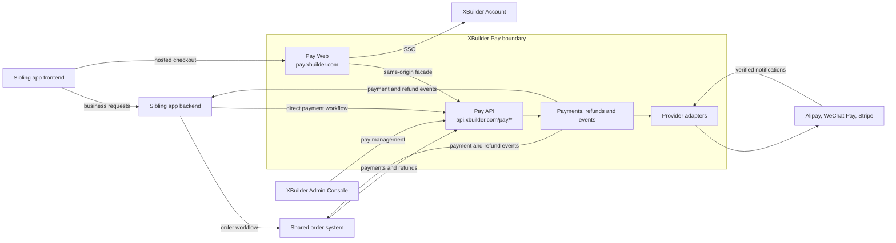
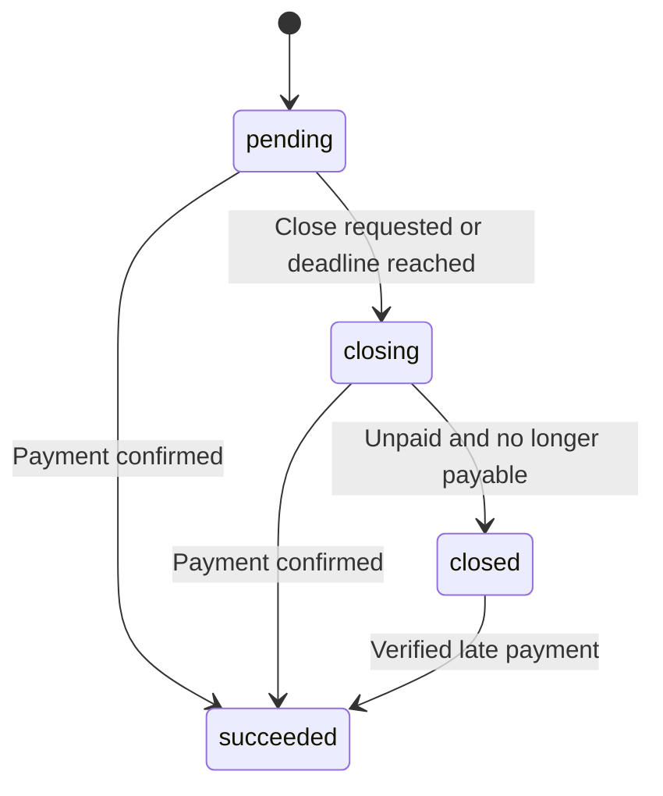
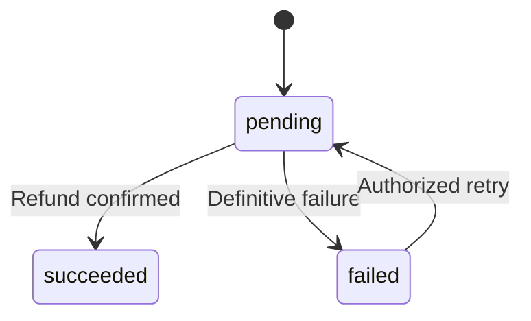

# XBuilder Pay

XBuilder Pay 是 XBuilder 的自有支付系统。它负责一次性支付、收银台、付款方式选择、上游支付服务接入、支付与退款事实、异步事件、个人支付记录，以及 XBuilder Admin Console 中的支付管理模块。

本文档定义 XBuilder Pay 的产品与系统边界。它描述第一期的目标状态，不定义最终数据库 schema、完整 OpenAPI 契约或具体实现任务。

## 背景与目标

XBuilder 和其他自有 app 需要接受用户付款。这些付款可以用于购买一定期限的会员、购买实物或数字商品，以及购买由业务系统发放的点数或额度。不同业务共享支付能力，但各自拥有商品、订单、履约和产品授权规则。

XBuilder Pay 为这些自有业务提供统一的支付基础设施。自有 app 只依赖 Pay API 和支付事件，不直接对接支付宝、微信支付或 Stripe，也不需要管理上游凭证、付款方式切换、渠道回调或支付状态映射。

目标包括：

- 支持自有 app 直接接入，也支持订单系统代表自有 app 创建支付
- 提供统一的支付单、退款单、状态和异步事件
- 通过统一收银台完成付款方式选择和付款交互
- 支持一次性支付、全额退款和多次部分退款
- 支持创建、查询和关闭支付，以及查询退款结果
- 支持超时、重复请求、重复通知、乱序事件和进程中断后的恢复
- 使用稳定的 XBuilder Account `user.id` 关联购买者
- 支持用户在 Pay Web 查看跨自有 app 的支付记录，并返回业务详情
- 使用同一套代码和 API 契约支持中国大陆与海外部署
- 支持平台管理的接入方、上游配置和支付管理权限
- 保留收款、退款、事件投递和管理操作的审计记录

非目标包括：

- 自动续费、自动充值等周期扣款
- 用户钱包、余额账户、储值账户或内部资金转账
- 商品目录、价格计算、优惠、税费计算、订单或物流管理
- 会员、点数、额度、席位或其他产品权益的发放与回收
- 统一各业务的退款次数、退款审批或订单行退款规则
- 独立的订阅合约、账期或订阅管理
- 面向外部商家的支付服务、分账、代收、商家入驻或商家结算
- 任意第三方 app 自助注册
- 原生支付 SDK、小程序支付或客户端提交上游支付凭证的接入方式
- 保存银行卡号等原始支付凭证
- 跨部署环境共享账号、合并交易记录或自动迁移支付

购买一个月或一年的会员可以是一笔一次性支付。会员有效期由业务系统管理，不要求 Pay 具备订阅或自动扣款能力。购买点数或额度也可以是一笔一次性支付，业务余额和消费记录仍由对应业务系统管理。

## 核心概念

| 概念 | 含义 |
| - | - |
| `user` | 购买者关联的 XBuilder Account 账号主体，以稳定的 `user.id` 引用 |
| `app` | 平台登记的自有 app，在 Pay 中表示支付所属的业务来源 |
| `client` | 经平台授权调用 Pay API 的服务端接入方，如 XBuilder 后端或订单系统 |
| `payment` | 接入方提出的一次收款请求，包含购买者、业务来源、金额、币种和外部业务关联 |
| `checkout` | 某笔支付对应的收银台交互，承载付款方式选择、跳转、扫码和结果展示 |
| `payment_attempt` | Pay 内部一次具体的上游支付尝试 |
| `refund` | 对某次成功收款提出的一次退款请求 |
| `refund_attempt` | Pay 内部一次具体的上游退款尝试 |
| `provider` | Pay 对接的上游支付服务，如支付宝、微信支付或 Stripe |
| `payment_method` | 用户在收银台中选择的付款方式，如支付宝、微信支付或银行卡 |
| `event` | 支付或退款事实发生变化后生成的不可变事件 |
| `event_delivery` | 向某个接收方投递一个事件的记录 |
| `reference` | 接入方为支付或退款分配的稳定外部关联标识，同时用于资源创建幂等 |

上游支付服务与付款方式属于不同层次。Stripe 是上游支付服务，可以提供银行卡、支付宝或微信支付等付款方式。自有 app 不需要选择或组合这些概念。

`payment_attempt` 和 `refund_attempt` 是 Pay 内部的执行与恢复概念，不要求自有 app 创建、查询或编排。Pay 对外暴露的业务资源是支付单和退款单。

## 系统边界



XBuilder Account、XBuilder Pay 和订单系统分别负责账号身份、资金交易和订单编排。XBuilder 产品本身与其他自有 app 一样，是这些系统的使用者。

订单系统负责商品、订单、订单行、业务退款审批和履约编排。Pay 不需要理解订单行、打印任务、物流或会员套餐。订单系统中的多租户或商家模型不改变 Pay 的收款边界。Pay 只为我们的主体收款，不提供外部商家代收或结算能力。

同一个产品可以在某条业务链路中使用订单系统，在另一条业务链路中直接使用 Pay。每笔支付必须有一个明确的创建接入方，负责该笔支付的业务编排、关闭和退款。通过订单系统创建的支付由订单系统负责这些操作。产品侧可以获得展示所需的读取权限，但不能因此绕过订单系统执行退款。

Pay 的支付成功只表示收款事实已确认，不表示会员已开通、点数已发放、商品已交付或订单已履约。业务系统应在可靠接收支付事实后，以自己的业务标识幂等执行履约。

## 自有 app 与服务接入方

每笔支付保存以下关联：

| 关联 | 字段 | 示例 |
| - | - | - |
| 创建支付的服务端接入方 | `clientID` | 订单系统 |
| 所属业务来源 | `appID` | XBuilder |
| 关联的 Account 用户 | `userID` | 购买者的稳定 `user.id` |
| 外部业务关联 | `reference` | 订单系统中的某次收款尝试 ID |

`clientID` 从经过认证的 Pay API 凭证中确定，不接受请求正文指定。`appID` 用于表达支付属于哪个自有业务，不表示谁在上游拥有商户号，也不决定资金收款主体。

直接接入的产品后端可以配置默认 `appID`。订单系统等共享服务需要显式提交实际业务来源的 `appID`。Pay 必须校验该接入方获准代表这个 app 创建支付，不允许任意声明业务来源。

`appID` 引用平台登记的自有 app。XBuilder Account 中的 app 是 OAuth client configuration，它可以作为稳定的 app 引用，但 Pay 的接入权限、API 凭证、事件配置和业务链接规则由 Pay 单独管理。拥有 Account app 的 OAuth 凭证不等于获得 Pay API 权限。

Pay 中的 `clientID` 是 Pay 服务端接入方标识。它不是 OAuth 协议中的 `client_id`，也不要求一个业务来源只能对应一个 Pay 接入方。

`userID` 必须由可信后端根据已验证的用户身份确定。前端不能通过修改请求参数选择另一名购买者。微信支付 `openid`、支付宝买家标识、Stripe Customer ID、邮箱和 app 内部用户 ID 都不能替代 XBuilder Account `user.id`。

自有 app 统一通过 XBuilder Account 登录。创建支付时，app 后端提交登录结果对应的稳定 `user.id`。通过订单系统创建支付时，app 后端应在可信服务调用中传递该标识，由订单系统保存关联并提交给 Pay。

`userID` 表示这笔业务购买关联的账号，不保证等于上游实际付款人的身份。用户通过其他人的支付宝、微信或银行卡付款时，不应改变支付所属账号。

支付记录应展示业务来源的 app 名称和图标，并保存必要的展示快照，避免 app 更名或停用后历史记录失去业务含义。快照不替代稳定的 `appID`。

## 收款主体与区域部署

中国大陆与海外分别部署 XBuilder Pay，并分别使用对应区域的 XBuilder Account、收款主体、商户账户、凭证和数据存储。

两套部署共享产品模型、代码和 API 契约。差异通过服务端受控配置表达，包括收款主体、启用的上游支付服务、上游商户账户、币种、可用付款方式、域名和凭证。

中国大陆部署可以启用支付宝和微信支付。海外部署可以启用 Stripe。Stripe 中是否启用支付宝或微信支付，应根据收款主体、账户地区、币种、支付产品开通情况和业务需求配置。

接入方使用明确配置的 Pay API 地址和凭证。Pay 不根据用户 IP、浏览器语言或临时地理位置，把已经创建的支付切换到另一套部署。

支付创建时固定部署环境、收款主体和可用上游账户范围。已经发起的支付与退款必须使用原有的上游关联和账户配置恢复，不能因为配置更新就改用另一主体或账户。

两个环境的数据、密钥、事件接收地址和幂等空间相互隔离。同名 app 或相同的文本 ID 不表示两套环境中的用户或交易自动关联。

Pay Web 应分别展示业务来源、实际收款主体和付款方式。

## 金额与币种

金额由可信后端确定，使用对应货币最小单位的整数。人民币的最小单位是分，`amount: 123` 和 `currency: "CNY"` 表示人民币 1.23 元。展示层可以显示小数金额，API 不使用浮点金额。

| API 金额 | 币种 | 展示金额 |
| - | - | - |
| `123` | `CNY` | 1.23 元 |
| `1234` | `USD` | 12.34 美元 |
| `123` | `JPY` | 123 日元 |

币种使用大写 ISO 4217 代码。Pay 按各币种的最小单位处理金额，并为支持的币种维护金额精度、取值范围和上游映射规则。上游金额格式转换由适配器负责，参考 [Stripe currencies](https://docs.stripe.com/currencies)。

支付和退款金额必须是正整数，并满足对应币种和上游账户的金额限制。退款金额与原收款使用相同币种。

Pay 不计算商品价格、折扣、税费或业务应收金额。创建支付时，接入方已经完成这些计算。创建后的 `amount`、`currency`、`clientID`、`appID`、`userID` 和 `reference` 不可修改。

支付和退款统计应按币种分别汇总。上游手续费、结算汇率和净结算金额属于对账信息，不应改变用户支付金额或业务退款金额。

## 支付接入模型

### 直接接入

1. 用户在自有 app 发起购买。
2. app 后端验证用户身份、业务权限和购买内容，确定金额、币种与稳定的 `reference`。
3. app 后端调用 Pay 创建支付单，并保存返回的支付单 ID。
4. app 前端打开 Pay 返回的 `checkoutURL`。
5. 用户在 Pay Web 完成付款。
6. Pay 向 app 后端投递支付事件。
7. app 后端可靠接收事件，确认业务关联后幂等履约。

接入的最小主流程是一次服务端创建调用、一次浏览器跳转和一个可靠的事件接收端点。前端不需要先列出上游支付服务，不需要自行创建上游交易，也不需要理解上游状态。

### 通过订单系统接入

1. 用户在自有 app 发起购买，app 后端向订单系统创建订单。
2. 订单系统确定待收款金额，并为本次收款分配稳定的 `reference`。
3. 订单系统以自己的 Pay 接入方身份创建支付单，提交实际业务来源 `appID` 和购买者 `userID`。
4. 订单系统把 Pay 支付单 ID 和 `checkoutURL` 通过业务接口返回给 app。
5. 用户在 Pay Web 完成付款。
6. Pay 向订单系统投递支付事件。
7. 订单系统更新订单资金状态，并通知对应业务方履约。

订单系统创建的支付单按实际产品记录业务来源，如 XBuilder 或 X3D。订单系统自身作为创建接入方记录。

订单系统的订单 ID、收款尝试 ID 和 Pay 支付单 ID 是不同的标识。订单系统可以把自己的收款尝试 ID 作为 Pay `reference`，并在自身数据中维护订单与该尝试的关系。Pay 不需要同时理解订单系统全部内部标识。

### 服务端认证

Pay 为平台管理的接入方分配独立的 API 凭证。第一期使用服务端可撤销的高熵 opaque Bearer token，通过 HTTPS 传递。凭证绑定接入方、部署环境和授权范围，不暴露给前端，也不与 Account app 的 OAuth 凭证或事件签名密钥共用。

Pay 服务端保存 API 凭证的哈希，凭证值只在创建时返回。凭证应支持有界的轮换重叠期和立即撤销。接入方配置和凭证生命周期由受控部署或运维流程管理，不提供公开自助接入。

Pay API 不接受自有 app 的用户 access token 代替服务端 API 凭证。用户身份由经过认证的后端在授权范围内声明，Pay 继续校验账号存在性和 app 关联。

接入方被停用后不得创建支付单或发起新的资金操作。已发生的资金事实、上游通知、对账和必要的补偿处理必须继续执行。需要保留的只读排障权限应显式配置。

## Hosted checkout

`pay.xbuilder.com` 是 Pay Web，包含收银台和个人支付记录。`api.xbuilder.com/pay/*` 是 Pay API 的权威入口。实际域名按部署环境配置。

Pay Web 使用 `pay.xbuilder.com/api/*` 作为同源 API 接入层。例如 `pay.xbuilder.com/api/checkouts/{checkoutToken}` 对应 `api.xbuilder.com/pay/checkouts/{checkoutToken}`。同源接入层不是安全边界，不改变 Pay API 的鉴权或权限语义。

`checkoutURL` 是 Pay 拥有的入口，不是 Stripe Checkout Session URL、微信支付二维码内容或支付宝表单地址。收银台可以跳转到上游支付页面，但这些交互由 Pay 负责。

收银台展示业务来源、购买说明、应付金额、币种、收款主体和当前可用的付款方式。可用方式由部署配置、币种、金额、设备环境、已开通产品和支付单状态共同决定。

收银台应提供准确的加载、待付款、处理中、成功、关闭和错误状态。上游结果未知时，应展示处理中并允许恢复查询，不能因为浏览器超时就宣布支付失败。

`checkoutToken` 是高熵、不可猜的随机凭证，只授权查看该收银台的必要摘要和发起受限付款交互。它不授权读取账号支付列表、读取其他支付单、关闭支付单或退款，也不包含用户 session 或服务端 API 凭证。

收银台不依赖跨站共享 Account cookie。它可以允许持有有效收银台入口的人完成付款，但不能因此修改原支付单的 `userID`。进入个人支付记录则必须完成 Pay 自己的登录。

收银台凭证应具有明确的有效期和撤销语义，日志和监控中必须脱敏。Pay Web 应使用合适的 `Referrer-Policy`，避免凭证通过跳转或第三方资源泄露。过期入口不能继续创建上游尝试，已发出的尝试仍按支付生命周期处理。

### 付款方式切换

用户在同一个收银台中切换付款方式时，Pay 保持同一笔支付单和同一个 `reference`。自有 app 不需要重新创建支付单。

每次具体的上游交互由内部 `payment_attempt` 表达。并发点击、页面刷新和网络重试应复用同一次有效交互，不能无条件创建新的上游收款对象。

切换付款方式需要协调旧尝试与新尝试。旧尝试尚可付款或其结果未知时，应先关闭并确认，或者等待其结果明确。不能仅隐藏旧二维码或关闭浏览器页面，就认定旧尝试已经无法收款。

已经发出的上游创建调用即使超时，也可能稍后创建成功。Pay 必须保存执行关联并恢复查询。关闭或到期处理需要覆盖这些未返回的创建调用，不能仅凭后台任务租约过期就把它们视为不存在。

新的尝试不得绕过支付关闭意图或 `expiresAt`。如果上游的有效期限制使某种交互无法满足剩余付款时间，收银台应停止提供该交互。

## 支付生命周期

Pay 对外使用以下支付状态：

| 状态 | 含义 |
| - | - |
| `pending` | 等待用户付款或等待上游结果，仍可能完成支付 |
| `closing` | 已请求关闭或到期，正在确认所有尝试不可再支付且没有成功收款 |
| `succeeded` | 已确认一笔归属于该支付单的成功收款 |
| `closed` | 已确认未收款，且所有已知尝试不可再支付 |



某一次上游尝试失败不等于整笔支付单失败。只要支付单仍在有效期内且没有关闭意图，用户可以重新尝试或选择其他付款方式。

支付成功必须来自经过验证的上游通知、主动查询或对账。Stripe Checkout 的完成页面或浏览器跳转不能单独证明资金已经支付，参考 [Stripe Checkout fulfillment](https://docs.stripe.com/checkout/fulfillment?payment-ui=stripe-hosted)。

Pay 应校验收款主体、上游账户、交易关联、金额和币种，再记录成功事实。金额或归属不匹配的交易应进入异常处理，不能直接触发 `payment.succeeded` 或业务履约。

### 关闭与到期

接入方可以重复提交同一支付单的关闭请求，Pay 应继续恢复同一个关闭过程。

`expiresAt` 表示 Pay 停止发起新付款交互的时间，不表示远端资金状态已经自动终结。到期后应进入关闭流程，直到所有尝试的创建、关闭和查询结果足以确认不可再支付。

关闭结果未知时保持 `closing`，由补偿任务继续查询和关闭。任何已确认的成功收款都优先于关闭意图。已经 `succeeded` 的支付单不得关闭，需要返还资金时应创建退款单。

迟到的经过验证的成功事实可能纠正之前的 `closed` 结果。Pay 应记录该纠正、产生新的 `payment.succeeded` 事件并告警。不能为了维持本地终态而丢弃实际收款。

接入方在业务订单取消后收到迟到成功时，应按自己的规则恢复业务或发起退款。Pay 不判断该订单是否仍能履约。

### 成功收款认领

同一支付单最多认领一笔成功收款作为正常业务支付。成功认领、支付单状态更新和成功事件写入必须原子完成。

不同上游尝试如果都实际收款，额外收款必须单独保存为资金事实，并进入重复收款处理。它不能覆盖已认领的收款，也不能再次触发普通业务履约。

重复通知和同一上游交易的重复查询结果只更新同一个资金事实。上游交易唯一标识必须与上游支付服务、环境和商户账户一起确定唯一性。

不同支付单是否属于同一个业务订单，由创建接入方判断。Pay 不能仅凭金额、用户或描述相同就把两笔支付单当作重复购买。

## 退款

退款是独立资源。在上游允许的退款期限、次数和交易类型范围内，同一支付单可以分多次部分退款，累计成功退款与进行中退款的金额不得超过原收款金额。

退款不改变原始收款事实。支付单在全额退款后仍然是 `succeeded`，用户界面通过退款状态和金额展示部分退款或全额退款。

业务系统负责退款资格、退款次数、退款审批、订单行分配和权益回收。自有 app 或订单系统可以只允许一笔业务退款，不需要提供多次退款入口，也不需要放宽已有业务规则。

Pay 负责校验资金范围、执行退款、恢复未知结果和报告退款事实。每次新的业务退款使用新的 `reference`，同一次退款的重试继续使用原 `reference`。一次退款与多次退款使用同一套创建、查询和事件接口。

同一上游交易的退款执行由 Pay 串行协调，并满足上游的调用间隔和次数限制。这些执行约束不由接入方编排。上游是否允许部分退款、剩余次数和退款期限由 Pay 校验，拒绝时返回统一的业务错误。

退款必须退回原成功收款对应的上游交易，不因为当前上游配置变化而改用另一个渠道。第一期不提供向任意收款账户打款的退款方式。

退款单始终关联原支付单的 `clientID`、`appID` 和 `userID`，并向原创建接入方投递退款事件。业务退款由创建接入方发起，管理台不能绕过该接入方新增业务退款。

### 退款状态

| 状态 | 含义 |
| - | - |
| `pending` | 已接受退款，正在执行、等待结果或恢复执行 |
| `succeeded` | 上游已确认退款成功 |
| `failed` | 已确认本次退款没有成功，且不存在仍可能完成的上游执行 |



上游超时、网络中断、余额不足等待处理或需要人工处理的状态，不应一律映射为 `failed`。只要资金结果仍可能变化，就应保持 `pending` 并保留金额预占。具体映射应依据上游产品契约，参考[微信支付退款查询](https://pay.wechatpay.cn/doc/v3/merchant/4013071031)和[支付宝退款接口](https://aipay.alipay.com/docs/vibe-pay/ai-web-app-payment-qianyi/api-list/alipay-trade-refund.html)。

重试同一逻辑退款时继续使用原 `reference`，不能创建另一笔逻辑退款绕过幂等和金额预占。确需重建上游退款尝试时，必须先确认旧尝试已终结且不可能继续退款。

已确认 `failed` 的退款可以由原接入方用相同参数重新提交，进入 `pending` 并重新预占金额。Pay 内部按需要创建新的 `refund_attempt`。如果其间可退金额已经减少，重新提交应被拒绝，不得超额退款。

`succeeded` 不允许回退。后续资金异常另行记录并处理，不能把已经成功的退款静默重置为待退款。

### 可退金额

支付响应提供以下金额汇总：

| 字段 | 含义 |
| - | - |
| `amount` | 原支付金额 |
| `refundedAmount` | 已确认成功的业务退款金额 |
| `refundingAmount` | 进行中且已预占的业务退款金额 |
| `refundableAmount` | 尚未退款且未被预占的业务收款金额 |

支付成功后，`refundableAmount` 等于 `amount - refundedAmount - refundingAmount`。支付成功前，三个退款汇总字段都为 `0`。

可退金额表示尚未退款且未被预占的资金余额，不表示上游一定能够受理退款。退款期限、次数和交易类型限制仍需在申请时校验。

退款创建、金额预占和幂等记录必须在同一事务中完成。并发退款不能分别读取旧余额后各自通过。退款明确失败时释放预占，成功时将预占转为已退款金额。

### 业务退款与重复收款退款

正常业务退款针对支付单认领的成功收款，退款类别为 `business`。Pay 内部对同一支付单额外收款的退款类别为 `duplicatePayment`。

重复收款退款绑定额外收款事实，按该事实单独控制退款上限，不占用正常业务收款的 `refundableAmount`，也不应让业务系统误认为用户购买已经被退款。

Pay 应为重复收款生成稳定的补偿关联并推进退款。未知结果保持待处理，明确失败后继续使用同一逻辑退款恢复。自动处理无法完成时，应告警并进入人工处理，不得遗失额外收款。

跨不同支付单的业务重复收款由创建接入方认定和编排退款。订单系统内部的重复收款类别与 Pay 内部的重复尝试收款属于不同的判断范围，不依赖彼此的内部数据模型。

## 业务链接与支付结果

每笔支付可以关联两个业务 URL：

| 字段 | 含义 |
| - | - |
| `returnURL` | 用户结束收银台交互后返回自有 app 的入口 |
| `detailsURL` | 用户在个人支付记录中查看对应业务详情的入口 |

`checkoutURL` 由 Pay 生成。`returnURL` 和 `detailsURL` 由可信后端提供。

`detailsURL` 可以指向订单详情、会员购买记录或商品购买记录。通过订单系统创建支付时，应指向用户可访问的业务详情页面。

Pay 自己的支付详情由支付单 ID 定位，包含支付金额、状态、退款记录和业务来源。`detailsURL` 是这个页面中的业务导航，不替代 Pay 的支付详情资源。

`returnURL` 只是导航。用户可能在支付确认前返回，也可能付款后关闭页面。自有 app 到达结果页面后仍应向自己的后端查询业务结果，不能相信 URL 参数、客户端状态或跳转本身。

业务 URL 只能使用对应 `appID` 已登记的 HTTPS origin。Pay 应按解析后的协议、主机和端口校验允许列表，不使用字符串前缀匹配。URL 不允许包含用户 token、Pay API 凭证或其他长期凭证。

链接目标必须由对应业务系统校验当前用户权限。Pay 不保证用户点击后仍拥有该业务资源的访问权，也不把支付单 ID 当作业务授权凭证。

上游的浏览器回跳、异步通知和业务 `returnURL` 是不同的边界。上游的浏览器回跳先进入 Pay，Pay 处理关联后再导航到已保存的业务 URL。

## 异步事件

Pay 使用事件通知创建接入方资金结果。第一期事件包括：

| 事件 | 含义 |
| - | - |
| `payment.succeeded` | 确认正常业务收款成功 |
| `payment.closed` | 确认支付单未付款且已关闭 |
| `refund.succeeded` | 确认退款成功 |
| `refund.failed` | 确认退款失败且没有仍可能完成的执行 |
| `payment.anomaly` | 发现需要关注的资金异常，如重复收款或金额不匹配 |

每个事件包含稳定的 `id`、`type`、`createdAt`、资源标识、创建接入方、业务来源、`reference` 和事件发生时的资源快照。退款事件同时包含支付单 ID 与退款单的 `reference`。金额和币种应足以与接入方本地记录核对。

事件 ID 和已序列化的事件数据在生成后不可改变。重投不能用相同事件 ID 携带资源最新状态。当前状态通过查询 API 获取。

### 投递与接收

支付或退款状态变更与事件写入同一个数据库事务。后台任务读取 outbox 并投递，支持超时恢复、退避重试、告警和管理员重投。

事件采用至少一次投递。接收方必须按事件 ID 持久化去重，并把可靠接收与后续业务处理分开。只有事件已经可靠落库，或业务变更与接收记录已经原子提交，才返回 2xx。

2xx 表示接收方已可靠接收，不表示订单已经履约。HTTP 响应丢失时，Pay 会重投同一个事件。接收方不能再次发放会员、点数或商品。

事件发送采用 [Standard Webhooks](https://github.com/standard-webhooks/standard-webhooks/blob/main/spec/standard-webhooks.md)。签名覆盖事件 ID、本次投递时间戳和原始请求体。每个接收方使用独立的事件签名密钥，密钥轮换支持有界重叠期。

接收方必须验证原始请求体的签名并校验投递时间窗口，再解析 JSON。重投保持事件 ID 和请求体不变，更新本次投递时间戳和签名。事件发生时间可以很早，不能用事件发生时间代替本次投递的签名时间校验。

事件端点由接入方受控配置，不允许在每笔支付中提交任意通知 URL。默认只有创建接入方接收资金编排事件，避免产品与订单系统同时执行同一笔支付的业务流程。

### 乱序与状态恢复

支付单和退款单分别维护单调递增的 `version`。事件中的资源快照包含对应 `version`，接收方不能用旧快照覆盖新状态。

事件传输去重与业务履约幂等是两层约束。接收方除了按事件 ID 去重，还应保证同一个业务对象的履约只完成一次。

退款事件可能先于支付成功事件到达。接收方应按资源关联保存事实，必要时主动查询，不能因为尚未收到前一个事件就永久拒绝后续资金事实。

接收方发现缺少关联、版本冲突或状态不一致时，应调用 Pay 查询并补偿。Pay 的事件投递失败不能导致已经落库的成功收款或退款被回滚。

## 幂等与请求恢复

创建支付单使用 `(clientID, reference)` 唯一确定资源。创建退款单使用 `(clientID, paymentID, reference)` 唯一确定资源。

接入方应在调用 Pay 前，先把 `reference` 和业务对象关联持久化。请求超时后继续使用同一个 `reference` 查询或重新提交，不能为了重试生成新的 `reference`。

同一 `reference` 和相同的创建参数返回同一资源的当前状态。同一 `reference` 携带不同金额、币种、购买者、业务来源或业务链接时返回冲突，不能修改旧资源或创建第二笔收款。

`reference` 不因支付关闭、退款成功或上游幂等窗口结束而重新可用。Pay 必须在资源生命周期内保持唯一性，归档后也应保留足够的关联或去重记录，拒绝旧 `reference` 被用于新收款。

Pay 内部为每个上游尝试保存稳定的请求关联、上游对象 ID、所属商户账户和执行状态。调用结果未知时先恢复查询，只有确认旧调用不会继续执行且上游契约允许时，才能重发或创建新尝试。

上游幂等保证存在作用域和保留期限。例如 Stripe 允许清理至少保留 24 小时的幂等键，参考 [Stripe idempotent requests](https://docs.stripe.com/api/idempotent_requests)。Pay 对外的 `reference` 不能仅靠上游 `Idempotency-Key` 实现。

超过上游安全重试窗口且结果未知时，应隔离、告警并通过查询、事件或对账恢复，不得盲目重发支付或退款。上游对象的关联元数据和本地任务租约都不能单独证明上游没有执行。

## 个人支付记录

Pay Web 是使用 XBuilder Account 的自有 app。它通过自有 app SSO 获得稳定的 `user.id`，并使用 App-owned session model 维护自己的 Pay session。

Account session 只存在于 Account Web。Pay 不读取或共享 Account session cookie，也不接受其他自有 app 的用户凭证直接作为 Pay Web session。

Pay session 应使用 Pay 域名下带 `__Host-` 前缀的 cookie，设置 `HttpOnly`、`Secure`、`SameSite=Lax` 和 `Path=/`，不得设置 `Domain`。使用 cookie 鉴权的写接口应校验 `Origin` 或使用等价 CSRF 防护。

用户在 Pay Web 可以查看当前部署环境中关联自己 `userID` 的支付记录，包括由不同产品直接创建或由订单系统代创建的记录。

个人列表按服务端已验证的 Pay session 过滤，不接受前端指定其他用户的 `userID`。支付详情同样需要校验支付单属于当前用户，不能仅凭可猜测的支付单 ID 访问。

支付记录应至少展示业务来源、购买说明、金额、币种、付款时间、支付状态、退款摘要和详情入口。单笔详情可以展示适合用户理解的付款方式和脱敏信息，不展示上游凭证、原始回调或内部执行数据。

个人记录中点击业务详情时使用 `detailsURL`。没有业务链接时仍可查看完整的 Pay 支付详情。业务链接不可用不能影响资金记录的可见性。

第一期的个人中心只包含支付和退款记录。会员有效期、业务点数余额和订阅管理属于相应业务系统，不从支付金额或支付描述推导。

## 读取与资金操作权限

Pay 分别判断创建接入方权限、业务来源读取权限、当前用户权限和管理员权限。

| 调用身份 | 可见范围与操作 |
| - | - |
| 创建接入方 | 查询自己创建的支付单和关联退款单，并在授权范围内关闭和退款 |
| 获得来源读取授权的产品接入方 | 读取所属 `appID` 的必要支付详情，包括订单系统代创建的记录 |
| Pay Web 当前用户 | 读取属于自己 `userID` 的个人支付与退款记录 |
| Pay 管理员 | 按管理权限查询、排障和执行受审计的管理操作 |

来源读取权限需要显式授予，不因为请求中带有 `appID` 或已知支付单 ID 就自动成立。返回的数据应限制在产品展示需要的范围内。

来源读取权限不授予关闭、退款或修改事件接收方的能力。通过订单系统创建的支付仍由订单系统编排资金操作。

普通用户不能通过个人支付详情直接调用服务端退款接口。用户退款申请由业务系统受理并判断资格，再由拥有资金操作权限的接入方执行。

## 上游接入

上游支付服务由部署配置或服务端受控配置管理。配置包括启用状态、商户账户、支持币种、支付产品、凭证、证书和回调入口。它们不属于自有 app 的请求参数。

第一期上游支付服务标识包括：

- `alipay`
- `wechatpay`
- `stripe`

| 上游支付服务 | 收银台交互 | 适配器负责的主要能力 |
| - | - | - |
| 支付宝 | 按开通产品使用托管页面或其他受支持的 Web 交互 | 创建、查询、关闭、退款、退款查询和异步通知验签 |
| 微信支付 | 按开通产品使用 Native 扫码、H5 或受支持的浏览器交互 | 创建、查询、关闭、退款、退款查询、通知解密与验签 |
| Stripe | Checkout Session，使用一次性支付模式 | Session 与资金对象关联、支付查询、关闭协调、退款和 webhook 验签 |

上游适配器负责金额格式转换、状态映射、请求签名、通知验签、密钥与证书轮换、幂等约束、错误分类和查询恢复。支付核心负责统一资源、资金约束、权限、事务和事件。

上游返回的成功 HTTP 状态不一定表示资金操作完成。适配器必须依据实际的业务状态和资金字段确认结果，不能把 API 请求已接受直接映射成支付或退款成功。

Stripe Checkout Session 完成不必然表示所有付款方式都已经到账。关闭 Session 也不必然覆盖已经进入异步处理的资金对象。适配器必须结合实际 PaymentIntent、Charge 或等价资金状态，确认收款与关闭结果。

微信支付所需商户号、APPID、支付产品、授权和证书配置由 Pay 管理。浏览器内的身份获取如需上游专用交互，应由 Pay Web 承载，不要求自有 app 实现上游身份流程。

每个部署只启用已经开通并验证的交互方式。没有可用方式时应明确拒绝创建或展示不可付款原因，不提供无法完成的付款入口。

上游凭证、原始支付凭证和上游特有字段不进入通用接入方 API。确需展示的付款方式应使用 Pay 自己的展示模型，不要求业务系统根据上游服务名称解释交易。

## 对账与异常处理

Pay 需要主动查询和定期对账，恢复通知丢失、创建结果未知、关闭结果未知、退款处理中和本地状态不一致的交易。

对账按部署环境、收款主体、商户账户、币种和上游交易关联执行。支付单、支付尝试、退款单、退款尝试和实际资金事实必须可以相互追溯。

以下情况应生成异常记录并告警：

- 同一支付单存在额外成功收款
- 收款或退款金额、币种、商户账户与预期不一致
- 收到无法关联的有效上游资金通知
- 上游已经收款或退款，本地仍没有对应资金事实
- 创建、关闭或退款结果长时间未知
- 上游幂等安全窗口即将结束，但结果仍未恢复
- 事件持续投递失败
- 重复收款退款无法自动完成

异常记录应保留处理状态、关联资源、证据和操作日志。管理员可以触发查询、补偿和重投，但不能凭手工输入把支付标记为成功或把退款标记为完成。

上游报告的拒付、争议或强制资金调整即使不属于第一期的业务 API，也必须被保存、告警并进入人工处理。它们不应自动映射成普通退款或静默修改历史支付事实。

日志应能通过接入方、业务来源、支付单、支付尝试、退款单、退款尝试、事件和上游交易关联排障。凭证、原始支付数据和敏感个人信息必须脱敏。

## 管理台与管理权限

Pay 管理模块位于 XBuilder Admin Console。它与 Account、Authorization 和其他产品管理模块共享管理台入口，但拥有独立的资源和权限边界。

XBuilder Pay 管理权限标识为 `payAdmin`。它的授予和判定属于 XBuilder Authorization 的管理范围，不属于 Account OAuth scope。

管理模块至少应包含以下能力：

- 按用户、业务来源、创建接入方、状态和时间查询支付
- 查看单笔支付、上游尝试、收款事实和退款记录
- 查询退款执行与异常原因
- 请求关闭未完成的支付
- 恢复既有退款执行，并处理 Pay 内部重复收款退款
- 查看事件和投递记录，并重投既有事件
- 查看和处理资金异常
- 查看相关管理审计记录

管理员可以触发既有退款的查询和补偿，并处理 Pay 内部重复收款。所有资金操作必须经过相同的金额预占、幂等和上游执行流程，并记录原因与操作者。业务退款申请仍由创建接入方受理，管理权限不替代业务退款资格或次数规则。

上游密钥、商户配置和付款方式配置通过受控部署或运维流程管理，不提供管理台编辑入口。

`/admin/pay/*` 接口应要求 `payAdmin`。Admin API 应在 ingress 层限制访问范围，并继续由后端权限校验和审计日志保护。权限服务不可用时不得放行管理操作。

## API 边界

本节只描述 API 边界。接口实现时，应在 `docs/openapi.yaml` 中定义具体契约。

### Client endpoints

```http
POST /pay/payments
GET  /pay/payments
GET  /pay/payments/{paymentID}
PUT  /pay/payments/{paymentID}/closure

POST /pay/payments/{paymentID}/refunds
GET  /pay/payments/{paymentID}/refunds
GET  /pay/refunds/{refundID}
```

- 创建支付单需要 `userID`、`reference`、`amount`、`currency` 和 `description`，可提供 `appID`、`returnURL` 和 `detailsURL`
- `appID` 只有在接入方已配置唯一默认业务来源时才可以省略
- `expiresAt` 可以由接入方在部署允许的范围内指定，未指定时由 Pay 使用受控默认值
- 创建响应直接返回已落库的支付单，包括 `id` 和可使用的 `checkoutURL`
- 支付列表支持按 `reference`、`appID`、`userID` 和状态筛选，并始终附加调用方权限范围
- 以 `reference` 恢复未知创建结果时，只查询当前接入方创建的资源，不能在其他接入方的 `reference` 空间中匹配
- `PUT /pay/payments/{paymentID}/closure` 表达关闭目标，返回支付单当前状态，结果可能仍为 `closing`
- 创建退款单需要稳定的 `reference`、`amount` 和 `reason`，币种从原支付单继承
- 退款单读取接口返回稳定的退款单 ID、`reference`、原支付单关联、金额、币种、状态和 `version`
- 退款列表支持按 `reference` 查询，便于请求超时后恢复
- 自有 app 不提交上游支付服务、付款方式、上游商户号或上游交易 ID

直接接入的创建请求示例：

```http
POST /pay/payments
Authorization: Bearer <client-api-token>
Content-Type: application/json

{
  "userID": "123",
  "reference": "purchase_20261016_0001",
  "amount": 9900,
  "currency": "CNY",
  "description": "XBuilder Plus annual membership",
  "returnURL": "https://xbuilder.com/purchases/payment-result",
  "detailsURL": "https://xbuilder.com/purchases/purchase_20261016_0001"
}
```

创建响应示例：

```json
{
  "id": "501",
  "createdAt": "2026-10-16T08:00:00+08:00",
  "updatedAt": "2026-10-16T08:00:00+08:00",
  "clientID": "10",
  "appID": "1",
  "userID": "123",
  "reference": "purchase_20261016_0001",
  "amount": 9900,
  "currency": "CNY",
  "description": "XBuilder Plus annual membership",
  "status": "pending",
  "refundedAmount": 0,
  "refundingAmount": 0,
  "refundableAmount": 0,
  "checkoutURL": "https://pay.xbuilder.com/checkout/opaque-checkout-reference",
  "returnURL": "https://xbuilder.com/purchases/payment-result",
  "detailsURL": "https://xbuilder.com/purchases/purchase_20261016_0001",
  "expiresAt": "2026-10-16T08:30:00+08:00",
  "version": 1
}
```

这个响应表示收款请求已经创建，不表示用户已经付款，也不要求 Pay 此时已经创建上游交易。Pay 可以在用户选择付款方式后再创建具体的上游尝试。

### Pay Web endpoints

```http
GET  /pay/checkouts/{checkoutToken}
POST /pay/checkouts/{checkoutToken}/attempts
```

- 这些接口主要供 Pay Web 使用，不属于自有 app 的服务端支付接入流程
- 收银台查询返回必要摘要、可用付款选项和当前交互状态
- Pay Web 使用收银台返回的 opaque 付款选项标识发起交互，由 Pay 解析具体上游服务和付款方式
- 创建交互必须具备内部幂等与并发协调，不能因前端重试重复发起上游收款
- 上游专用浏览器跳转、扫码内容和受支持的浏览器交互只在这个边界内表达

### Current user endpoints

```http
GET /pay/user/payments
GET /pay/user/payments/{paymentID}
```

- 这些接口属于 Pay，不属于 XBuilder 产品业务 API 或 Account API
- 当前用户从经过验证的 Pay session 确定
- 列表与详情只返回当前用户的支付和必要退款信息
- 不返回其他用户数据、服务端凭证或上游原始数据
- 不授予服务端关闭或退款权限

### Provider notification endpoints

```http
POST /pay/providers/{provider}/events
GET  /pay/providers/{provider}/callback
```

- 这些接口属于上游协议边界，不供自有 app 调用
- 接收格式、HTTP 方法、验签和应答格式按对应上游产品契约定义
- 上游要求 POST 浏览器回跳时，应在具体契约中声明对应 POST 接口
- 上游通知必须经过原始消息验签、必要解密和交易关联校验后才能写入资金事实
- 上游浏览器回跳只恢复收银台交互，不能单独作为支付成功依据
- 上游协议使用各自要求的应答格式

### Pay admin endpoints

```http
GET  /admin/pay/payments
GET  /admin/pay/payments/{paymentID}
PUT  /admin/pay/payments/{paymentID}/closure

GET  /admin/pay/refunds
GET  /admin/pay/refunds/{refundID}

GET  /admin/pay/events
GET  /admin/pay/events/{eventID}
POST /admin/pay/events/{eventID}/deliveries

GET  /admin/pay/anomalies
```

- 这些接口共享 XBuilder Admin API 命名空间，但不是 Account API 或 XBuilder 产品业务 API
- 事件重投创建新的投递记录，保留原事件 ID 和事件数据
- 退款查询和补偿只恢复已有执行，不创建新的业务退款单
- 管理操作必须保留操作者、关联资源、原因和结果，不允许覆盖历史资金事实

## 安全边界

前端、管理台页面和同源接入层都不是权限边界。Pay 后端必须验证调用身份、资源归属、操作范围、金额和状态。

Pay API 凭证、事件签名密钥、收银台凭证、Pay session 和上游凭证必须分别管理。不同部署环境、不同接入方和不同上游支付服务不能共用凭证。

上游通知必须按对应协议对原始消息验签。处理前应限制消息大小，验证证书或可信公钥，并校验上游账户、交易关联、金额与币种。重复通知应通过持久化唯一关联幂等处理，不能仅依赖短期缓存。

上游通知需要快速可靠接收。接收记录与资金更新应原子提交，或先写入可靠 inbox 后异步处理。不能先应答成功，再把未经持久化的消息仅留在进程内存。

业务说明、app 展示信息、退款原因和其他外部可控字段只能按纯文本展示。它们不能作为 HTML、脚本、URL 或路由片段直接拼接。

事件投递必须防止 SSRF。接收地址由受控配置管理，发送时仍需校验实际连接目标，禁止访问非预期内网或保留地址，防止 DNS rebinding，并禁止未经校验的重定向。

Pay 不接收或保存原始银行卡凭证。需要用户输入敏感付款信息时，应使用上游的托管交互。

支付、退款、关闭和异常处理都必须保留审计关联。任何人工补偿都应追加事实或操作记录，不允许通过删除历史记录消除资金差异。

## 术语表

| 术语 | 含义 |
| - | - |
| XBuilder Pay | XBuilder 自有支付系统 |
| Pay Web | `pay.xbuilder.com` 上的收银台和个人支付记录 UI |
| Pay API | `api.xbuilder.com/pay/*` 上的统一支付 API |
| Client | 经平台授权调用 Pay API 的服务端接入方 |
| Business source | 支付所属的自有业务，以 `appID` 引用 |
| Hosted checkout | 由 Pay 拥有的统一付款入口和交互 |
| Provider | Pay 对接的上游支付服务 |
| Payment method | 用户实际选择的付款方式 |
| Payment attempt | Pay 内部一次具体的上游支付尝试 |
| Refund attempt | Pay 内部一次具体的上游退款尝试 |
| Minor unit | 对应货币的最小金额单位，如人民币的分 |
| Reference | 接入方分配的稳定外部关联与资源创建幂等标识 |
| Opaque token | 不编码业务语义、由服务端解析的随机凭证 |
| Outbox | 与业务状态原子写入、由后台任务可靠投递的事件记录 |
| Inbox | 接收方可靠保存并用于去重和恢复处理的事件记录 |
| Reconciliation | 将本地资金记录与上游交易或账单核对的过程 |
| `payAdmin` | 访问 Pay 管理模块的管理权限 |
