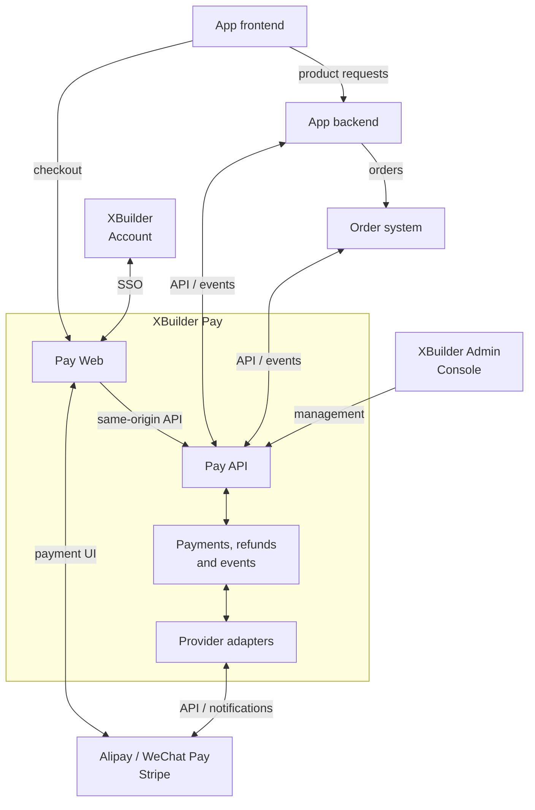
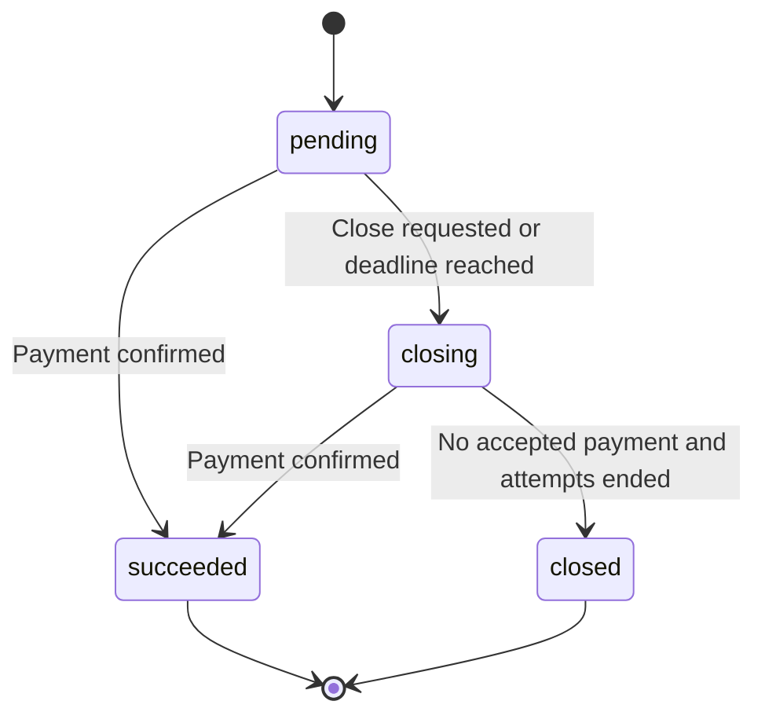
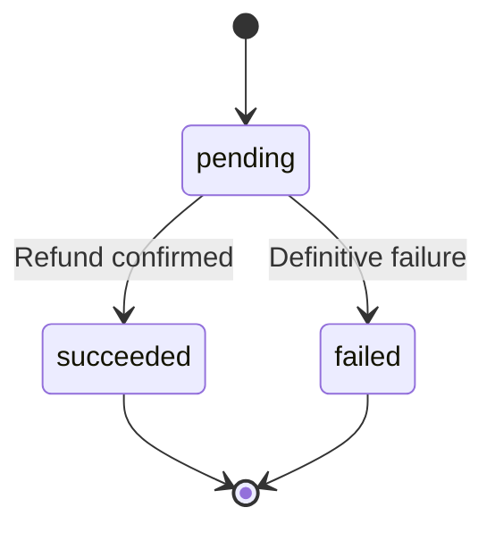

# XBuilder Pay

XBuilder Pay 是 XBuilder 的自有支付系统。它负责一次性支付、收银台、付款方式选择、上游支付服务接入、支付与退款事实、异步事件、个人支付记录，以及 XBuilder Admin Console 中的支付管理模块。

本文档定义 XBuilder Pay 的产品与系统边界。它描述第一期的目标状态，不定义最终数据库 schema、完整 OpenAPI 契约或具体实现任务。

## 背景与目标

XBuilder 和其他自有 app 需要接受用户付款。这些付款可以用于购买一定期限的会员、购买实物或数字商品，以及购买由业务系统发放的点数或额度。不同业务共享支付能力，但各自拥有商品、订单、履约和产品授权规则。

XBuilder Pay 为这些自有业务提供统一的支付基础设施。自有 app 只依赖 Pay API 和支付事件，不直接对接支付宝、微信支付或 Stripe，也不需要管理上游凭证、付款方式切换、渠道回调或支付状态映射。

目标包括：

- 支持自有 app 直接接入，也支持订单系统代表自有 app 创建支付
- 提供统一的支付单、退款单、状态和异步事件
- 通过统一收银台完成付款方式选择和付款交互
- 支持一次性支付、全额退款和多次部分退款
- 支持创建、查询和关闭支付，以及查询退款结果
- 支持超时、重复请求、重复通知、乱序事件和进程中断后的恢复
- 由 Pay 处理异常收款与资金退回，并提供用户记录和管理处置入口
- 使用稳定的 XBuilder Account `user.id` 和 `app.id` 关联购买者与自有 app
- 支持用户在 Pay Web 查看跨自有 app 的支付记录，并返回业务详情
- 使用同一套代码和 API 契约支持中国大陆与海外部署
- 支持平台管理的 app 接入、上游配置和支付管理权限
- 保留收款、退款、事件投递和管理操作的审计记录

非目标包括：

- 自动续费、自动充值等周期扣款
- 用户钱包、余额账户、储值账户或内部资金转账
- 商品目录、价格计算、优惠、税费计算、订单或物流管理
- 会员、点数、额度、席位或其他产品权益的发放与回收
- 统一各业务的退款次数、退款审批或订单行退款规则
- 独立的订阅合约、账期或订阅管理
- 面向外部商家的支付服务、分账、代收、商家入驻或商家结算
- 任意第三方 app 自助注册
- 原生支付 SDK、小程序支付或由自有 app 客户端提交上游支付凭证的接入方式
- 保存银行卡号等原始支付凭证
- 跨部署环境共享账号、合并交易记录或自动迁移支付

购买一个月或一年的会员可以是一笔一次性支付。会员有效期由业务系统管理，不要求 Pay 具备订阅或自动扣款能力。购买点数或额度也可以是一笔一次性支付，业务余额和消费记录仍由对应业务系统管理。

## 核心概念

| 概念 | 含义 |
| - | - |
| `user` | 购买者关联的 XBuilder Account 账号主体，以稳定的 `user.id` 引用 |
| `app` | 在 XBuilder Account 中登记的自有 app，以稳定的 `app.id` 引用 |
| `payment` | 接入 app 提出的一次收款请求，包含购买者、业务来源、金额、币种和外部业务关联 |
| `checkout` | 某笔支付对应的收银台交互，承载付款方式选择、跳转、扫码和结果展示 |
| `payment_attempt` | Pay 内部一次具体的上游支付尝试 |
| `refund` | 接入 app 针对已认领成功收款提出的一次业务退款请求 |
| `refund_attempt` | Pay 内部一次具体的上游退款尝试 |
| `funds_record` | 经核实的上游收款、退款及后续资金变动记录 |
| `anomaly` | 资金或执行异常的核实与处置记录 |
| `provider` | Pay 对接的上游支付服务，如支付宝、微信支付或 Stripe |
| `event` | 支付单或业务退款单确认终态时生成的不可变事件 |
| `event_delivery` | 向某个接收方投递一个事件的记录 |
| `reference` | 接入 app 为支付或退款分配的稳定外部关联标识，同时用于资源创建幂等 |

上游支付服务可以在其付款交互中提供不同的付款方式。Pay 负责接入这些交互，自有 app 不需要选择上游支付服务或管理其付款方式。

`payment_attempt` 和 `refund_attempt` 是 Pay 内部的执行与恢复概念，不要求自有 app 创建、查询或编排。接入 app 使用的业务资源是支付单和退款单，资金记录与异常处置由 Pay 管理。

## 系统边界



Pay Web 位于 `pay.xbuilder.com`，Pay API 的权威入口为 `api.xbuilder.com/pay/*`。双向连线表示协议交互。App 后端或订单系统调用 Pay API，Pay 向创建该支付单的接入 app 投递支付核心产生的异步事件。Pay Web 按上游要求加载浏览器组件、展示二维码或跳转至上游页面。上游通知由适配器验签后交给支付核心处理。

XBuilder Account 维护账号身份与自有 app 登记，XBuilder Pay 负责资金交易，订单系统负责订单编排。XBuilder 产品本身与其他自有 app 一样，是这些系统的使用者。

订单系统负责商品、订单、订单行、业务退款审批和履约编排。Pay 不需要理解订单行、打印任务、物流或会员套餐。订单系统中的多租户或商家模型不改变 Pay 的收款边界。Pay 只为我们的主体收款，不提供外部商家代收或结算能力。

同一个产品可以在某条业务链路中使用订单系统，在另一条业务链路中直接使用 Pay。每笔支付必须明确负责其业务编排、关闭和业务退款的接入 app。通过订单系统创建的支付由订单系统负责这些操作。产品侧可以获得展示所需的读取权限，但不能因此绕过订单系统执行退款。

Pay 的支付成功只表示收款事实已确认，不表示会员已开通、点数已发放、商品已交付或订单已履约。业务系统应在可靠接收支付事实后，以自己的业务标识幂等执行履约。

Pay 负责同一支付单内部的重复收款、关闭后收款及业务退款结束后的资金异常。异常核实与资金处置由 Pay 完成，不要求业务系统恢复订单或新增业务退款申请。

## App 身份与业务来源

Pay 使用 XBuilder Account 的 `app.id` 统一标识自有 app。接入 app 和业务来源 app 是同一类 app 在支付中的不同角色。

每笔支付保存以下关联：

| 关联 | 字段 | 示例 |
| - | - | - |
| 创建支付的接入 app | `appID` | 订单系统 |
| 所属业务来源 app | `businessAppID` | XBuilder |
| 关联的 Account 用户 | `userID` | 购买者的稳定 `user.id` |
| 外部业务关联 | `reference` | 订单系统中的某次收款尝试 ID |

支付单的 `appID` 表示创建该支付单的接入 app，由 Pay 根据已验证的 API 凭证确定，不接受请求正文指定。`businessAppID` 表示支付所属的业务来源 app，不决定上游商户账户或资金收款主体。

产品后端直接为自身业务创建支付时，`appID` 和 `businessAppID` 相同。订单系统代表产品创建支付时，`appID` 引用订单系统，`businessAppID` 引用对应产品。

App 在 Account 中登记不等于获得 Pay API 权限。Pay 独立管理接入权限、API 凭证、事件配置和业务链接规则。

Pay 可以为直接接入的产品后端配置默认 `businessAppID`。订单系统等共享服务需要显式提交实际业务来源的 `businessAppID`。Pay 必须校验接入 app 获准代表该业务来源 app 创建支付，不允许任意声明业务来源。

支付记录使用业务来源 app 的 `displayName` 展示名称，并保存必要的展示快照，保留交易发生时的业务含义。展示快照不替代稳定的 `businessAppID`。

`userID` 必须由可信后端根据已验证的用户身份确定。前端不能通过修改请求参数选择另一名购买者。微信支付 `openid`、支付宝买家标识、Stripe Customer ID、邮箱和 app 内部用户 ID 都不能替代 XBuilder Account `user.id`。

自有 app 统一通过 XBuilder Account 登录。创建支付时，app 后端提交登录结果对应的稳定 `user.id`。通过订单系统创建支付时，app 后端应在可信服务调用中传递该标识，由订单系统保存关联并提交给 Pay。

`userID` 表示这笔业务购买关联的账号，不保证等于上游实际付款人的身份。用户通过其他人的支付宝、微信或银行卡付款时，不应改变支付所属账号。

## 收款主体与区域部署

中国大陆与海外分别部署 XBuilder Pay，并分别使用对应区域的 XBuilder Account、收款主体、商户账户、凭证和数据存储。Pay 使用对应 Account 中的标识关联 app 和用户。

两套部署共享产品模型、代码和 API 契约。差异通过服务端受控配置表达，包括收款主体、启用的上游支付服务、上游商户账户、币种、可用付款方式、域名和凭证。

中国大陆部署可以启用支付宝和微信支付。海外部署可以启用 Stripe。Stripe 中是否启用支付宝或微信支付，应根据收款主体、账户地区、币种、支付产品开通情况和业务需求配置。

接入 app 使用明确配置的 Pay API 地址和凭证。Pay 不根据用户 IP、浏览器语言或临时地理位置，把已经创建的支付切换到另一套部署。

支付创建时固定部署环境、收款主体和可用上游账户范围。已经发起的支付与退款必须使用原有的上游关联和账户配置恢复，不能因为配置更新就改用另一主体或账户。

两个环境的数据、密钥、事件接收地址和幂等空间相互隔离。同名 app 或相同的文本 ID 不表示两套环境中的 app、用户或交易自动关联。

Pay Web 应分别展示业务来源、实际收款主体和付款方式。

## 金额与币种

金额由可信后端确定，使用对应货币最小单位的整数。人民币的最小单位是分，`amount: 123` 和 `currency: "CNY"` 表示人民币 1.23 元。展示层可以显示小数金额，API 不使用浮点金额。

| API 金额 | 币种 | 展示金额 |
| - | - | - |
| `123` | `CNY` | 1.23 元 |
| `1234` | `USD` | 12.34 美元 |
| `123` | `JPY` | 123 日元 |

币种使用 [ISO 4217](https://www.iso.org/iso-4217-currency-codes.html) 的大写三字母代码。Pay 按各币种的最小单位处理金额，并为支持的币种维护金额精度、取值范围和上游映射规则。上游金额格式转换由适配器负责，参考 [Stripe currencies](https://docs.stripe.com/currencies)。

支付和退款金额必须是正整数，并满足对应币种和上游账户的金额限制。退款金额与原收款使用相同币种。

Pay 不计算商品价格、折扣、税费或业务应收金额。创建支付时，接入 app 已经完成这些计算。创建后的 `amount`、`currency`、`appID`、`businessAppID`、`userID` 和 `reference` 不可修改。

业务支付和退款统计应按币种分别汇总。异常收款及其退回不计入业务收款或业务退款统计，实际资金仍须完整核对。上游手续费、结算汇率和净结算金额属于对账信息，不应改变用户支付金额或业务退款金额。

## 支付接入模型

### 直接接入

1. 用户在自有 app 发起购买。
2. App 后端验证用户身份、业务权限和购买内容，确定金额、币种与稳定的 `reference`。
3. App 后端调用 Pay 创建支付单，并保存返回的支付单 ID。
4. App 前端打开 Pay 返回的 `checkoutURL`。
5. 用户在收银台按引导完成付款。
6. Pay 向 app 后端投递支付事件。
7. App 后端可靠接收事件，确认业务关联后幂等履约。

接入的最小主流程是一次服务端创建调用、一次浏览器跳转和一个可靠的事件接收端点。前端不需要先列出上游支付服务，不需要自行创建上游交易，也不需要理解上游状态。

### 通过订单系统接入

1. 用户在自有 app 发起购买，app 后端向订单系统创建订单。
2. 订单系统确定待收款金额，并为本次收款分配稳定的 `reference`。
3. 订单系统以自己的 Pay API 凭证创建支付单，提交实际业务来源 `businessAppID` 和购买者 `userID`。
4. 订单系统把 Pay 支付单 ID 和 `checkoutURL` 通过业务接口返回给 app。
5. 用户在收银台按引导完成付款。
6. Pay 向订单系统投递支付事件。
7. 订单系统更新订单资金状态，并通知对应业务方履约。

订单系统的订单 ID、收款尝试 ID 和 Pay 支付单 ID 是不同的标识。订单系统可以把自己的收款尝试 ID 作为 Pay `reference`，并在自身数据中维护订单与该尝试的关系。Pay 不需要同时理解订单系统全部内部标识。

### 服务端认证

Pay 为已授权的接入 app 分配独立的 API 凭证。第一期使用服务端可撤销的高熵 opaque Bearer token，通过 HTTPS 传递。凭证绑定接入 app 的 Account `app.id`、部署环境和授权范围，不暴露给前端，也不与 Account app 的 OAuth 凭证或事件签名密钥共用。

Pay 服务端保存 API 凭证的哈希，凭证值只在创建时返回。凭证应支持有界的轮换重叠期和立即撤销。同一接入 app 的多份凭证共享身份和幂等空间，凭证轮换不改变既有支付归属或事件接收配置。

接入配置、授权和凭证生命周期由受控部署或运维流程管理，不提供公开自助接入。

Pay API 不接受自有 app 的用户 access token 代替服务端 API 凭证。用户身份由经过认证的后端在授权范围内声明，Pay 继续校验账号存在性和接入 app 的业务来源权限。

接入 app 在 Pay 中被停用后不得创建支付单或发起新的资金操作。已发生的资金事实、上游通知、对账和必要的补偿处理必须继续执行。需要保留的只读排障权限应显式配置。

## Hosted checkout

`pay.xbuilder.com` 是 Pay Web，包含收银台和个人支付记录。`api.xbuilder.com/pay/*` 是 Pay API 的权威入口。实际域名按部署环境配置。

Pay Web 使用 `pay.xbuilder.com/api/*` 作为同源 API 接入层。例如 `pay.xbuilder.com/api/checkouts/{checkoutToken}` 对应 `api.xbuilder.com/pay/checkouts/{checkoutToken}`。同源接入层不是安全边界，不改变 Pay API 的鉴权或权限语义。

`checkoutURL` 指向 Pay 的收银台。用户先在收银台查看支付信息，再按引导完成付款。

收银台展示业务来源、购买说明、应付金额、币种、收款主体和当前可用的付款方式。购买说明使用接入 app 创建支付时提供的 `description`。

付款方式选择和信息填写尽可能在收银台完成。直接对接支付宝、微信支付时，收银台呈现相应的付款选项。接入 Stripe 时，使用官方内嵌组件提供付款交互。上游要求跳转、扫码或唤起客户端时，收银台按对应流程引导用户继续付款。

可用付款方式由部署配置、币种、金额、设备环境、已开通产品和支付单状态共同决定。上游组件中的具体付款选项和表单由上游根据已启用能力和当前交易条件呈现。组件外观在其支持范围内与收银台保持协调。

收银台应提供准确的加载、待付款、处理中、成功、关闭和错误状态。上游结果未知时，应展示处理中并允许恢复查询，不能因为浏览器超时就宣布支付失败。

`checkoutToken` 是高熵、不可猜的随机凭证，只授权查看该收银台的必要摘要和发起受限付款交互。它不授权读取账号支付列表、读取其他支付单、关闭支付单或退款，也不包含用户 session 或服务端 API 凭证。

收银台不依赖跨站共享 Account cookie。它可以允许持有有效收银台入口的人完成付款，但不能因此修改原支付单的 `userID`。进入个人支付记录则必须完成 Pay 自己的登录。

收银台凭证应具有明确的有效期和撤销语义，日志和监控中必须脱敏。Pay Web 应使用合适的 [Referrer-Policy](https://www.w3.org/TR/referrer-policy/#referrer-policy-header)，避免凭证通过跳转或第三方资源泄露。过期入口不能继续创建上游尝试，已发出的尝试仍按支付生命周期处理。

### 付款交互与支付尝试

用户在同一个收银台中切换付款方式或重试时，Pay 保持同一笔支付单和同一个 `reference`。自有 app 不需要重新创建支付单。

具体的上游支付尝试由内部 `payment_attempt` 表达。并发点击、页面刷新和网络重试应复用同一次有效尝试，不能无条件创建新的上游收款对象。

同一上游会话内的付款选项切换由上游处理，不要求 Pay 为每次切换创建新的支付尝试。只有需要另行发起并独立跟踪上游收款请求时，Pay 才创建新的支付尝试。

启动新的支付尝试前，需要协调仍然有效的旧尝试。旧尝试尚可付款或其结果未知时，应先关闭并确认，或者等待其结果明确。不能仅隐藏旧二维码或关闭浏览器页面，就认定旧尝试已经无法收款。

已经发出的上游创建调用即使超时，也可能稍后创建成功。Pay 必须保存执行关联并恢复查询。关闭或到期处理需要覆盖这些未返回的创建调用，不能仅凭后台任务租约过期就把它们视为不存在。

新的尝试不得绕过支付关闭意图或 `expiresAt`。如果上游的有效期限制使某种交互无法满足剩余付款时间，收银台应停止提供该交互。

## 支付生命周期

Pay 对外使用以下支付状态：

| 状态 | 含义 |
| - | - |
| `pending` | 等待用户付款或等待上游结果，仍可能完成支付 |
| `closing` | 已请求关闭或到期，正在结束上游尝试并确认是否存在可认领的正常收款 |
| `succeeded` | 已认领一笔成功收款作为正常业务支付 |
| `closed` | 支付已结束，未认领正常业务收款，不再接受新的业务支付成功 |



`succeeded` 和 `closed` 是支付单终态。业务退款、异常处置和后续资金变化不会使支付单状态反转。

某一次上游尝试失败不等于整笔支付单失败。只要支付单仍在有效期内且没有关闭意图，用户可以重新尝试或选择其他付款方式。

支付成功必须来自经过验证的上游通知、主动查询或对账。Stripe Checkout 的完成页面或浏览器跳转不能单独证明资金已经支付，参考 [Stripe Checkout fulfillment](https://docs.stripe.com/checkout/fulfillment?payment-ui=stripe-hosted)。

Pay 认领正常业务收款前，应校验收款主体、上游账户、交易关联、金额和币种。金额或归属不匹配的交易应进入异常处理，不能直接触发 `payment.succeeded` 或业务履约。

### 关闭与到期

接入 app 可以重复提交同一支付单的关闭请求，Pay 应继续恢复同一个关闭过程。

`expiresAt` 表示 Pay 停止发起新付款交互的时间，不表示远端资金状态已经自动终结。到期后应进入关闭流程，直到所有尝试的创建、关闭和查询结果足以确认不可再支付。

关闭结果或已发出创建调用的结果未知时保持 `closing`，由 Pay 继续查询和关闭。关闭终态提交前，符合金额、币种和归属要求的成功收款优先于关闭意图。已经 `succeeded` 的支付单不得关闭，需要返还正常业务收款时应创建业务退款单。

进入 `closed` 前，必须确认所有已知上游尝试已终结，且没有可认领的正常收款。已核实但不符合业务支付要求的收款应进入异常处置。关闭终态提交与正常收款认领必须互斥。

已经 `closed` 后确认的实际收款，由 Pay 保存资金记录并推进异常处置，不改变支付单状态，也不产生普通支付成功事件。业务系统不需要因此恢复订单或发起退款。通知延迟到达时，仍处于 `pending` 或 `closing` 的支付应按实际结果处理，不能仅因通知迟到就认定为异常。

进入 `closed` 后，接入 app 查询或幂等重试获取的支付单业务表示保持不变。后续内部处置不修改该支付单公开的金额汇总、`version` 或 `updatedAt`。

### 成功收款认领

同一支付单最多认领一笔成功收款作为正常业务支付。资金记录保存、成功认领、支付单状态更新和成功事件写入必须原子完成。

不同上游尝试如果都实际收款，额外收款必须单独保存为资金事实，并进入重复收款处理。它不能覆盖已认领的收款，也不能再次触发普通业务履约。

重复通知和同一上游交易的重复查询结果幂等关联同一个资金事实。资金退回等后续变化追加关联资金记录，保留已发生的历史。上游交易唯一标识必须与上游支付服务、环境和商户账户一起确定唯一性。

不同支付单是否属于同一个业务订单，由创建支付的接入 app 判断。Pay 不能仅凭金额、用户或描述相同就把两笔支付单当作重复购买。

## 退款

业务退款单是独立资源，表达接入 app 对已认领正常收款提出的退款请求。在上游允许的退款期限、次数和交易类型范围内，同一支付单可以分多次部分退款，累计成功退款与进行中退款的金额不得超过原收款金额。

退款不改变原始收款事实。支付单在全额退款后仍然是 `succeeded`，用户界面通过退款状态和金额展示部分退款或全额退款。

业务系统负责退款资格、退款次数、退款审批、订单行分配和权益回收。自有 app 或订单系统可以只允许一笔业务退款申请，不需要提供多次退款入口，也不需要放宽已有业务规则。

Pay 负责校验资金范围、执行退款、恢复未知结果和报告退款事实。一次退款与多次退款使用同一套创建、查询和事件接口。

同一上游交易的退款执行由 Pay 串行协调，并满足上游的调用间隔和次数限制。这些执行约束不由接入 app 编排。上游是否允许部分退款、剩余次数和退款期限由 Pay 校验，拒绝时返回统一的业务错误。

退款必须关联原成功收款对应的上游交易，不因为当前上游配置变化而改用另一个渠道。退款接口只提供原交易退款，不接受任意收款账户或跨渠道打款参数。原路执行无法完成时进入受控异常处置。

退款单继承原支付单的 `appID`、`businessAppID` 和 `userID`。业务退款由原接入 app 发起，退款事件也投递给该 app。管理台不能绕过该 app 新增业务退款。

### 退款状态

| 状态 | 含义 |
| - | - |
| `pending` | 已接受退款，正在执行、等待结果或恢复执行 |
| `succeeded` | 已按对应上游契约确认业务退款成功 |
| `failed` | 已确认本次请求未退款，相关资金去向已核实，且执行已经结束 |



`succeeded` 和 `failed` 是业务退款单终态。进入终态后，查询或使用相同参数幂等重试均保持该退款单的业务结果、金额、`version` 和 `updatedAt` 不变。后续资金异常由 Pay 单独记录和处置。

`pending` 包括上游处理中、调用结果未知和仍由 Pay 恢复的执行。上游超时、网络中断、查询暂未找到退款、等待补足余额或需要人工处理，都不能单独作为 `failed` 的依据。接口受理成功或预计到账时间也不能作为退款成功依据。具体映射应依据上游产品契约，参考[微信支付退款指引](https://pay.wechatpay.cn/doc/v3/merchant/4013071031)和[支付宝退款接口](https://aipay.alipay.com/docs/vibe-pay/ai-web-app-payment-qianyi/api-list/alipay-trade-refund.html)。

进入 `failed` 前，必须确认没有已完成的退付，所有已发出的上游调用和退款尝试均已终结，且该请求的后续执行已经停止。已有部分退付、结果未知或仍有在途执行时，应保持 `pending` 并保留金额预占，不能按整笔失败释放预占。

### 请求恢复与再次退款

退款处于 `pending` 时，Pay 负责查询、重试和必要的上游执行恢复。上游退款请求号的复用或更换遵循对应产品契约，不由接入 app 编排。确需重建上游退款尝试时，必须先确认旧尝试已终结且不可能继续退款，恢复执行只补足原请求尚未完成的金额。

退款单进入 `failed` 后，由原接入 app 按业务规则决定是否再次发起退款。再次发起时，使用新的 `reference` 创建新的业务退款单，并重新校验可退金额与上游限制。原 `reference` 继续关联已失败的退款单，不恢复执行或重新预占金额。

一笔业务退款申请可以关联多笔先后创建的 Pay 退款单。接入 app 负责保存这些关联，并串行协调同一申请的再次发起，在调用 Pay 前持久化新的 `reference`。是否需要重新审批由业务系统决定。

### 可退金额

支付响应提供以下金额汇总：

| 字段 | 含义 |
| - | - |
| `amount` | 原支付金额 |
| `refundedAmount` | 已确认成功的业务退款金额 |
| `refundingAmount` | 进行中且已预占的业务退款金额 |
| `refundableAmount` | 尚未退款且未被预占的业务收款金额 |

支付成功后，`refundableAmount` 等于 `amount - refundedAmount - refundingAmount`。支付成功前，三个退款汇总字段都为 `0`。

`refundableAmount` 表示业务可退额度，不表示上游一定能够受理退款。Pay 在申请和执行时仍须校验资金记录及上游的退款期限、次数和交易类型限制。

退款创建、金额预占和幂等记录必须在同一事务中完成。并发退款不能分别读取旧余额后各自通过。退款进入 `failed` 时释放预占，进入 `succeeded` 时将预占转为已退款金额。退款结果确认、金额汇总调整和事件写入必须原子完成，重复请求、通知和查询结果不能重复调整金额。

异常收款及其退回、业务退款进入终态后的资金异常均不调整上述业务金额汇总。已成功退款的后续资金退回不释放新的可退额度，恢复执行也不再次累计业务退款金额。实际资金变动由 Pay 单独记录并核对。

例如，100 元支付确认退款 30 元后，业务金额汇总为已退款 30 元、退款中 0 元和可退 70 元。即使这 30 元随后被上游退回，业务金额汇总仍保持不变，由 Pay 单独记录并补足应退资金。

### 业务退款与异常处置

退款结束后的资金异常由 Pay 关联原退款单独立处置，不要求接入 app 重新申请退款或重复回收业务权益。

同一支付单的额外收款、关闭后收款及核实后需要退回的其他异常收款，由 Pay 推进内部退款。内部退款绑定实际收款，按该笔上游交易的金额、币种和账户控制退款上限，不占用正常业务收款的 `refundableAmount`，不产生接入 app 的业务退款单，也不消耗业务退款次数。

业务退款与异常处置复用上游退款执行、幂等、金额约束与恢复能力。每次退款执行关联实际收款，并明确来源是业务退款单还是异常处置。异常处置涉及原业务退款时，必须保留该关联。

异常处置中的资金恢复使用由 Pay 持久化的稳定补偿关联，不占用接入 app 的 `reference` 空间，也不要求订单系统先登记退款或提供审批。结果未知时继续恢复，自动处理无法完成时进入人工处理。

接入 app 认定不同支付单构成业务重复付款时，通过业务退款接口退回相应收款。

## 业务链接与支付结果

每笔支付可以关联两个业务 URL：

| 字段 | 含义 |
| - | - |
| `returnURL` | 用户结束收银台交互后返回自有 app 的入口 |
| `detailsURL` | 用户在个人支付记录中查看对应业务详情的入口 |

`checkoutURL` 由 Pay 生成。`returnURL` 和 `detailsURL` 由可信后端提供。

`detailsURL` 可以指向订单详情、会员购买记录或商品购买记录。通过订单系统创建支付时，应指向用户可访问的业务详情页面。

Pay 自己的支付详情由支付单 ID 定位，包含支付金额、状态、退款记录和业务来源。`detailsURL` 是这个页面中的业务导航，不替代 Pay 的支付详情资源。

`returnURL` 只是导航。用户可能在支付确认前返回，也可能付款后关闭页面。自有 app 到达结果页面后仍应向自己的后端查询业务结果，不能相信 URL 参数、客户端状态或跳转本身。

业务 URL 只能使用 Pay 为对应 `businessAppID` 配置的 HTTPS origin。Pay 应按解析后的协议、主机和端口校验允许列表，不使用字符串前缀匹配。URL 不允许包含用户 token、Pay API 凭证或其他长期凭证。

链接目标必须由对应业务系统校验当前用户权限。Pay 不保证用户点击后仍拥有该业务资源的访问权，也不把支付单 ID 当作业务授权凭证。

上游的浏览器回跳、异步通知和业务 `returnURL` 是不同的边界。上游的浏览器回跳先进入 Pay，Pay 处理关联后再导航到已保存的业务 URL。

## 异步事件

Pay 通过事件向创建支付的接入 app 通知支付与业务退款结果。第一期事件包括：

| 事件 | 含义 |
| - | - |
| `payment.succeeded` | 确认正常业务收款成功 |
| `payment.closed` | 支付单已关闭，未认领正常业务收款，后续不再产生业务支付成功 |
| `refund.succeeded` | 确认业务退款成功 |
| `refund.failed` | 确认业务退款失败，相关资金去向已核实且没有仍可能完成的执行 |

支付单和业务退款单在确认终态时生成对应的结果事件。同一资源的结果事件只生成一次。异常记录、内部处置进度和运维告警不进入面向接入 app 的业务事件协议。

每个事件包含稳定的 `id`、`type`、`createdAt`、资源标识、接入 app `appID`、业务来源 `businessAppID`、`reference` 和事件发生时的资源快照。退款事件同时包含支付单 ID 与退款单的 `reference`。金额和币种应足以与接入 app 本地记录核对。

事件 ID 和已序列化的事件数据在生成后不可改变。重投不能用相同事件 ID 携带资源最新状态。当前状态通过查询 API 获取。

### 投递与接收

支付或退款的业务结果确认与对应事件写入同一个数据库事务。后台任务读取 outbox 并投递，支持超时恢复、退避重试、告警和管理员重投。

事件采用至少一次投递。接收方必须按事件 ID 持久化去重，并把可靠接收与后续业务处理分开。只有事件已经可靠落库，或业务变更与接收记录已经原子提交，才返回 2xx。

2xx 表示接收方已可靠接收，不表示订单已经履约。HTTP 响应丢失时，Pay 会重投同一个事件。接收方不能再次发放会员、点数或商品。

事件发送采用 [Standard Webhooks](https://github.com/standard-webhooks/standard-webhooks/blob/main/spec/standard-webhooks.md)。签名覆盖事件 ID、本次投递时间戳和原始请求体。每个接收方使用独立的事件签名密钥，密钥轮换支持有界重叠期。

接收方必须验证原始请求体的签名并校验投递时间窗口，再解析 JSON。重投保持事件 ID 和请求体不变，更新本次投递时间戳和签名。事件发生时间可以很早，不能用事件发生时间代替本次投递的签名时间校验。

Pay 按接入 app 管理事件端点，不允许在每笔支付中提交任意通知 URL。业务结果事件投递给支付单 `appID` 对应的接入 app，由该 app 负责业务编排。

### 乱序与状态恢复

每笔支付单和业务退款单分别维护单调递增的 `version`。事件中的资源快照包含对应 `version`，接收方不能用旧快照覆盖新状态。不同资源的 `version` 不能相互比较。

`version` 和 `updatedAt` 只随该业务资源的对外可见变化更新。业务退款的创建和结果确认会更新支付单的金额汇总，资金记录、异常处置或内部执行进度的变化不单独更新业务资源。

事件传输去重与业务履约幂等是两层约束。接收方除了按事件 ID 去重，还应保证同一个业务对象的履约只完成一次。

退款事件可能先于支付成功事件到达。接收方应按资源关联保存事实，必要时主动查询，不能因为尚未收到前一个事件就永久拒绝后续资金事实。

多笔 Pay 退款单关联同一业务退款申请时，接收方应分别保存各笔退款单的结果，再按业务关联推进申请。旧退款单的失败事件不能覆盖后续退款单的处理结果。权益回收等业务操作应按业务退款申请或对应业务对象幂等执行。

接收方发现缺少关联、版本冲突或状态不一致时，应调用 Pay 查询并补偿。Pay 的事件投递失败不能导致已经落库的成功收款或退款被回滚。

## 幂等与请求恢复

创建支付单使用 `(appID, reference)` 唯一确定资源。创建退款单使用 `(appID, paymentID, reference)` 唯一确定资源。同一接入 app 为不同业务来源创建支付时，应保证 `reference` 在该 app 内唯一。

接入 app 应在调用 Pay 前，先把 `reference` 和业务对象关联持久化。请求超时后继续使用同一个 `reference` 查询或重新提交，不能为了重试生成新的 `reference`。

同一幂等作用域内，相同的 `reference` 和创建参数返回同一资源的当前状态。使用相同 `reference` 提交不同创建参数时返回冲突，不修改原资源，也不创建新的支付单或退款单。

`reference` 不因支付关闭、退款结束或上游幂等窗口结束而重新可用。归档后也应保留必要的关联或去重记录，保证相同作用域内的旧 `reference` 不被用于新的支付或退款。

Pay 内部为每个上游尝试保存稳定的上游幂等标识、上游对象 ID、所属商户账户和执行状态。调用结果未知时，应先查询恢复。在上游幂等保证有效的范围内，可沿用同一尝试的原幂等标识和相同参数重发。更换幂等标识或创建新的上游尝试前，必须确认旧执行已终结且不会继续产生收款或退款，并符合上游产品契约。

上游幂等保证存在作用域和保留期限。例如 Stripe API v1 允许清理至少保留 24 小时的幂等键，参考 [Stripe idempotent requests](https://docs.stripe.com/api/idempotent_requests)。Pay 对外的 `reference` 不能仅靠上游 `Idempotency-Key` 实现。

超过上游安全重试窗口且结果未知时，应隔离、告警并通过查询、事件或对账恢复，不得盲目重发支付或退款。上游对象的关联元数据和本地任务租约都不能单独证明上游没有执行。

## 个人支付记录

Pay Web 是使用 XBuilder Account 的自有 app。它通过自有 app SSO 获得稳定的 `user.id`，并使用 [App-owned session model](account.zh.md#自有-app) 维护自己的 Pay session。

Account session 只存在于 Account Web。Pay 不读取或共享 Account session cookie，也不接受其他自有 app 的用户凭证直接作为 Pay Web session。

Pay session 应使用 Pay 域名下带 `__Host-` 前缀的 cookie，设置 `HttpOnly`、`Secure`、`SameSite=Lax` 和 `Path=/`，不得设置 `Domain`。使用 cookie 鉴权的写接口应校验 `Origin` 或使用等价 CSRF 防护。

用户在 Pay Web 可以查看当前部署环境中关联自己 `userID` 的支付记录，包括由不同产品直接创建或由订单系统代创建的记录，以及相关资金异常摘要和退回进度。

个人列表按服务端已验证的 Pay session 过滤，不接受前端指定其他用户的 `userID`。支付详情同样需要校验支付单属于当前用户，不能仅凭可猜测的支付单 ID 访问。

异常摘要按已核实的支付单或业务退款关联确定账号归属。实际付款人的钱包或银行卡身份、有效收银台链接都不自动授予个人记录读取权限。无法可靠关联 Account 用户的异常，仅在管理台中核对和处理。

支付记录应至少展示业务来源、购买说明、金额、币种、付款时间、支付状态、退款摘要和详情入口。单笔详情可以展示适合用户理解的付款方式和脱敏信息，不展示上游凭证、原始回调或内部执行数据。

个人支付详情分别展示业务支付结果、业务退款记录和相关资金异常摘要。异常摘要用于展示实际资金情况及处置进度，业务退款状态不能代替当前到账情况。

异常摘要与业务支付、退款金额分别展示，异常收款退回和退款后的资金恢复不能显示为新增的业务退款。内部查询重试、事件投递失败等运维事项不作为用户资金异常展示。

个人记录中点击业务详情时使用 `detailsURL`。没有业务链接时仍可查看完整的 Pay 支付详情。业务链接不可用不能影响资金记录的可见性。

会员有效期、业务点数余额和订阅管理属于相应业务系统，不从支付金额或支付描述推导。

## 读取与资金操作权限

Pay 分别判断创建支付的接入 app 权限、业务来源读取权限、当前用户权限和管理员权限。

| 调用身份 | 可见范围与操作 |
| - | - |
| 创建支付的接入 app | 查询自己创建的支付单和业务退款单，并在授权范围内关闭和退款 |
| 获得来源读取授权的接入 app | 读取获准 `businessAppID` 的必要支付详情，包括订单系统代创建的记录 |
| Pay Web 当前用户 | 读取属于自己 `userID` 的个人支付、业务退款和相关资金异常摘要 |
| Pay 管理员 | 按管理权限查询业务资源、资金和异常记录，并执行受审计的管理操作 |

来源读取权限需要显式授予，不因支付单的 `businessAppID` 与调用 app 的 `app.id` 相同或已知支付单 ID 而自动成立。返回的数据应限制在产品展示需要的范围内。

来源读取权限不授予关闭、退款或修改事件接收方的能力。通过订单系统创建的支付仍由订单系统编排资金操作。

服务端接入凭证仅授权对应业务资源，不授予资金记录、内部退款或异常记录的读取权限。

普通用户不能通过个人支付详情直接调用服务端退款接口。用户退款申请由业务系统受理并判断资格，再由拥有资金操作权限的接入 app 执行。

## 上游接入

上游支付服务由部署配置或服务端受控配置管理。配置包括启用状态、商户账户、支持币种、支付产品、凭证、证书和回调入口。它们不属于自有 app 的请求参数。

第一期上游支付服务标识包括：

- `alipay`
- `wechatpay`
- `stripe`

| 上游支付服务 | 收银台交互 | 适配器负责的主要能力 |
| - | - | - |
| 支付宝 | 按开通产品使用托管页面或其他受支持的 Web 交互 | 创建、查询、关闭、退款、退款查询和异步通知验签 |
| 微信支付 | 按开通产品使用 Native 扫码、H5 或受支持的浏览器交互 | 创建、查询、关闭、退款、退款查询、通知解密与验签 |
| Stripe | 一次性支付模式的 Checkout Session，使用[官方内嵌组件](https://docs.stripe.com/checkout/form/quickstart) | Session 与资金对象关联、支付查询、关闭协调、退款和 webhook 验签 |

上游适配器负责金额格式转换、状态映射、请求签名、通知验签、密钥与证书轮换、幂等约束、错误分类和查询恢复。支付核心负责统一资源、资金约束、权限、事务和事件。

Pay Web 负责接入上游要求的浏览器组件并处理交互结果。组件初始化所需的数据通过收银台接口提供，不进入自有 app 的服务端支付接口。上游服务端密钥不得发送至浏览器。

上游返回的成功 HTTP 状态不一定表示资金操作完成。适配器必须依据实际的业务状态和资金字段确认结果，不能把 API 请求已接受直接映射成支付或退款成功。

Stripe Checkout Session 完成不必然表示所有付款方式都已经到账。关闭 Session 也不必然覆盖已经进入异步处理的资金对象。适配器必须结合实际 PaymentIntent、Charge 或等价资金状态，确认收款与关闭结果。

微信支付所需商户号、APPID、支付产品、授权和证书配置由 Pay 管理。浏览器内的身份获取如需上游专用交互，应由 Pay Web 承载，不要求自有 app 实现上游身份流程。

每个部署只启用已经开通并验证的交互方式。没有可用方式时应明确拒绝创建或展示不可付款原因，不提供无法完成的付款入口。

面向接入 app 的 API 不暴露上游凭证、原始支付凭证或上游特有字段。确需展示的付款方式和脱敏信息由 Pay 统一整理，不要求业务系统解析上游特有字段。

## 对账与异常处理

Pay 需要主动查询和定期对账，恢复通知丢失、创建结果未知、关闭结果未知、退款处理中和本地状态不一致的交易。

### 资金与处置记录

资金记录保存经核实的上游交易、资金变动方向、金额、币种、商户账户、发生时间和证据。正常收款、异常收款、退款及后续资金退回使用同一套记录与关联能力，支付单和业务退款单按各自语义引用这些事实。

支付单和业务退款单表达业务确认结果，资金记录表达实际资金变动。尚未关联业务资源或与业务预期不符的已核实资金，同样应保存资金记录并进入异常处理。对账必须核对全部资金记录，不能仅依据接入 app 可见的业务状态或金额汇总判断资金是否一致。

异常记录保存稳定的 ID、异常类型、关联资金、可确定的支付单或业务退款单、处理状态、时间、版本和操作记录。有效通知尚无法关联业务资源时，应先保存证据并查询核对，匹配后补充关联，不创建虚假的业务支付单或退款单。

异常处理状态为 `processing` 或 `resolved`。`processing` 包括待核实、自动恢复和人工处理，只有核实与必要的资金处置都已完成时，才能进入 `resolved`。

对账按部署环境、收款主体、商户账户、币种和上游交易关联执行。支付单、支付尝试、业务退款单、退款尝试、资金记录和异常记录必须可以相互追溯。

以下情况应生成异常记录并告警：

- 同一支付单存在额外成功收款
- 支付单已关闭后确认实际收款
- 收款或退款金额、币种、商户账户与预期不一致
- 收到无法关联的有效上游资金通知
- 对账发现上游已经收款或退款，本地仍没有对应资金记录
- 业务退款需要特殊处理或人工介入
- 上游已确认成功的业务退款资金被退回
- 业务退款已确认失败后又核实到实际退付
- 创建、关闭或退款结果长时间未知
- 上游幂等安全窗口即将结束，但结果仍未恢复
- 事件持续投递失败
- 内部退款无法自动完成

### 资金退回与恢复

异常收款退款前应核实收款归属，并依据对应上游交易的实际金额、币种和账户独立控制已退与在途金额。异常收款的退款上限不使用支付单的预期金额或业务可退额度计算。

某些付款方式可能在上游确认退款成功后，因收款账户无法接收等原因退回资金，参考 [Stripe refunds that require action](https://docs.stripe.com/refunds#requires-action)。Pay 应保留原退款成功确认和后续资金退回记录，核实资金与旧执行结果后补足尚未退给用户的金额。恢复执行关联原业务退款单与异常记录，并按资金记录控制已退和在途金额，避免重复退款。

业务退款已确认失败后又核实到实际退付时，Pay 应保存资金记录与关联异常，暂停受影响收款尚未发出的退款执行，并核对该交易全部已退与在途金额，再按实际资金推进受控处置，避免与后续退款请求重复退付。

退款受阻或结果未知时继续保留执行与金额关联。需要更换接收账户等特殊处理时，由授权人员按上游流程核验并操作，保留实际资金证据。资金仅退回商户不等于用户已经收到退款。

Pay 持续扫描未解决异常并恢复查询和执行。管理员可以触发查询、补偿和重投，但不能凭手工输入把支付标记为成功或把退款标记为完成。

上游报告的拒付、争议或强制资金调整即使不属于第一期的业务 API，也必须被保存、告警并进入人工处理。它们不应自动映射成普通退款或静默修改历史支付事实。需要业务履约证据时，由 Pay 运营人员与对应业务负责人协作。

日志应能通过接入 app、业务来源、支付单、支付尝试、业务退款单、退款尝试、资金记录、异常记录、事件和上游交易关联排障。凭证、原始支付数据和敏感个人信息必须脱敏。

## 管理台与管理权限

Pay 管理模块位于 XBuilder Admin Console。它与 Account、Authorization 和其他产品管理模块共享管理台入口，但拥有独立的资源和权限边界。

XBuilder Pay 管理权限标识为 `payAdmin`。它的授予和判定属于 XBuilder Authorization 的管理范围，不属于 Account OAuth scope。

管理模块至少应包含以下能力：

- 按接入 app、业务来源、用户、状态和时间查询支付
- 查看单笔支付、上游尝试、资金记录和业务退款
- 查询退款执行与异常原因
- 请求关闭未完成的支付
- 恢复既有业务退款执行，并推进异常资金处置
- 查看事件和投递记录，并重投既有事件
- 查看异常详情、关联资金、处理进度和操作记录
- 查看相关管理审计记录

管理员可以恢复处于 `pending` 的既有业务退款执行，并按已核实的资金事实推进异常处置。所有资金操作必须经过相同的金额约束、幂等和上游执行流程，并记录来源、原因与操作者。业务退款单始终由创建支付的接入 app 发起，管理权限不替代业务退款资格或次数规则。

管理台分别展示业务退款记录和异常处置记录。异常详情包含关联资金、处置进度和内部执行记录。

上游密钥、商户配置和付款方式配置通过受控部署或运维流程管理，不提供管理台编辑入口。

`/admin/pay/*` 接口应要求 `payAdmin`。Admin API 应在 ingress 层限制访问范围，并继续由后端权限校验和审计日志保护。权限服务不可用时不得放行管理操作。

## API 边界

本节只描述 API 边界。接口实现时，应在 `docs/openapi.yaml` 中定义具体契约。

### App endpoints

```http
POST /pay/payments
GET  /pay/payments
GET  /pay/payments/{paymentID}
PUT  /pay/payments/{paymentID}/closure

POST /pay/payments/{paymentID}/refunds
GET  /pay/payments/{paymentID}/refunds
GET  /pay/refunds/{refundID}
```

- 创建支付单需要 `userID`、`reference`、`amount`、`currency` 和 `description`，可提供 `businessAppID`、`returnURL` 和 `detailsURL`
- `businessAppID` 只有在已配置默认业务来源时才可省略，订单系统等共享服务必须显式提供
- `expiresAt` 可以由接入 app 在部署允许的范围内指定，未指定时由 Pay 使用受控默认值
- 创建响应直接返回已落库的支付单，包括 `id` 和可使用的 `checkoutURL`
- 支付列表支持按 `reference`、`businessAppID`、`userID` 和状态筛选，并始终附加调用方权限范围
- 以 `reference` 恢复未知创建结果时，只查询当前接入 app 创建的资源，不能在其他接入 app 的 `reference` 空间中匹配
- `PUT /pay/payments/{paymentID}/closure` 表达关闭目标，返回支付单当前状态，结果可能仍为 `closing`
- 创建退款单需要稳定的 `reference`、`amount` 和 `reason`，币种从原支付单继承
- 确认失败后再次发起退款需使用新的 `reference` 创建退款单
- 退款单读取接口返回稳定的退款单 ID、`reference`、原支付单关联、金额、币种、状态和 `version`
- 退款列表支持按 `reference` 查询，便于请求超时后恢复
- 支付单、退款列表和单笔退款查询只返回获授权的业务资源，不返回内部异常或内部退款
- 支付单的退款金额汇总只统计正常业务收款对应的业务退款
- 自有 app 不提交上游支付服务、付款方式、上游商户号或上游交易 ID

以下直接接入示例使用 XBuilder 的 Pay API 凭证，`appID` 和默认 `businessAppID` 均为 `1`：

```http
POST /pay/payments
Authorization: Bearer <app-api-token>
Content-Type: application/json

{
  "userID": "123",
  "reference": "purchase_20261016_0001",
  "amount": 9900,
  "currency": "CNY",
  "description": "XBuilder Plus annual membership",
  "returnURL": "https://xbuilder.com/purchases/payment-result",
  "detailsURL": "https://xbuilder.com/purchases/purchase_20261016_0001"
}
```

创建响应示例：

```json
{
  "id": "501",
  "createdAt": "2026-10-16T08:00:00+08:00",
  "updatedAt": "2026-10-16T08:00:00+08:00",
  "appID": "1",
  "businessAppID": "1",
  "userID": "123",
  "reference": "purchase_20261016_0001",
  "amount": 9900,
  "currency": "CNY",
  "description": "XBuilder Plus annual membership",
  "status": "pending",
  "refundedAmount": 0,
  "refundingAmount": 0,
  "refundableAmount": 0,
  "checkoutURL": "https://pay.xbuilder.com/checkout/opaque-checkout-reference",
  "returnURL": "https://xbuilder.com/purchases/payment-result",
  "detailsURL": "https://xbuilder.com/purchases/purchase_20261016_0001",
  "expiresAt": "2026-10-16T08:30:00+08:00",
  "version": 1
}
```

这个响应表示收款请求已经创建，不表示用户已经付款，也不要求 Pay 此时已经创建上游交易。Pay 可以在初始化收银台或用户开始付款时创建或复用上游尝试。

### Pay Web endpoints

```http
GET  /pay/checkouts/{checkoutToken}
POST /pay/checkouts/{checkoutToken}/attempts
```

- 这些接口主要供 Pay Web 使用，不属于自有 app 的服务端支付接入流程
- 收银台查询返回必要摘要、可用付款选项和当前交互状态
- Pay Web 使用收银台返回的 opaque 付款选项标识发起或恢复付款交互，由 Pay 确定对应的上游接入配置
- 创建交互必须具备内部幂等与并发协调，不能因前端重试重复发起上游收款
- 上游组件初始化数据、浏览器跳转和扫码内容只在这个边界内表达
- 上游组件的交互结果用于继续付款流程或查询状态，不单独作为支付成功依据

### Current user endpoints

```http
GET /pay/user/payments
GET /pay/user/payments/{paymentID}
```

- 这些接口属于 Pay，不属于 XBuilder 产品业务 API 或 Account API
- 当前用户从经过验证的 Pay session 确定
- 列表使用个人支付摘要，包含业务支付信息和用户可见的 `anomalyCount`
- 详情分别返回 `payment` 业务支付信息、`refunds` 业务退款和 `anomalies` 用户资金异常摘要
- 异常摘要只包含已可靠关联当前用户支付记录的资金异常，不暴露内部排障数据
- 不返回其他用户数据、服务端凭证或上游原始数据
- 不授予服务端关闭或退款权限

异常摘要包含 `id`、`createdAt`、`updatedAt`、`type`、`status` 和 `version`。金额与币种按该异常涉及的实际资金表达。关联业务退款时包含 `refundID`。

涉及资金退回或补足时，异常摘要提供 `refundedAmount` 和 `refundingAmount`，分别表示该异常处置中已退和在途的金额。已退金额依据资金记录核算，后续被退回的资金不再计入。

个人支付详情响应示例：

```json
{
  "payment": {
    "id": "501",
    "createdAt": "2026-10-16T08:00:00+08:00",
    "updatedAt": "2026-10-16T08:30:10+08:00",
    "appID": "1",
    "businessAppID": "1",
    "userID": "123",
    "reference": "purchase_20261016_0001",
    "amount": 9900,
    "currency": "CNY",
    "description": "XBuilder Plus annual membership",
    "status": "closed",
    "refundedAmount": 0,
    "refundingAmount": 0,
    "refundableAmount": 0,
    "checkoutURL": "https://pay.xbuilder.com/checkout/opaque-checkout-reference",
    "returnURL": "https://xbuilder.com/purchases/payment-result",
    "detailsURL": "https://xbuilder.com/purchases/purchase_20261016_0001",
    "expiresAt": "2026-10-16T08:30:00+08:00",
    "version": 3
  },
  "refunds": [],
  "anomalies": [
    {
      "id": "801",
      "createdAt": "2026-10-16T08:31:00+08:00",
      "updatedAt": "2026-10-16T08:32:00+08:00",
      "type": "latePayment",
      "amount": 9900,
      "currency": "CNY",
      "status": "processing",
      "refundedAmount": 0,
      "refundingAmount": 9900,
      "version": 2
    }
  ]
}
```

该支付的业务结果保持已关闭，异常条目表达另行核实的 99 元收款及其退回进度。异常摘要有自己的版本和更新时间，个人详情的刷新与缓存不能只依赖业务支付单或退款单的 `version`。

### Provider notification endpoints

```http
POST /pay/providers/{provider}/events
GET  /pay/providers/{provider}/callback
```

- 这些接口属于上游协议边界，不供自有 app 调用
- 接收格式、HTTP 方法、验签和应答格式按对应上游产品契约定义
- 上游要求 POST 浏览器回跳时，应在具体契约中声明对应 POST 接口
- 根据上游通知保存资金记录前，必须对原始消息验签、进行必要解密，并核实上游交易真实性和商户账户归属
- 上游浏览器回跳只恢复收银台交互，不能单独作为支付成功依据

### Pay admin endpoints

```http
GET  /admin/pay/payments
GET  /admin/pay/payments/{paymentID}
PUT  /admin/pay/payments/{paymentID}/closure

GET  /admin/pay/refunds
GET  /admin/pay/refunds/{refundID}

GET  /admin/pay/events
GET  /admin/pay/events/{eventID}
POST /admin/pay/events/{eventID}/deliveries

GET  /admin/pay/anomalies
GET  /admin/pay/anomalies/{anomalyID}
```

- 这些接口共享 XBuilder Admin API 命名空间，但不是 Account API 或 XBuilder 产品业务 API
- 事件重投创建新的投递记录，保留原事件 ID 和事件数据
- 业务退款执行恢复仅针对 `pending` 的既有退款单
- 异常详情可包含尚未关联业务资源的已核实资金
- 管理操作必须保留操作者、关联资源、原因和结果，不允许覆盖历史资金事实

## 安全边界

前端、管理台页面和同源接入层都不是权限边界。Pay 后端必须验证调用身份、资源归属、操作范围、金额和状态。

面向接入 app、当前用户和管理员的接口应按各自权限构造响应。不能把完整资金和异常记录返回前端后，再依靠页面隐藏字段。

Pay API 凭证、事件签名密钥、收银台凭证、Pay session 和上游凭证必须分别管理。不同部署环境、不同接入 app 和不同上游支付服务不能共用凭证。

上游通知必须按对应协议对原始消息验签。处理前应限制消息大小，验证证书或可信公钥，并核实上游交易真实性、商户账户归属、实际金额和币种。重复通知应通过持久化唯一关联幂等处理，不能仅依赖短期缓存。

上游通知需要快速可靠接收。接收记录与资金更新应原子提交，或先写入可靠 inbox 后异步处理。不能先应答成功，再把未经持久化的消息仅留在进程内存。

业务说明、app 展示信息、退款原因和其他外部可控字段只能按纯文本展示。它们不能作为 HTML、脚本、URL 或路由片段直接拼接。

事件投递必须防止 SSRF。接收地址由受控配置管理，发送时仍需校验实际连接目标，禁止访问非预期内网或保留地址，防止 DNS rebinding，并禁止未经校验的重定向。

Pay 不接收或保存原始银行卡凭证。需要用户输入敏感付款信息时，由上游托管页面或内嵌组件直接处理。

支付、退款、关闭和异常处理都必须保留审计关联。任何人工补偿都应追加事实或操作记录，不允许通过删除历史记录消除资金差异。

## 术语表

| 术语 | 含义 |
| - | - |
| XBuilder Pay | XBuilder 自有支付系统 |
| Pay Web | `pay.xbuilder.com` 上的收银台和个人支付记录 UI |
| Pay API | `api.xbuilder.com/pay/*` 上的统一支付 API |
| App | 在 XBuilder Account 中登记的自有 app |
| Business source | 支付所属的自有业务，以 `businessAppID` 引用 |
| Hosted checkout | 由 Pay 拥有的统一付款入口和交互 |
| Provider | Pay 对接的上游支付服务 |
| Payment attempt | Pay 内部一次具体的上游支付尝试 |
| Refund attempt | Pay 内部一次具体的上游退款尝试 |
| Funds record | 经核实的上游收款、退款及后续资金变动记录 |
| Anomaly | 资金或执行异常的核实与处置记录 |
| Minor unit | 对应货币的最小金额单位，如人民币的分 |
| Reference | 接入 app 分配的稳定外部关联与资源创建幂等标识 |
| Opaque token | 不编码业务语义、由服务端解析的随机凭证 |
| Outbox | 与业务结果原子写入、由后台任务可靠投递的事件记录 |
| Inbox | 接收方可靠保存并用于去重和恢复处理的事件记录 |
| Reconciliation | 将本地资金记录与上游交易或账单核对的过程 |
| `payAdmin` | 访问 Pay 管理模块的管理权限 |
